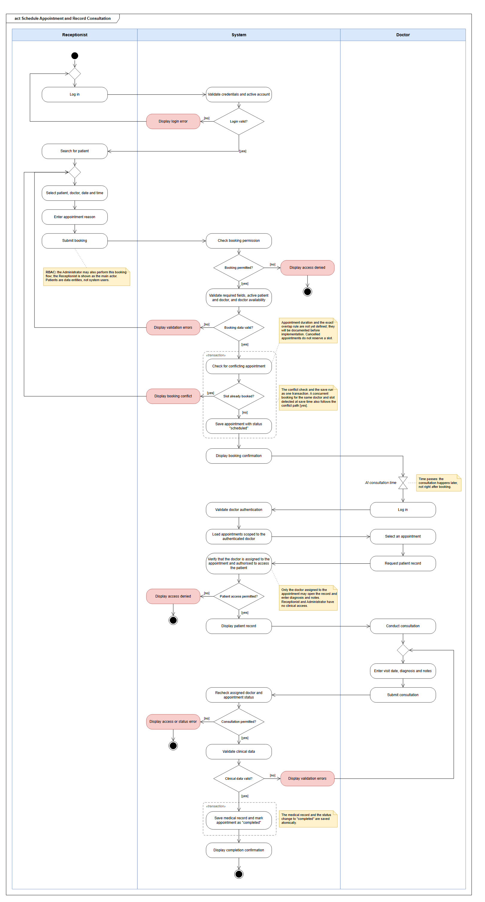

# Hospital Management — DevOps Project

## 1. Project overview
A simple hospital administration web application for managing
patients, doctors, appointments and medical records.
The project focuses on building an automated DevOps pipeline.

## 2. Requirement analysis

### 2.1 Functional requirements
- FR-01: Register, search, view and edit patients.
- FR-02: Deactivate patients while preserving past appointments.
- FR-03: Register, view, update and deactivate doctors.
- FR-04: Track doctors' specialisations and availability.
- FR-05: Create appointments with a patient, doctor, date, time and reason.
- FR-06: Support scheduled, completed and cancelled appointment statuses.
- FR-07: Prevent double-booking a doctor.
- FR-08: Allow doctors to record visit dates, diagnoses and notes.
- FR-09: Retain medical records and allow authorised staff to read them.
- FR-10: Require login before accessing protected functionality.
- FR-11: Restrict functionality according to the three user roles.
- FR-12: Allow doctors to export authorised data as CSV reports.

### 2.2 Non-functional requirements

- **NFR-01 — Performance:** At least 95% of page requests must complete within two seconds with 20 concurrent users against the seeded demo dataset.
- **NFR-02 — Recovery:** After an application process crashes, the container must restart automatically within 30 seconds using a declared restart policy.
- **NFR-03 — Password storage:** Passwords must be stored as bcrypt hashes with a cost factor of at least 10, never as plain text.
- **NFR-04 — Access control:** Every protected route must enforce authentication and role permissions, returning HTTP 401 for unauthenticated requests and HTTP 403 for forbidden actions.
- **NFR-05 — Deployability:** Every source change merged into main that passes the pipeline must automatically build and publish a container image to GHCR.
- **NFR-06 — Testability:** Automated unit and end-to-end tests must run in CI on every pull request, and failed required checks must prevent merging.
- **NFR-07 — Observability:** Request counts, error rates, response times and container CPU and memory usage must be visible on a dashboard with a refresh interval of no more than 30 seconds.
- **NFR-08 — Maintainability:** The README must document the branching strategy and image versioning scheme; published images must include a commit SHA tag for traceability.

## 3. Roles and access control

### 3.1 User roles

- **Receptionist:** Manages patient administrative records and the appointment calendar. Registers, searches, edits and deactivates patients, and schedules, updates and cancels appointments, without accessing clinical notes.

- **Doctor:** Views their own appointments and the medical history of their patients. Records visit dates, diagnoses and notes, and exports authorised data to CSV.

- **Administrator:** Manages doctor records, system user accounts and role assignments. Also manages patient administrative records and appointments, without accessing clinical information.

Patients are data entities, not system users. A patient login role was considered and excluded because the scenario does not provide patient self-service functionality.

### 3.2 RBAC matrix

RBAC stands for Role-Based Access Control.

| Capability | Receptionist | Doctor | Administrator |
|---|---|---|---|
| Register, search and edit a patient | Yes | No | Yes |
| Deactivate a patient record | Yes | No | Yes |
| Register, update or deactivate a doctor | No | No | Yes |
| Schedule an appointment | Yes | No | Yes |
| View appointments | All | Own only | All |
| Update appointment details or cancel an appointment | Yes | No | Yes |
| Record diagnosis and visit notes | No | Own appointments only | No |
| Read a patient's medical history | No | Own patients only | No |
| Export authorised data to CSV | No | Own patients' authorised data only | No |
| Manage user accounts and roles | No | No | Yes |

### 3.3 Decisions for ambiguous permissions

- **Doctors cannot reschedule or cancel appointments:** Calendar administration is assigned to receptionists and administrators; doctors remain responsible for clinical documentation.
- **Administrators cannot read medical histories:** Their role is administrative, so clinical information is restricted to authorised doctors.
- **Administrators cannot export data to CSV:** The scenario assigns export functionality to doctors, so no additional export permission is granted.

### 3.4 Access enforcement

Permissions must be enforced on the server for every protected route.
Unauthenticated requests are rejected with HTTP 401, and authenticated
users without the required permission receive HTTP 403.

Doctor access must also verify the relationship between the doctor
and the requested appointment or patient. Hiding interface elements
alone is not sufficient.

Automated authorisation tests must verify every denied permission
and confirm that doctors cannot access another doctor's appointments
or patients outside their authorised scope.

## 4. Product backlog

### 4.1 Ordered user stories

The following list is ordered by implementation priority, considering
dependencies, risk and business value. Story identifiers remain stable
if the backlog is reordered.

1. **US-22 — Containerised application and database**
   As a developer, I want to run the application and database through
   a documented container setup, so that development and delivery use
   a reproducible environment.

2. **US-01 — Login and role-based access**
   As a receptionist, doctor or administrator, I want to log in and
   access only the functionality permitted for my role, so that
   hospital information is protected against unauthorised access.

3. **US-23 — Continuous integration and merge checks**
   As a developer, I want pull requests to run automated checks, so
   that failing changes are identified before merging.

4. **US-24 — Automated container publication**
   As a developer, I want successful changes on main to publish a
   traceable container image to GHCR, so that each delivered image can
   be linked to its source commit.

5. **US-02 — Register a doctor**
   As an administrator, I want to register a doctor with their
   specialisation and availability, so that receptionists can assign
   appointments to an appropriate available doctor.

6. **US-03 — Register a patient**
   As a receptionist, I want to register a patient with their name,
   date of birth and contact details, so that the patient can be
   booked for an appointment.

7. **US-04 — Schedule an appointment**
   As a receptionist, I want to schedule an appointment with a
   patient, doctor, date, time and reason without double-booking, so
   that patients receive a confirmed consultation slot.

8. **US-05 — View my appointments**
   As a doctor, I want to view my scheduled appointments, so that I
   can prepare for upcoming consultations.

9. **US-06 — Open a patient's record**
   As a doctor, I want to open the record of a patient assigned to my
   appointment, so that I can identify the patient correctly before
   providing care.

10. **US-07 — Record a consultation**
    As a doctor, I want to record the visit date, diagnosis and notes
    and mark the appointment as completed, so that future care can
    rely on documented consultation outcomes.

11. **US-08 — Read previous medical records**
    As a doctor, I want to read previous medical records of my
    authorised patients, so that I can make informed clinical
    decisions.

12. **US-09 — Search for a patient**
    As a receptionist, I want to search for an existing patient, so
    that I can locate the correct record without creating duplicates.

13. **US-10 — Edit patient contact details**
    As a receptionist, I want to update a patient's contact details,
    so that the hospital can reach them using current information.

14. **US-11 — Update an appointment**
    As a receptionist, I want to change appointment details while
    respecting doctor availability and preventing double-booking, so
    that changes in patient needs can be accommodated.

15. **US-12 — Cancel an appointment**
    As a receptionist, I want to cancel an appointment while retaining
    its record, so that the slot becomes available and the hospital
    preserves the scheduling history.

16. **US-13 — Update doctor details**
    As an administrator, I want to update a doctor's details and
    availability, so that appointment scheduling uses accurate
    information.

17. **US-14 — Create staff accounts**
    As an administrator, I want to create a staff account and assign
    one of the three supported roles, so that new staff members
    receive appropriate system access.

18. **US-15 — Deactivate a staff account**
    As an administrator, I want to deactivate a staff account, so that
    former staff members can no longer access hospital information.

19. **US-16 — Deactivate a doctor**
    As an administrator, I want to deactivate an unavailable doctor
    while preserving past appointments, so that new appointments
    cannot be assigned to that doctor and historical information
    remains.

20. **US-17 — Deactivate a patient**
    As a receptionist, I want to deactivate a patient record while
    preserving past appointments and medical records, so that inactive
    patients are excluded from new bookings without losing their
    history.

21. **US-18 — Export authorised data**
    As a doctor, I want to export my authorised data as a CSV report,
    so that I can analyse consultation information outside the
    application.

22. **US-25 — Performance and recovery verification**
    As a maintainer, I want repeatable performance and recovery
    checks, so that the application can demonstrate the response-time
    and restart requirements.

23. **US-26 — Monitoring and metrics dashboard**
    As a maintainer, I want application and container metrics on a
    dashboard, so that I can observe errors, response times and
    resource usage.

24. **US-19 — Filter the appointment calendar [Extra: Receptionist]**
    As a receptionist, I want to filter appointments by date and
    doctor, so that I can answer scheduling questions more quickly.

25. **US-20 — Filter my medical records [Extra: Doctor]**
    As a doctor, I want to filter my authorised patients' medical
    records by visit date, so that I can find relevant consultations
    efficiently during follow-up care.

26. **US-21 — Filter staff accounts [Extra: Administrator]**
    As an administrator, I want to filter staff accounts by role and
    active status, so that I can review access assignments
    efficiently.

### 4.2 Prioritisation rationale

Among the functional stories, login and role-based access come first
because every protected workflow depends on identifying staff and
enforcing permissions.
Doctor registration and patient registration follow because
both are prerequisites for scheduling, with doctor availability
establishing the scheduling constraints before bookings are introduced.

The platform stories US-22 to US-26 make the delivery and non-functional
requirements explicit backlog items. US-22 comes first because every
story needs the application, database and migration foundation.
US-23 and US-24 follow login so that the Definition of Done checks
exist from Sprint 1. US-25 and US-26 are placed after the functional
workflows they measure, and the extra stories US-19 to US-21 come last.

### 4.3 Acceptance criteria

#### US-01 — Login and role-based access

- Given an active staff account with valid credentials, when the staff
  member logs in, then the system grants access according to their role.
- Given invalid credentials or an inactive account, when login is
  attempted, then access is refused.
- Given an unauthenticated request to a protected route, when the
  request is processed, then the system returns HTTP 401.
- Given an authenticated staff member without the required permission,
  when they request a restricted action, then the system returns HTTP 403.

#### US-02 — Register a doctor

- Given an authenticated administrator and valid doctor details,
  specialisation and availability, when registration is submitted, then
  the doctor is saved as active and linked to a doctor staff account.
- Given missing required details or invalid availability, when
  registration is submitted, then the system rejects it and identifies
  the invalid fields.
- Given a receptionist or doctor, when they attempt to register a
  doctor, then the system refuses the action.

#### US-03 — Register a patient

- Given an authenticated receptionist and valid patient information,
  when registration is submitted, then the patient is saved and
  can be found through patient search.
- Given a missing required name or date of birth, when registration
  is submitted, then the system rejects it and identifies the missing fields.
- Given an authenticated doctor, when they attempt to register a
  patient, then the system refuses the action.

#### US-04 — Schedule an appointment

- Given an active patient, an active doctor and an available slot,
  when a receptionist submits all required appointment details,
  then the system creates an appointment with status "scheduled".
- Given a doctor already has a scheduled appointment at a particular
  date and time, when another booking is attempted for that same
  doctor and slot, then the system rejects it and explains the conflict.
- Given an inactive patient, an inactive doctor or a slot outside
  the doctor's availability, when booking is attempted, then
  the system rejects the appointment.

#### US-05 — View my appointments

- Given an authenticated doctor, when they open their appointment list,
  then only appointments assigned to them are shown with their date,
  time and status.
- Given a doctor, when they request another doctor's appointment,
  including through a direct request, then the system refuses the
  action.

#### US-06 — Open a patient's record

- Given a doctor with an appointment for a patient, when they open that
  patient's record from the appointment, then the patient's details are
  displayed.
- Given a doctor without an appointment relationship to a patient, when
  they request that patient's record, including with an altered
  identifier, then the system refuses the action.

#### US-07 — Record a consultation

- Given a doctor assigned to a scheduled appointment, when they
  submit a visit date, diagnosis and notes and complete the consultation,
  then the system saves the medical record and marks the appointment
  as "completed".
- Given a receptionist, administrator or an unassigned doctor,
  when they attempt to record clinical information for that appointment,
  then the system refuses the action.
- Given a saved medical record, when an authorised doctor opens
  the patient's history, then the consultation information is displayed.

#### US-08 — Read previous medical records

- Given a doctor authorised for a patient, when they open the patient's
  medical history, then previous records are displayed in chronological
  order.
- Given an authorised patient without medical records, when the history
  is opened, then an empty-state message is displayed.
- Given a receptionist, administrator or unrelated doctor, when they
  request the medical history, then the system refuses the action.

#### US-09 — Search for a patient

- Given an authenticated receptionist or administrator, when they search
  by patient name or identifier, then matching patients are listed.
- Given a search without matches, when it is submitted, then an empty-
  state message is displayed.
- Given an authenticated doctor, when they attempt to use patient
  search, then the system refuses the action.

#### US-10 — Edit patient contact details

- Given a receptionist or administrator and valid contact details, when
  the changes are saved, then the updated details are persisted and
  displayed after reloading the record.
- Given invalid contact details, when the changes are submitted, then
  the system rejects them and identifies the invalid fields.
- Given an authenticated doctor, when they attempt to edit patient
  contact details, then the system refuses the action.

#### US-11 — Update an appointment

- Given a scheduled appointment and a new slot within the doctor's
  availability without a conflict, when a receptionist or administrator
  saves the change, then the appointment is updated.
- Given a conflicting slot, a slot outside the doctor's availability, or
  an inactive patient or doctor, when the change is submitted, then the
  system rejects it and explains the reason.
- Given an appointment saved without changing its slot, when the update
  is processed, then the appointment is not treated as conflicting with
  itself.
- Given an authenticated doctor, when they attempt to update an
  appointment, then the system refuses the action.

#### US-12 — Cancel an appointment

- Given a scheduled appointment, when a receptionist or administrator
  cancels it, then its status becomes "cancelled" and the record is
  retained.
- Given a cancelled appointment, when a new booking is submitted for the
  same doctor and slot, then the booking can be accepted.
- Given a completed or already cancelled appointment, when cancellation
  is attempted, then the system rejects the status change.
- Given an authenticated doctor, when they attempt to cancel an
  appointment, then the system refuses the action.

#### US-13 — Update doctor details

- Given an authenticated administrator and valid changes, when doctor
  details or availability are saved, then the changes are persisted and
  existing appointments are retained.
- Given invalid availability, when the change is submitted, then the
  system rejects it and identifies the invalid fields.
- Given a receptionist or doctor, when they attempt to update doctor
  details, then the system refuses the action.

#### US-14 — Create staff accounts

- Given an authenticated administrator, a unique login and one of the
  three supported roles, when the account is created, then the password
  is stored as a bcrypt hash and the new user can log in with the
  assigned role.
- Given a duplicate login or an unsupported role, when account creation
  is submitted, then the system rejects it.
- Given a receptionist or doctor, when they attempt to create a staff
  account, then the system refuses the action.

#### US-15 — Deactivate a staff account

- Given an active staff account, when an administrator deactivates it,
  then later login attempts are refused and requests through existing
  sessions are rejected.
- Given a receptionist or doctor, when they attempt to deactivate a
  staff account, then the system refuses the action.

#### US-16 — Deactivate a doctor

- Given an active doctor, when an administrator deactivates the doctor,
  then the profile and historical appointments are retained and new
  bookings for that doctor are refused.
- Given a receptionist or doctor, when they attempt to deactivate a
  doctor, then the system refuses the action.

#### US-17 — Deactivate a patient

- Given an active patient, when a receptionist or administrator
  deactivates the patient, then the patient record, historical
  appointments and medical records are retained and new bookings are
  refused.
- Given an authenticated doctor, when they attempt to deactivate a
  patient, then the system refuses the action.

#### US-18 — Export authorised data

- Given an authenticated doctor, when they export data, then the CSV
  file contains only authorised data for their own patients, using the
  documented columns.
- Given exported values that begin with spreadsheet-formula characters,
  when the CSV file is generated, then those values are neutralised.
- Given a receptionist or administrator, when they attempt an export,
  then the system refuses the action.

#### US-19 — Filter the appointment calendar [Extra: Receptionist]

- Given a receptionist or administrator, when they filter appointments
  by date, doctor or both, then only matching appointments are
  displayed, and clearing the filters restores the full list.
- Given filters without matching appointments, when they are applied,
  then an empty-state message is displayed.
- Given an authenticated doctor, when they request the administrative
  calendar, then the system refuses the action.

#### US-20 — Filter my medical records [Extra: Doctor]

- Given an authenticated doctor and a valid visit-date range, when the
  filter is applied, then only authorised records within that range are
  displayed.
- Given a start date later than the end date, when the filter is
  applied, then the system rejects the range.
- Given any filter, when results are returned, then records outside the
  doctor's authorised patients are never included.

#### US-21 — Filter staff accounts [Extra: Administrator]

- Given an authenticated administrator, when they filter accounts by
  role, active status or both, then only matching accounts are
  displayed.
- Given filters without matching accounts, when they are applied, then
  an empty-state message is displayed.
- Given a receptionist or doctor, when they request the account list,
  then the system refuses the action.

#### US-22 — Containerised application and database

- Given a fresh clone and settings based on `.env.example`, when the
  documented start command is run, then the application and PostgreSQL
  start, migrations are applied and the health endpoint reports a
  working database connection.
- Given the application container, when it is running, then the
  application process does not run as root.

#### US-23 — Continuous integration and merge checks

- Given a pull request, when it is opened or updated, then CI runs
  linting, unit, integration and end-to-end tests and a container build.
- Given a failing required check, when a merge is attempted, then GitHub
  prevents the merge.

#### US-24 — Automated container publication

- Given a change merged into main that passes the required checks, when
  the pipeline completes, then an image tagged with the commit SHA is
  published to GHCR.
- Given a pull request, when its workflow runs, then no release image is
  published.
- Given a published image, when it is pulled and started, then its
  health endpoint responds successfully.

#### US-25 — Performance and recovery verification

- Given the seeded demo dataset and 20 concurrent authenticated users,
  when the load test runs, then at least 95% of page requests complete
  within two seconds.
- Given a running application container, when the application process
  crashes, then the container restarts automatically and is healthy
  again within 30 seconds.

#### US-26 — Monitoring and metrics dashboard

- Given the running stack, when the dashboard is opened, then request
  counts, error rates, response times and container CPU and memory usage
  are displayed, refreshing at least every 30 seconds.
- Given generated traffic, when the dashboard refreshes, then the change
  is visible in the request metrics.
- Given exposed metrics, when they are inspected, then they contain no
  patient names, diagnoses, passwords or patient identifiers as labels.

### 4.4 Definition of Done

Every user story must satisfy the following conditions before it is
considered done. Individual tasks are completed when their specific
completion conditions are met and their pull request is merged with
passing required checks.

- Its acceptance criteria are satisfied.
- Changes are merged into main through a pull request, never pushed directly.
- Relevant unit tests are written and pass in CI.
- The end-to-end test for the affected workflow passes.
- Authorisation tests verify relevant allowed and denied access.
- The container image builds successfully and is published to
  GitHub Container Registry (GHCR).
- The README is updated if a requirement or design decision changes.

## 5. Process and ceremonies

### 5.1 Sprint duration

The initial plan consists of four two-week sprints, covering eight weeks.
Two weeks provide enough time to deliver a working increment alongside
other coursework while allowing frequent feedback and adjustments.

This is an individual project, so I will perform the Product Owner,
developer and Scrum Master responsibilities.

### 5.2 Sprint outline

| Sprint | Goal | Planned deliverables |
|---|---|---|
| 1 | Establish a containerised application with secure login, automated checks and traceable image publication | Containerised application and database (US-22), login and role-based access (US-01), CI and required merge checks (US-23), GHCR image publication (US-24), repository conventions and branching strategy. |
| 2 | Deliver patient and doctor registration and administrative account management | Doctor registration and updates (US-02, US-13), patient registration, search and editing (US-03, US-09, US-10), staff account creation and deactivation (US-14, US-15). |
| 3 | Deliver the appointment and consultation workflow with authorised access to medical history | Scheduling without double-booking (US-04), doctor appointment and patient views (US-05, US-06), clinical notes and history (US-07, US-08), appointment cancellation (US-12). |
| 4 | Complete administrative workflows and export, and verify performance, recovery and monitoring | Appointment updates (US-11), doctor and patient deactivation (US-16, US-17), CSV export (US-18), performance and recovery verification (US-25), monitoring and a metrics dashboard (US-26); extra stories (US-19–US-21) if capacity permits. |

Container image publication to GHCR and an end-to-end smoke test
will be established in Sprint 1 to support the Definition of Done.
Each later sprint will extend the tests alongside its functionality.
The detailed sprint backlogs and point totals are in §8.

The outline is a forecast. At each planning session, stories will be
selected according to capacity and dependencies. Any story too large
for one sprint will be split, and unfinished work will be re-estimated
and reprioritised.

### 5.3 Ceremonies

| Ceremony | When | Activity | Output |
|---|---|---|---|
| Sprint Planning | First day of each sprint, 30–60 minutes | Review the ordered backlog, check dependencies and acceptance criteria, and select realistic work. | Sprint goal and sprint backlog. |
| Sprint Review | Last day of each sprint, approximately 30 minutes | Run the working application, check completed stories against their acceptance criteria and demonstrate it to a classmate or instructor for feedback. | Recorded feedback and an updated product backlog. |
| Sprint Retrospective | Immediately after the review, approximately 20 minutes | Review progress, blockers and working practices, then choose one improvement for the next sprint. | A written retrospective and one concrete improvement action. |

As this is an individual project, I will keep a short dated work log
instead of holding a Daily Scrum. Each entry will record completed work,
the next action and any blockers.

Planning, review and retrospective notes will be stored in the repository.

### 5.4 Backlog refinement

Refinement will be continuous, with approximately 10% of available
sprint working time reserved for clarifying and preparing upcoming work.

The following events will trigger refinement:

- **New or changed requirement:** Add or update stories and acceptance criteria.
- **Story too large for one sprint:** Split it into smaller, testable stories.
- **Missing or unclear acceptance criteria:** Clarify the expected behaviour before selecting the story.
- **Unfinished sprint work:** Re-estimate the remaining effort and reconsider its priority.
- **Technical discovery:** Update tasks and ordering when a constraint or dependency is discovered.
- **Sprint Review feedback:** Adjust the backlog based on the demonstration and feedback.

Changes affecting requirements or permissions will also be reflected
in the requirement analysis and RBAC matrix.

## 6. Task decomposition

### 6.1 Structure and conventions

The backlog is organised into epics, user stories and implementation tasks.

- An epic groups related stories; it is not estimated separately.
- A user story describes an outcome and receives a story-point estimate.
- A task describes a small, independently reviewable repository change.
- Existing identifiers US-01 to US-21 remain unchanged.
- US-22 to US-26 make the platform and pipeline requirements explicit.
- Task identifiers follow T-XX.Y, where XX identifies the parent story.
- Each task becomes a GitHub Issue titled `T-XX.Y <short task description>`, worked on a branch named `feature/US-XX-<short-name>` and merged through a pull request.
- "Blocked by" identifies prerequisites. "None" means no backlog prerequisite.
- Each task has one owner: the project developer, because this is an individual project.
- Each task must have a clear completion condition and should fit into a working session. Larger tasks will be split during refinement.

Implementation will use Python and FastAPI. Database changes will use PostgreSQL migrations. Automated tests will use pytest for unit and integration tests and Playwright for end-to-end tests.

Each task has exactly one classification:
- **Implementation:** a change to application code, configuration, infrastructure or the pipeline.
- **Formal code test — automated:** executable assertions, including unit, integration and end-to-end tests.
- **General test case — manual:** a documented checklist for messages, usability or visual behaviour.
- **Documentation:** a repository change limited to documentation, such as recorded results, commands or limitations.

Every story includes at least one automated test task. Relevant access-control checks are included in the automated tests for protected functionality.

The dependencies below describe implementation order. Completion also requires the shared Definition of Done in §4.4, including successful CI checks and container publication. Models and migrations depend on the application and database foundation in US-22, so US-01 is blocked by US-22. US-23 and US-24 are developed alongside US-01 in Sprint 1 to establish the completion checks; only the login end-to-end test links them (T-23.3 is blocked by T-01.7), so no dependency cycle is created.

### 6.2 Epic overview

| Epic | Name | User stories |
| --- | --- | --- |
| E1 | Authentication and access | US-01, US-14, US-15, US-21 |
| E2 | Patient management | US-03, US-09, US-10, US-17 |
| E3 | Doctor management | US-02, US-13, US-16 |
| E4 | Appointment scheduling | US-04, US-05, US-11, US-12, US-19 |
| E5 | Medical records and export | US-06, US-07, US-08, US-18, US-20 |
| E6 | Platform and pipeline | US-22, US-23, US-24, US-25, US-26 |

### 6.3 E1 — Authentication and access

#### US-01 — Login and role-based access

Blocked by: US-22.

| ID | Task | Classification | Blocked by |
| --- | --- | --- | --- |
| T-01.1 | Create the staff account model and migration, with role, active status and bcrypt password hashing | Implementation | T-22.4 |
| T-01.2 | Add a development-only command to seed initial staff accounts for the three roles | Implementation | T-01.1 |
| T-01.3 | Implement login, logout and authenticated session handling | Implementation | T-01.1 |
| T-01.4 | Implement reusable authentication and role checks returning HTTP 401 or 403 | Implementation | T-01.3 |
| T-01.5 | Create the login interface and role-appropriate navigation | Implementation | T-01.4 |
| T-01.6 | Test password hashing, invalid credentials, inactive accounts, sessions, CSRF rejection and allowed/denied role access | Formal code test — automated | T-01.2, T-01.4, T-01.9 |
| T-01.7 | Add Playwright tests for login, protected navigation and logout for each role | Formal code test — automated | T-01.5, T-01.2 |
| T-01.8 | Check login error messages, keyboard navigation and the layout on a small screen | General test case — manual | T-01.5 |
| T-01.9 | Add CSRF protection to state-changing browser requests | Implementation | T-01.3 |

#### US-14 — Create staff accounts

Blocked by: US-01.

| ID | Task | Classification | Blocked by |
| --- | --- | --- | --- |
| T-14.1 | Implement administrator-only account creation with unique login validation and supported role assignment | Implementation | US-01 |
| T-14.2 | Create the staff account registration form | Implementation | T-14.1 |
| T-14.3 | Test duplicate logins, invalid roles, password hashing and denied access for other roles | Formal code test — automated | T-14.1 |
| T-14.4 | Add an end-to-end test that creates an account and logs in with its assigned role | Formal code test — automated | T-14.2 |

#### US-15 — Deactivate a staff account

Blocked by: US-14.

| ID | Task | Classification | Blocked by |
| --- | --- | --- | --- |
| T-15.1 | Implement administrator-only deactivation and reject subsequent protected requests from inactive accounts | Implementation | US-14 |
| T-15.2 | Add a deactivation action and confirmation to the staff account interface | Implementation | T-15.1 |
| T-15.3 | Test denied login, rejection of existing sessions after deactivation and role restrictions | Formal code test — automated | T-15.1 |
| T-15.4 | Add an end-to-end test for account deactivation and refused access | Formal code test — automated | T-15.2 |

#### US-21 — Filter staff accounts [Extra: Administrator]

Blocked by: US-14, US-15.

| ID | Task | Classification | Blocked by |
| --- | --- | --- | --- |
| T-21.1 | Implement an administrator-only account list filtered by role and active status | Implementation | US-14, US-15 |
| T-21.2 | Add role and status controls with an empty-state message | Implementation | T-21.1 |
| T-21.3 | Test individual and combined filters, empty results and denied access | Formal code test — automated | T-21.1 |
| T-21.4 | Add an end-to-end test for changing and clearing filters | Formal code test — automated | T-21.2 |

### 6.4 E2 — Patient management

#### US-03 — Register a patient

Blocked by: US-01.

| ID | Task | Classification | Blocked by |
| --- | --- | --- | --- |
| T-03.1 | Create the patient model and migration with name, date of birth, contact details and active status | Implementation | T-22.4 |
| T-03.2 | Implement patient registration with required-field validation and receptionist/administrator permissions | Implementation | T-03.1, US-01 |
| T-03.3 | Create the patient registration form and success confirmation | Implementation | T-03.2 |
| T-03.4 | Test persistence, missing required fields, invalid dates and denied doctor access | Formal code test — automated | T-03.2 |
| T-03.5 | Add an end-to-end test for registration and display of the saved patient | Formal code test — automated | T-03.3 |
| T-03.6 | Check field labels, validation messages and keyboard navigation | General test case — manual | T-03.3 |

The search-specific acceptance criterion in §4.3 will be verified when US-09 is integrated. US-03 can be implemented first and demonstrated through the saved patient's detail view.

#### US-09 — Search for a patient

Blocked by: US-03.

| ID | Task | Classification | Blocked by |
| --- | --- | --- | --- |
| T-09.1 | Implement patient search by name or identifier for receptionists and administrators | Implementation | US-03 |
| T-09.2 | Create the search form, result list and empty state | Implementation | T-09.1 |
| T-09.3 | Test matching results, empty queries, no matches and denied doctor access | Formal code test — automated | T-09.1 |
| T-09.4 | Add an end-to-end test that registers a patient, searches and opens the correct record | Formal code test — automated | T-09.2 |

#### US-10 — Edit patient contact details

Blocked by: US-03.

| ID | Task | Classification | Blocked by |
| --- | --- | --- | --- |
| T-10.1 | Implement authorised contact updates with input validation | Implementation | US-03 |
| T-10.2 | Create the contact-edit form and save confirmation | Implementation | T-10.1 |
| T-10.3 | Test valid and invalid updates, persistence and denied doctor access | Formal code test — automated | T-10.1 |
| T-10.4 | Add an end-to-end test that edits contacts and reloads the record | Formal code test — automated | T-10.2 |

#### US-17 — Deactivate a patient

Blocked by: US-03.

| ID | Task | Classification | Blocked by |
| --- | --- | --- | --- |
| T-17.1 | Implement authorised soft deactivation without deleting the patient record | Implementation | US-03 |
| T-17.2 | Add a deactivation confirmation and inactive indicator | Implementation | T-17.1 |
| T-17.3 | Test deactivation, retention of patient data and denied doctor access | Formal code test — automated | T-17.1 |
| T-17.4 | Add integration tests confirming that historical appointments and medical records remain and new bookings are refused | Formal code test — automated | T-17.1, US-04, US-07 |
| T-17.5 | Add an end-to-end test for deactivating a patient | Formal code test — automated | T-17.2 |

Basic deactivation can be implemented before appointments. The history-preservation task is completed after the appointment and medical-record workflows exist.

### 6.5 E3 — Doctor management

#### US-02 — Register a doctor

Blocked by: US-01.

| ID | Task | Classification | Blocked by |
| --- | --- | --- | --- |
| T-02.1 | Create doctor and availability models and migrations, including specialisation, active status and staff-account association | Implementation | T-01.1 |
| T-02.2 | Implement administrator-only registration with availability validation | Implementation | T-02.1, US-01 |
| T-02.3 | Create the doctor registration form and availability inputs | Implementation | T-02.2 |
| T-02.4 | Test registration, invalid availability, account association and denied access | Formal code test — automated | T-02.2 |
| T-02.5 | Add an end-to-end test for registering and viewing a doctor | Formal code test — automated | T-02.3 |
| T-02.6 | Check availability input labels and validation wording | General test case — manual | T-02.3 |

Initial doctor accounts are provided by the development seed command. Registering doctor profiles therefore does not depend on the later account-management interface in US-14.

#### US-13 — Update doctor details

Blocked by: US-02.

| ID | Task | Classification | Blocked by |
| --- | --- | --- | --- |
| T-13.1 | Implement administrator-only updates to doctor details and availability | Implementation | US-02 |
| T-13.2 | Create the doctor-edit form and save confirmation | Implementation | T-13.1 |
| T-13.3 | Test persistence, invalid availability and denied access for other roles | Formal code test — automated | T-13.1 |
| T-13.4 | Add an end-to-end test for updating and reloading doctor details | Formal code test — automated | T-13.2 |

Availability changes apply to new or rescheduled appointments. Existing appointments are retained and are not silently cancelled.

#### US-16 — Deactivate a doctor

Blocked by: US-02.

| ID | Task | Classification | Blocked by |
| --- | --- | --- | --- |
| T-16.1 | Implement administrator-only soft deactivation while retaining the doctor profile | Implementation | US-02 |
| T-16.2 | Add the deactivation confirmation and inactive indicator | Implementation | T-16.1 |
| T-16.3 | Test profile retention, deactivation and denied access for other roles | Formal code test — automated | T-16.1 |
| T-16.4 | Test retention of historical appointments and refusal of new bookings for inactive doctors | Formal code test — automated | T-16.1, US-04 |
| T-16.5 | Add an end-to-end test for doctor deactivation | Formal code test — automated | T-16.2 |

Doctor profile deactivation prevents new bookings. Staff account deactivation is handled separately by US-15.

### 6.6 E4 — Appointment scheduling

#### US-04 — Schedule an appointment

Blocked by: US-01, US-02, US-03.

| ID | Task | Classification | Blocked by |
| --- | --- | --- | --- |
| T-04.1 | Create the appointment model and migration with patient, doctor, datetime, reason and status | Implementation | T-02.1, T-03.1 |
| T-04.2 | Implement the availability and booking-conflict validator | Implementation | T-04.1 |
| T-04.3 | Implement authorised appointment creation with transactional conflict protection and initial scheduled status | Implementation | T-04.2, US-01 |
| T-04.4 | Create the booking form with active patient and doctor selectors | Implementation | T-04.3, US-02, US-03 |
| T-04.5 | Test inactive entities, availability boundaries, duplicate/concurrent bookings and denied doctor access | Formal code test — automated | T-04.3 |
| T-04.6 | Add an end-to-end test for successful booking and refusal of a conflicting booking | Formal code test — automated | T-04.4 |
| T-04.7 | Check conflict messages, missing fields and empty selectors | General test case — manual | T-04.4 |
| T-04.8 | Unit-test the validator for availability boundaries, conflicting slots and cancelled appointments | Formal code test — automated | T-04.2 |

Appointment duration and overlap rules will be documented before implementation. Cancelled appointments do not reserve a slot.

#### US-05 — View my appointments

Blocked by: US-04.

| ID | Task | Classification | Blocked by |
| --- | --- | --- | --- |
| T-05.1 | Implement an appointment query scoped to the authenticated doctor's profile | Implementation | US-04 |
| T-05.2 | Create the doctor's appointment list with dates and statuses | Implementation | T-05.1 |
| T-05.3 | Test doctor scoping and attempts to access another doctor's appointments | Formal code test — automated | T-05.1 |
| T-05.4 | Add an end-to-end test using two doctors with separate appointment lists | Formal code test — automated | T-05.2 |

#### US-11 — Update an appointment

Blocked by: US-04.

| ID | Task | Classification | Blocked by |
| --- | --- | --- | --- |
| T-11.1 | Implement authorised appointment updates using the existing availability and conflict rules | Implementation | US-04 |
| T-11.2 | Create the appointment-edit form | Implementation | T-11.1 |
| T-11.3 | Test conflicts, unchanged slots, inactive entities and denied doctor access | Formal code test — automated | T-11.1 |
| T-11.4 | Add an end-to-end test for successful rescheduling and refusal of a conflicting change | Formal code test — automated | T-11.2 |

#### US-12 — Cancel an appointment

Blocked by: US-04.

| ID | Task | Classification | Blocked by |
| --- | --- | --- | --- |
| T-12.1 | Implement authorised cancellation while retaining the appointment record | Implementation | US-04 |
| T-12.2 | Add the cancellation action, confirmation and status display | Implementation | T-12.1 |
| T-12.3 | Test retained history, slot release, invalid status transitions and denied doctor access | Formal code test — automated | T-12.1 |
| T-12.4 | Add an end-to-end test that cancels an appointment and books the released slot | Formal code test — automated | T-12.2 |

#### US-19 — Filter the appointment calendar [Extra: Receptionist]

Blocked by: US-04.

| ID | Task | Classification | Blocked by |
| --- | --- | --- | --- |
| T-19.1 | Implement appointment filtering by date and doctor for receptionists and administrators | Implementation | US-04 |
| T-19.2 | Add calendar filters and an empty state | Implementation | T-19.1 |
| T-19.3 | Test individual and combined filters and denied access to the administrative calendar | Formal code test — automated | T-19.1 |
| T-19.4 | Add an end-to-end test for applying and clearing calendar filters | Formal code test — automated | T-19.2 |

### 6.7 E5 — Medical records and export

#### US-06 — Open a patient's record

Blocked by: US-05.

| ID | Task | Classification | Blocked by |
| --- | --- | --- | --- |
| T-06.1 | Implement patient-detail access that verifies the authenticated doctor's appointment relationship | Implementation | US-05 |
| T-06.2 | Create the patient-detail view linked from the doctor's appointment list | Implementation | T-06.1 |
| T-06.3 | Test authorised access, unrelated patients and direct requests with altered identifiers | Formal code test — automated | T-06.1 |
| T-06.4 | Add an end-to-end test for opening an assigned patient's record | Formal code test — automated | T-06.2 |

#### US-07 — Record a consultation

Blocked by: US-06.

| ID | Task | Classification | Blocked by |
| --- | --- | --- | --- |
| T-07.1 | Create the medical-record model and migration linked to an appointment and its doctor | Implementation | T-04.1 |
| T-07.2 | Implement assigned-doctor-only recording of visit date, diagnosis and notes, with an atomic transition to completed | Implementation | T-07.1, US-06 |
| T-07.3 | Create the consultation form and completion confirmation | Implementation | T-07.2 |
| T-07.4 | Test required fields, ownership, duplicate completion, cancelled appointments and atomic persistence | Formal code test — automated | T-07.2 |
| T-07.5 | Add an end-to-end test for recording a consultation and verifying completed status | Formal code test — automated | T-07.3 |
| T-07.6 | Check clinical field labels and validation messages | General test case — manual | T-07.3 |

#### US-08 — Read previous medical records

Blocked by: US-07.

| ID | Task | Classification | Blocked by |
| --- | --- | --- | --- |
| T-08.1 | Implement medical-history retrieval for the authenticated doctor's authorised patients | Implementation | US-07 |
| T-08.2 | Create the chronological history view and empty state | Implementation | T-08.1 |
| T-08.3 | Test ordering, empty histories and denial for receptionists, administrators and unrelated doctors | Formal code test — automated | T-08.1 |
| T-08.4 | Add an end-to-end test that records a consultation and reads it in the patient's history | Formal code test — automated | T-08.2 |

#### US-18 — Export authorised data

Blocked by: US-08.

| ID | Task | Classification | Blocked by |
| --- | --- | --- | --- |
| T-18.1 | Implement a doctor-only CSV export reusing the authorised-patient scope and documenting exported columns | Implementation | US-08 |
| T-18.2 | Add the export action and download response | Implementation | T-18.1 |
| T-18.3 | Test authorisation, excluded records, headers, escaping, empty output and spreadsheet-formula input handling | Formal code test — automated | T-18.1 |
| T-18.4 | Add an end-to-end test that downloads a CSV and verifies its authorised contents | Formal code test — automated | T-18.2 |

#### US-20 — Filter my medical records [Extra: Doctor]

Blocked by: US-08.

| ID | Task | Classification | Blocked by |
| --- | --- | --- | --- |
| T-20.1 | Add visit-date filtering to the authorised medical-history query | Implementation | US-08 |
| T-20.2 | Add date controls and an empty state to the history view | Implementation | T-20.1 |
| T-20.3 | Test date boundaries, invalid ranges and preservation of the authorised-patient scope | Formal code test — automated | T-20.1 |
| T-20.4 | Add an end-to-end test for filtering and clearing the date range | Formal code test — automated | T-20.2 |

### 6.8 E6 — Platform and pipeline

The following stories are part of the Product Backlog in §4.1, with acceptance criteria in §4.3. They represent the non-functional and delivery work already described in the Lab 1 requirements and sprint outline.

#### US-22 — Containerised application and database

As a developer, I want to run the application and database through a documented container setup, so that development and delivery use a reproducible environment.

Blocked by: None.

| ID | Task | Classification | Blocked by |
| --- | --- | --- | --- |
| T-22.1 | Create the minimal FastAPI application structure and health endpoint | Implementation | None |
| T-22.2 | Create the application Dockerfile with a non-root runtime user | Implementation | T-22.1 |
| T-22.3 | Configure Docker Compose for the application and PostgreSQL, including persistence and environment configuration | Implementation | T-22.2 |
| T-22.4 | Add and document database migration and startup commands | Implementation | T-22.3 |
| T-22.5 | Automate a container smoke check for startup, health and database connectivity | Formal code test — automated | T-22.4 |

#### US-23 — Continuous integration and merge checks

As a developer, I want pull requests to run automated checks, so that failing changes are identified before merging.

Blocked by: US-22.

| ID | Task | Classification | Blocked by |
| --- | --- | --- | --- |
| T-23.1 | Configure pytest fixtures and an isolated PostgreSQL test database | Implementation | US-22 |
| T-23.2 | Add a GitHub Actions workflow for Ruff linting and unit/integration tests with pytest-cov coverage reporting | Implementation | T-23.1 |
| T-23.3 | Add headless Playwright execution and failure artifacts to CI | Implementation | T-23.2, T-01.7 |
| T-23.4 | Configure required checks and document the pull-request branching workflow | Implementation | T-23.3, T-23.7 |
| T-23.5 | Add a CI smoke test and verify that a deliberately failing test produces a failed required check | Formal code test — automated | T-23.2 |
| T-23.6 | Verify with a test pull request that failed required checks prevent merging | General test case — manual | T-23.4, T-23.5 |
| T-23.7 | Add the container image build to the pull-request workflow | Implementation | T-23.2 |

The login end-to-end test is introduced alongside US-01. Pipeline completion requires it, but implementing login does not depend on the pipeline already being complete.

#### US-24 — Automated container publication

As a developer, I want successful changes on main to publish a traceable container image to GHCR, so that each delivered image can be linked to its source commit.

Blocked by: US-23.

| ID | Task | Classification | Blocked by |
| --- | --- | --- | --- |
| T-24.1 | Configure main-branch image publication after successful automated checks | Implementation | US-23 |
| T-24.2 | Add commit-SHA image tags, source metadata and documentation of the versioning scheme | Implementation | T-24.1 |
| T-24.3 | Automate a smoke check that pulls the published image and verifies its health endpoint | Formal code test — automated | T-24.2 |
| T-24.4 | Check that pull requests cannot publish release images and that the published SHA matches its source commit | General test case — manual | T-24.3 |

This story covers automated image delivery. Publication to GHCR is not presented as deployment to a running production environment.

#### US-25 — Performance and recovery verification

As a maintainer, I want repeatable performance and recovery checks, so that the application can demonstrate the response-time and restart requirements.

Blocked by: US-22, US-04.

| ID | Task | Classification | Blocked by |
| --- | --- | --- | --- |
| T-25.1 | Create a reproducible demo dataset and authenticated load-test scenarios | Implementation | US-04 |
| T-25.2 | Add a load test for 20 concurrent users asserting that at least 95% of page requests finish within two seconds | Formal code test — automated | T-25.1 |
| T-25.3 | Configure and document the application container restart policy | Implementation | US-22 |
| T-25.4 | Automate an application-process crash and verify recovery within 30 seconds | Formal code test — automated | T-25.3 |
| T-25.5 | Document test environment, commands, results and any limitations | Documentation | T-25.2, T-25.4 |

#### US-26 — Monitoring and metrics dashboard

As a maintainer, I want application and container metrics on a dashboard, so that I can observe errors, response times and resource usage.

Blocked by: US-22.

| ID | Task | Classification | Blocked by |
| --- | --- | --- | --- |
| T-26.1 | Instrument request counts, error counts and response-time metrics | Implementation | US-22 |
| T-26.2 | Configure Prometheus and a container-metrics collector | Implementation | T-26.1 |
| T-26.3 | Provision a Grafana dashboard for request rate, error rate, response times, CPU and memory, refreshing within 30 seconds | Implementation | T-26.2 |
| T-26.4 | Automate checks that requests update application metrics and monitoring targets expose the expected series | Formal code test — automated | T-26.2 |
| T-26.5 | Verify dashboard refresh, units, labels and visible changes after generated traffic | General test case — manual | T-26.3, T-26.4 |

### 6.9 Refinement and completion

The decomposition is an initial implementation plan. Tasks will be refined before their story enters a sprint.

- Dependencies must be checked before selecting work.
- A task that takes more than a working session will be split.
- Additional test cases will be added when implementation reveals new boundaries or risks.
- Cross-story verification tasks must be completed before the parent story is counted as done.
- Optional stories US-19 to US-21 are selected only if capacity remains after required work.
- A story is complete only when its acceptance criteria and the Definition of Done are satisfied.
- Story points include implementation, testing and review; test tasks are not added again as separate story-point estimates.

## 7. Story-point estimation

### 7.1 Estimation approach

Story points estimate the relative size of a complete user story, including implementation, testing, review and integration.

The estimate considers:

- Amount of work.
- Technical complexity.
- Uncertainty and unfamiliar technology.
- Dependencies and integration risk.
- Testing effort.

Story points do not represent hours. Epic totals are derived from their stories rather than estimated independently. Individual tasks are not given additional story points, avoiding double-counting.

### 7.2 Scale

| Points | Meaning |
| --- | --- |
| 1 | Trivial: a narrowly scoped, well-understood change with minimal logic and testing |
| 2 | Small: routine work that reuses existing patterns, with limited validation and a few tests |
| 3 | Standard: several implementation tasks, ordinary validation, permission checks and an end-to-end test |
| 5 | Substantial: multiple layers, meaningful business rules or integration work, with several boundary cases |
| 8 | Large or unfamiliar: significant security, infrastructure or integration uncertainty and extensive verification |
| 13 | Too large for sprint selection: split into smaller independently testable stories and re-estimate |

A smaller estimate still includes the relevant Definition of Done checks. It does not mean that tests or permissions can be omitted.

### 7.3 Reference story

**US-03 — Register a patient = 3 story points.**

This is the anchor because it includes a database entity, a migration, a validated endpoint, a form, permission checks and automated tests, while using familiar implementation patterns.

Other stories are estimated by comparing their overall effort, risk and testing needs with this reference.

### 7.4 Backlog estimates

| ID | User story | Epic | Points | Estimation rationale |
| --- | --- | --- | --- | --- |
| US-01 | Login and role-based access | E1 | 8 | Password handling, sessions, reusable permissions and security tests introduce significant risk |
| US-02 | Register a doctor | E3 | 5 | More complex than the anchor because it includes availability and staff-account association |
| US-03 | Register a patient | E2 | 3 | Reference story: standard validated registration with persistence, a form and tests |
| US-04 | Schedule an appointment | E4 | 8 | Combines entities, availability rules, transactional conflict protection and concurrent-booking tests |
| US-05 | View my appointments | E4 | 2 | A scoped list view using existing appointment data, with ownership tests |
| US-06 | Open a patient's record | E5 | 3 | A detail view with relationship-based authorisation and direct-access security tests |
| US-07 | Record a consultation | E5 | 5 | Adds clinical persistence, ownership checks and an atomic appointment-status transition |
| US-08 | Read previous medical records | E5 | 3 | A history query and view with ordering and sensitive-data access checks |
| US-09 | Search for a patient | E2 | 2 | Reuses the patient model and adds a limited query and result interface |
| US-10 | Edit patient contact details | E2 | 2 | A narrow update using existing validation and permission patterns |
| US-11 | Update an appointment | E4 | 5 | Reuses booking rules but must handle self-conflicts, availability changes and update boundaries |
| US-12 | Cancel an appointment | E4 | 3 | Includes status-transition rules, retained history and verification that the slot is released |
| US-13 | Update doctor details | E3 | 3 | Reuses registration patterns but includes availability validation |
| US-14 | Create staff accounts | E1 | 5 | Sensitive account creation, role assignment, unique logins and password handling |
| US-15 | Deactivate a staff account | E1 | 3 | Must reject both new login attempts and requests through existing sessions |
| US-16 | Deactivate a doctor | E3 | 3 | Soft deactivation, historical retention and integration with booking restrictions |
| US-17 | Deactivate a patient | E2 | 3 | Soft deactivation with appointment and medical-record retention checks |
| US-18 | Export authorised data | E5 | 5 | Sensitive-data filtering, CSV formatting, download tests and formula-input handling |
| US-19 | Filter the appointment calendar [Extra] | E4 | 2 | Reuses existing appointment queries with date and doctor filters |
| US-20 | Filter my medical records [Extra] | E5 | 2 | Reuses the authorised history query with date-boundary tests |
| US-21 | Filter staff accounts [Extra] | E1 | 2 | Adds simple filters to existing administrative account data |
| US-22 | Containerised application and database | E6 | 5 | Application scaffolding, containers, persistence, migrations and startup verification |
| US-23 | Continuous integration and merge checks | E6 | 8 | Integrates isolated databases, multiple test runners, container builds and required checks |
| US-24 | Automated container publication | E6 | 5 | Registry permissions, image tagging and verification of the published artifact |
| US-25 | Performance and recovery verification | E6 | 5 | Repeatable load scenarios, timing assertions, crash recovery and environment documentation |
| US-26 | Monitoring and metrics dashboard | E6 | 8 | Unfamiliar integration across application metrics, container metrics, Prometheus and Grafana |

### 7.5 Estimate summary

| Epic | Points |
| --- | --- |
| E1 — Authentication and access | 18 |
| E2 — Patient management | 10 |
| E3 — Doctor management | 11 |
| E4 — Appointment scheduling | 20 |
| E5 — Medical records and export | 18 |
| E6 — Platform and pipeline | 31 |
| **Total including optional stories** | **108** |
| **Required work excluding US-19 to US-21** | **102** |
| **Optional stories US-19 to US-21** | **6** |

These totals describe the backlog, not a guaranteed delivery commitment. The four-sprint forecast will be checked against available capacity and actual completed work.

### 7.6 Re-estimation and velocity

Before sprint selection, stories will be reviewed for unclear requirements, unresolved dependencies and excessive size.

- Any story estimated at 13 points will be split before entering a sprint.
- An 8-point story will be examined carefully and split if it cannot realistically finish within one sprint.
- New discoveries can change estimates before work is selected.
- Initial sprint capacity is a provisional forecast, because no historical velocity exists.
- Velocity counts only points from fully completed stories that satisfy the Definition of Done.
- Partially completed stories contribute zero points to completed velocity.
- Later sprint forecasts use measured completion and available capacity.
- Optional stories are deferred before required functionality or pipeline verification is removed.

## 8. Projected sprint backlogs

### 8.1 Sprint duration and planning assumptions

The project is planned as four two-week sprints, covering eight weeks, as defined in §5.1.

The following backlogs are an initial forecast rather than a delivery commitment. No historical velocity is available yet. The forecast allocates all 102 points of required work, while the six points of optional stories remain outside the baseline.

Available capacity is estimated at about 6 hours per week, or 12 hours per two-week sprint, alongside other coursework. Story points are not converted into hours. The 26-point Sprint 1 forecast is therefore an opening bid rather than a measured capacity: Sprint 1 is expected to reveal the real velocity, and it is deliberately loaded with the foundation work that every later story depends on.

If Sprint 1 completes fewer points than forecast, the measured velocity will replace the forecast from Sprint 2 onwards. The project remains limited to four sprints, so work that does not fit the measured velocity is deferred in the following order:

1. Optional stories US-19, US-20 and US-21.
2. US-18 — Export authorised data.
3. US-11 — Update an appointment.
4. US-13 — Update doctor details.
5. US-14 and US-15 — Staff account creation and deactivation; the administrator then continues to use seeded staff accounts.

The platform and pipeline stories (US-22 to US-26) and the appointment and consultation workflow shown in the activity diagram (US-01 to US-07 and US-09) are never deferred. Deferred stories return to the Product Backlog with their estimates. Deferring a required story does not remove its associated requirement. Any reduction in the required delivery scope must be discussed with the instructor and documented in the sprint review.

Sprint Planning will confirm the selected work according to available capacity, dependencies and the results of previous sprints. If measured capacity is insufficient, the remaining backlog will be revised using the deferral order above.

Testing, review and integration are included in each story's estimate. They are performed throughout development rather than postponed to the final sprint.

### 8.2 Sprint overview

| Sprint | Goal | Planned stories | Points |
| --- | --- | --- | --- |
| 1 | Establish a containerised application with secure login, automated checks and traceable image publication | US-22, US-01, US-23, US-24 | 26 |
| 2 | Deliver patient and doctor registration and administrative account management | US-02, US-03, US-09, US-10, US-13, US-14, US-15 | 23 |
| 3 | Deliver the appointment and consultation workflow with authorised access to medical history | US-04, US-05, US-06, US-07, US-08, US-12 | 24 |
| 4 | Complete administrative workflows and export, and verify performance, recovery and monitoring | US-11, US-16, US-17, US-18, US-25, US-26 | 29 |
| **Total** | | **Required backlog** | **102** |

### 8.3 Sprint 1 — Application and delivery foundation

**Goal:** Establish a containerised application with secure login, automated checks and traceable image publication.

| Story | Deliverable | Points |
| --- | --- | --- |
| US-22 | FastAPI application, PostgreSQL, migrations and reproducible container startup | 5 |
| US-01 | Login, logout, seeded staff accounts and role enforcement | 8 |
| US-23 | CI for unit, integration and end-to-end tests, container builds and required merge checks | 8 |
| US-24 | Automatic GHCR publication with commit-SHA tags and published-image verification | 5 |
| **Total** | | **26** |

Implementation order:
1. Create the application structure and container environment.
2. Implement accounts, authentication and role checks.
3. Introduce tests and CI alongside implementation.
4. Add the login end-to-end test to CI.
5. Enable required checks and image publication after successful checks.

US-01 and the pipeline are developed together. Login implementation does not wait for a completed pipeline, but neither story is counted as done until its required checks pass.

**Review evidence:** Demonstrate container startup, login for each role, denied access, a successful pipeline run, a failed-check example and a published image linked to its commit.

### 8.4 Sprint 2 — Registration and administration

**Goal:** Deliver patient and doctor registration and administrative account management.

| Story | Deliverable | Points |
| --- | --- | --- |
| US-02 | Register doctors with specialisation and availability | 5 |
| US-03 | Register patients | 3 |
| US-09 | Search for patients | 2 |
| US-10 | Edit patient contact details | 2 |
| US-13 | Update doctor details and availability | 3 |
| US-14 | Create staff accounts and assign roles | 5 |
| US-15 | Deactivate staff accounts and reject subsequent access | 3 |
| **Total** | | **23** |

Implementation order:
1. Register doctor profiles and patients using the existing authentication foundation.
2. Add patient search and contact editing.
3. Add doctor updates.
4. Implement account creation before account deactivation.

US-03 and US-09 are completed in the same sprint so that the patient-registration acceptance criterion involving search can be verified.

Doctor registration initially uses seeded doctor accounts; it does not depend on the account-management interface being implemented first.

**Review evidence:** Demonstrate registration, search, updates, account creation and deactivation, including denied actions for unauthorised roles.

### 8.5 Sprint 3 — Appointments and clinical workflow

**Goal:** Deliver the appointment and consultation workflow with authorised access to medical history.

| Story | Deliverable | Points |
| --- | --- | --- |
| US-04 | Schedule appointments with availability and double-booking protection | 8 |
| US-05 | Show each doctor their own appointments | 2 |
| US-06 | Allow doctors to open assigned patients' records | 3 |
| US-07 | Record consultations and complete appointments | 5 |
| US-08 | Read authorised patients' medical histories | 3 |
| US-12 | Cancel appointments while preserving history and releasing slots | 3 |
| **Total** | | **24** |

Implementation order:
1. Implement appointment creation and booking rules.
2. Add the doctor's appointment list and authorised patient view.
3. Add clinical documentation and the completed status.
4. Add medical-history retrieval.
5. Add cancellation and slot-release verification.

US-04 requires patient and doctor registration from Sprint 2. Clinical stories follow their dependency chain: US-05 → US-06 → US-07 → US-08.

**Review evidence:** Demonstrate booking, refusal of conflicting bookings, doctor-specific access, consultation completion, medical history and cancellation. Include negative authorisation tests and concurrent-booking verification.

### 8.6 Sprint 4 — Completion and operational verification

**Goal:** Complete administrative workflows and export, and verify performance, recovery and monitoring.

| Story | Deliverable | Points |
| --- | --- | --- |
| US-11 | Update appointments while preserving booking rules | 5 |
| US-16 | Deactivate doctors without deleting historical appointments | 3 |
| US-17 | Deactivate patients without deleting historical appointments or medical records | 3 |
| US-18 | Export authorised clinical data to CSV | 5 |
| US-25 | Verify response-time and container-recovery requirements | 5 |
| US-26 | Display application and container metrics on a dashboard | 8 |
| **Total** | | **29** |

All required appointment and medical-record dependencies are available from Sprint 3. History-preservation tests for US-16 and US-17 are therefore completed in this sprint.

Monitoring can begin earlier if capacity permits because it depends on the container foundation rather than the clinical workflow.

This sprint has the largest forecast. Its scope will be reviewed against measured velocity before selection. Operational verification remains part of the required backlog.

**Review evidence:** Demonstrate rescheduling, deactivation with retained history, scoped CSV export, performance results, automatic recovery and a refreshing metrics dashboard.

The final review also checks documentation, the activity diagram and traceability between requirements, issues, branches, pull requests, tests and published images.

### 8.7 Optional backlog

The following stories are excluded from the 102-point baseline:

| Story | Optional deliverable | Points |
| --- | --- | --- |
| US-19 | Filter the appointment calendar by date and doctor | 2 |
| US-20 | Filter authorised medical records by visit date | 2 |
| US-21 | Filter staff accounts by role and active status | 2 |
| **Total** | | **6** |

They may be selected when required work is complete and capacity remains. They will not replace required tests, monitoring or delivery work.

### 8.8 Tracking and replanning

- Sprint items will be tracked in the repository-linked GitHub Project.
- The Sprint field will use two-week iterations.
- Status values will be Todo, In Progress, In review and Done.
- Only stories satisfying the Definition of Done contribute to velocity.
- Unfinished work returns to planning for dependency, estimate and priority review.
- Sprint reviews and retrospectives will be recorded in the repository.
- Changes to this forecast will also be reflected in the sprint outline in §5.2.

## 9. Tools and technology stack

### 9.1 Application development

| Area | Selected tool | Justification |
| --- | --- | --- |
| Programming language | Python | Uses an existing skill set and allows development effort to focus on the DevOps workflow |
| Backend framework | FastAPI | Provides routing, request validation and an API structure suitable for automated testing |
| Application server | Uvicorn | Runs the FastAPI application in development and inside the application container |
| User interface | Jinja2 templates, HTML, CSS and minimal JavaScript | Keeps the interface within the same application and avoids a separate frontend build pipeline |
| Database | PostgreSQL | Stores related hospital entities and supports transactions and database-level integrity constraints |
| Database access | SQLAlchemy | Provides a consistent approach to models, queries and transactional persistence |
| Database migrations | Alembic | Versions schema changes so they can be reviewed and applied reproducibly |
| Input validation | Pydantic | Defines and validates request data and supports clear validation responses |
| Password hashing | bcrypt | Implements the password-storage requirement with a configured cost factor of at least 10 |
| Authentication | Server-side sessions stored in PostgreSQL | Allows logout and inactive-account checks to invalidate access without relying only on client-side state |

The interface will use server-rendered pages with small JavaScript requests where appropriate. Protected routes will enforce the HTTP 401/403 behaviour defined in the requirements.

Session identifiers will be stored in HttpOnly cookies, with Secure enabled in HTTPS environments and an appropriate SameSite setting. State-changing browser requests will include CSRF protection.

### 9.2 Testing and code quality

| Area | Selected tool | Justification |
| --- | --- | --- |
| Unit and integration tests | pytest | Supports repeatable tests for business rules, persistence and permissions |
| HTTP endpoint tests | HTTPX | Exercises FastAPI endpoints and verifies response status, validation and access control |
| End-to-end tests | Playwright for Python | Verifies complete browser workflows and can run headlessly in CI |
| Test coverage | pytest-cov | Reports which application code is exercised and helps identify untested areas |
| Linting and formatting | Ruff | Provides consistent automated code-quality checks with limited configuration |
| Performance testing | Locust | Generates authenticated concurrent-user traffic for the response-time requirement |
| Recovery verification | Python test script and Docker CLI | Automates process failure and measures recovery against the 30-second requirement |

Integration tests will use an isolated PostgreSQL database. Automated tests will use synthetic data and will not contain real patient information.

Manual test checklists will be stored in the repository for validation wording, empty states, keyboard navigation and small-screen layouts.

### 9.3 Containers and delivery

| Area | Selected tool | Justification |
| --- | --- | --- |
| Application packaging | Docker | Packages the application and its runtime dependencies as a reproducible image |
| Local service orchestration | Docker Compose | Starts the application, database and monitoring services through versioned configuration |
| Continuous integration and delivery | GitHub Actions | Runs checks on pull requests and publishes successful main-branch images |
| Container registry | GitHub Container Registry — GHCR | Stores application images with source-commit tags for traceability |
| Dependency management | pip with pinned requirements files | Keeps runtime and development dependencies explicit and reproducible |
| Configuration | Environment variables and a committed `.env.example` | Documents required settings while keeping real credentials outside version control |

Runtime and development dependencies will be maintained separately. Selected versions will be pinned when the application is scaffolded.

Pull-request workflows will run linting, unit tests, integration tests, end-to-end tests and container builds. Required failed checks will prevent merging.

Successful main-branch checks will trigger image publication to GHCR. Every published image will include a commit-SHA tag and source metadata. Publication is the delivery target; a running production deployment is outside the current defined scope.

### 9.4 Monitoring

| Area | Selected tool | Justification |
| --- | --- | --- |
| Application instrumentation | Prometheus Python client | Exposes request counts, errors and response-time metrics |
| Metrics collection | Prometheus | Collects application and container metrics for dashboard queries |
| Container resource metrics | cAdvisor | Supplies container CPU and memory metrics |
| Dashboard | Grafana | Displays the required operational metrics with a refresh interval of no more than 30 seconds |
| Application logs | Python logging to standard output | Makes application events and failures accessible through container logs |

Metrics and logs will avoid patient names, diagnoses, passwords and other sensitive values. Patient identifiers will not be used as metric labels.

The monitoring setup will be versioned alongside the application configuration.

### 9.5 Collaboration and documentation

| Area | Selected tool | Justification |
| --- | --- | --- |
| Version control | Git and GitHub | Preserve change history and connect implementation work to branches and pull requests |
| Backlog tracking | GitHub Projects | Tracks status, story points, epic, sprint and item type |
| Development environment | Visual Studio Code | Supports Python development and editing of repository configuration |
| Activity UML diagram | diagrams.net / Draw.io | Produces an editable `.drawio` source file that can be versioned in `docs/` |
| Documentation | Markdown | Keeps requirements, decisions, sprint notes and instructions readable in the repository |

The GitHub Project will be linked to the repository and include board and table views. Its custom fields are Status (Todo, In Progress, In review, Done), Story points (number), Epic (single select: E1 to E6), Sprint (two-week iteration) and Item type (story, task, defect). The activity diagram for scheduling an appointment and recording the consultation is stored at `docs/activity-appointment.drawio`, with a PNG export beside the editable source:

### 9.6 Architecture and scope

The application will use a single FastAPI service with server-rendered pages and a PostgreSQL database. Routes, business logic, database models and tests will be organised into separate modules within the same repository.

This structure keeps application development manageable while supporting the main project objectives: automated testing, containerisation, delivery, monitoring and traceability.

External paid services are not required by the planned architecture.