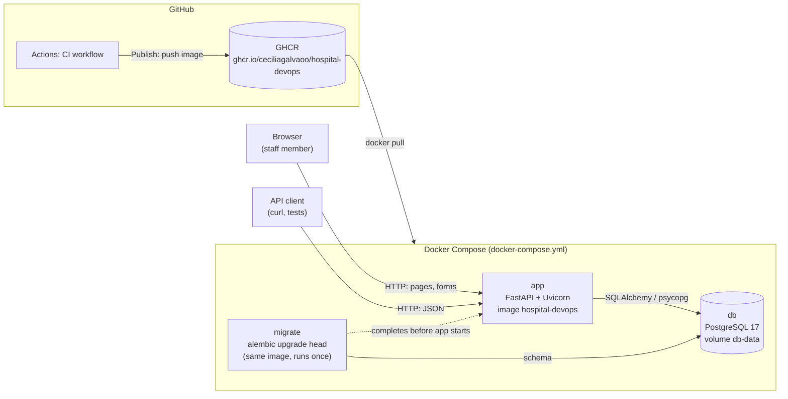
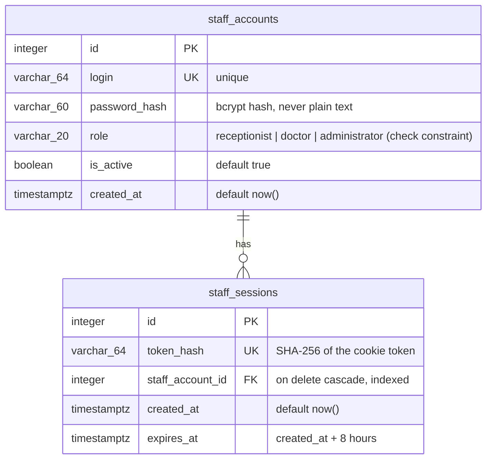
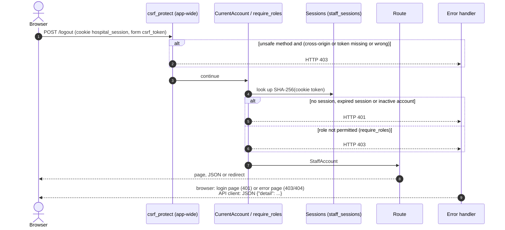
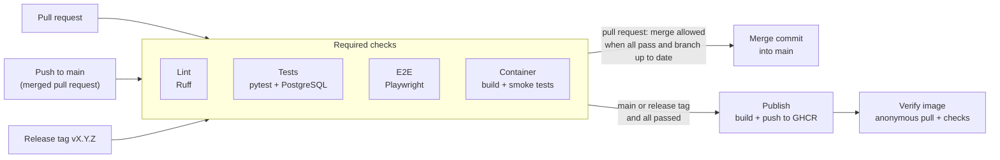

# Architecture

This document describes the architecture **as implemented**, at the end of Sprint 1 (2026-11-07, `main` at `d1d025c`). README §9.6 describes the planned architecture; this document is updated by the review of every sprint (#188, #190, #192), so it always matches the code.

## 1. Overview

The application is a single FastAPI service with server-rendered Jinja2 pages and a PostgreSQL database, packaged as one container image. Docker Compose runs it locally with the database and a one-off migration step; GitHub Actions checks every pull request and publishes the image to GitHub Container Registry (GHCR) from `main`. There is no production deployment: publication to GHCR is the delivery target (README §9.3).

| Service (`docker-compose.yml`) | Image | Role |
| --- | --- | --- |
| `db` | `postgres:17-alpine` | Database, with the named volume `db-data` and a `pg_isready` health check |
| `migrate` | the application image | Runs `alembic upgrade head` once after `db` is healthy; `app` starts only if it exits successfully |
| `app` | the application image | Runs Uvicorn on port 8000 as the unprivileged user UID 10001 |
| `test-db` | `postgres:17-alpine` | Isolated test database on `127.0.0.1:5433`, in the `test` profile only, on `tmpfs` |

The image is a multi-stage build (`Dockerfile`, `docs/docker-build.md`): a build stage installs the pinned runtime dependencies into a virtual environment without pip, and the runtime stage contains only that environment, `app/`, `migrations/` and `alembic.ini`.

## 2. Modules

| Path | Responsibility |
| --- | --- |
| `app/main.py` | Creates the FastAPI application: application-wide CSRF dependency, static files, routers, and the error handler that renders pages for browsers and JSON for API clients |
| `app/routes/health.py` | `GET /health`: HTTP 200 with a working database, HTTP 503 otherwise |
| `app/routes/auth.py` | JSON API: `POST /auth/login`, `POST /auth/logout`, `GET /auth/me`, `GET /auth/csrf` |
| `app/routes/pages.py` | Pages: `/login`, `/logout`, `/` and the area pages generated from `app/navigation.py` |
| `app/access.py` | Reusable dependencies: `CurrentAccount` (HTTP 401) and `require_roles(...)` (HTTP 403) |
| `app/auth.py` | Credential check, server-side session creation, lookup and deletion, session cookie helpers |
| `app/csrf.py` | CSRF token issue and check, applied to every state-changing request |
| `app/navigation.py` | The areas of the application and the roles that may open them (RBAC matrix, README §3.2) |
| `app/templating.py` | Renders Jinja2 pages with the CSRF token, the logged-in account and its navigation |
| `app/security.py` | bcrypt hashing and verification (cost factor 12, at most 72 bytes) |
| `app/models/` | SQLAlchemy models: `StaffAccount`, `StaffSession`, `Role` |
| `app/db.py` | Engine from `DATABASE_URL`, per-request database session, naming convention of constraints, database availability check |
| `app/seed.py` | Development-only command that creates one account per role |
| `app/templates/`, `app/static/` | Page templates and the stylesheet |
| `migrations/` | Alembic environment and revisions `0001` (baseline), `0002` (staff accounts), `0003` (staff sessions) |
| `scripts/image_metadata.py` | Computes the version label and the image tags of a CI publication |
| `tests/` | Unit, integration, end-to-end, container smoke, published-image and CI contract tests (§6) |

Dependencies point inwards: routes use `access`, `auth`, `csrf` and `templating`; these use the models and `db`; the models use `security`. The only import between routes is the shared login error message, which `pages.py` takes from `routes/auth.py`.

## 3. Data model

- **Staff accounts** are the only users; patients are data, not users (README §3.1). The role is stored as text with a check constraint (`native_enum=False`), so new roles need no PostgreSQL enum migration.
- **Sessions** are stored server-side, so logout and deactivation take effect immediately. Only a hash of the random cookie token is stored; a database leak does not reveal usable tokens.
- **Migrations** are the only way to change the schema. Constraint names follow a fixed naming convention (`pk_`, `uq_`, `ck_`, `fk_`, `ix_` in `app/db.py`), so migrations are reviewable and reversible. A test compares the models with the migrations (`alembic check` equivalent) and every revision is applied and rolled back in the test database.

## 4. Request flow

Every request passes the CSRF dependency first; protected routes then declare their access requirement as dependencies.

1. **CSRF** (`app/csrf.py`): for `POST`, `PUT`, `PATCH` and `DELETE`, the request is refused with HTTP 403 when its `Origin` is another site (or `Sec-Fetch-Site: cross-site`), or when the token in the form field `csrf_token` or the header `X-CSRF-Token` is missing or wrong. The token is an HMAC, with a key generated at start-up, of the session cookie, or of the pre-session cookie `hospital_csrf` before login; it changes with every login. Safe methods are not checked and never change state.
2. **Authentication** (`CurrentAccount`): the `hospital_session` cookie (`HttpOnly`, `SameSite=Lax`, eight hours, `Secure` when `SESSION_COOKIE_SECURE=true`) is hashed and looked up; expired sessions and sessions of inactive accounts are deleted and the request receives HTTP 401.
3. **Authorisation** (`require_roles`): the route's allowed roles come from the RBAC matrix (README §3.2); other roles receive HTTP 403. Authentication is always checked first, so a request without a session never receives 403.
4. **Responses** (`app/main.py`): browsers (`Accept: text/html`) receive the login page with HTTP 401 or an error page titled by the reason with HTTP 403/404; other clients receive the JSON error. The status codes are the same for both (NFR-04).

Login (`POST /login` or `/auth/login`) checks the password with bcrypt, also for unknown logins against a dummy hash, so response times do not reveal which logins exist; wrong passwords, unknown logins and inactive accounts receive the same message. A successful login replaces the browser's previous session.

## 5. Delivery

- **Pull requests** run `Lint`, `Tests`, `E2E` and `Container`, which are required checks of the ruleset on `main`, together with an up-to-date branch and merge commits only (`docs/branching-strategy.md` §3 and §7). Failed end-to-end tests keep screenshots, videos and traces as the `playwright-results` artifact.
- **Pushes to `main`** run the same checks and then `Publish`, the only job with permission to write packages: it pushes `main` and `sha-<commit>` with the version and commit as labels. **Release tags** `vX.Y.Z` (one per sprint) also publish `X.Y.Z`, `X.Y` and `latest` (`docs/docker-build.md`, "Versioning and image tags").
- **Verify image** then pulls the `sha-<commit>` tag without credentials, starts it with PostgreSQL and checks health, the login page, the non-root user and the labels.

## 6. Tests

| Layer | Location | Runs | What it covers |
| --- | --- | --- | --- |
| Unit | `tests/test_*.py` | `pytest` (default), `Tests` job | hashing, health route, image tag computation |
| Integration | `tests/integration/` | `pytest` (default), `Tests` job | models, migrations, sessions, 401/403, CSRF, pages, against an isolated PostgreSQL database inside a rolled-back transaction per test |
| CI contract | `tests/ci/` | `pytest` (default), `Tests` job | the workflow rules that the required checks and the publication rely on |
| End-to-end | `tests/e2e/` | `pytest -m e2e`, `E2E` job | login, navigation and logout per role in headless Chromium, small screens |
| Container smoke | `tests/smoke/` | `pytest -m smoke`, `Container` job | the Compose stack built from the Dockerfile |
| Published image | `tests/published/` | `pytest -m published`, `Verify image` job | the image pulled from GHCR |

Manual checks and the map of tests per story are in `docs/testing/`.

## 7. Configuration

| Variable | Used by | Purpose |
| --- | --- | --- |
| `DATABASE_URL` | application, Alembic | PostgreSQL connection (`postgresql+psycopg://...`), set by Compose from `POSTGRES_*` |
| `SESSION_COOKIE_SECURE` | application | Marks the session and CSRF cookies `Secure`; must be `true` behind HTTPS |
| `APP_ENV`, `SEED_PASSWORD` | `app.seed` | The seed runs only with `APP_ENV=development` and a password |
| `POSTGRES_DB`, `POSTGRES_USER`, `POSTGRES_PASSWORD`, `APP_PORT`, `TEST_DB_PORT` | Compose | Database credentials and host ports (`.env`, documented in `.env.example`) |
| `TEST_DATABASE_URL` | tests | Test database; defaults to the `test-db` service |

No secret is stored in the repository or the image. The CSRF key is generated at start-up, and CI uses the workflow's `GITHUB_TOKEN`.

## 8. Design decisions

| Decision | Reason | Where |
| --- | --- | --- |
| Single FastAPI service with server-rendered pages | Keeps the interface in the application, without a separate frontend build | README §9.1, §9.6 |
| Non-root runtime user, multi-stage image without pip, pinned base image | Smaller attack surface and reproducible builds | #133 (PR #170), #181 (PR #182) |
| Migrations as a one-off Compose service that gates the application | The application never starts on an outdated schema | #135 (PR #172) |
| Isolated test database with a transaction per test | Integration tests cannot touch development data and do not affect each other | #138 (PR #174) |
| bcrypt with cost 12 and a 72-byte limit | NFR-03; refuses passwords bcrypt would silently truncate | #5 (PR #178) |
| Server-side sessions with hashed tokens | Immediate logout and deactivation; no usable token in the database | #7 (PR #180) |
| 401/403 as reusable dependencies, authentication before roles | Routes declare access instead of checking it; consistent status codes (NFR-04) | #8 (PR #194) |
| Session-bound HMAC CSRF token plus `Origin` check, applied app-wide | Protects login and every new form by default, without a configured secret | #13 (PR #198) |
| One navigation table per role, placeholder area pages | Links and access checks cannot diverge; login per role and denied access can be demonstrated before the areas exist | #9 (PR #199) |
| Browser error pages titled by reason, JSON for API clients | Clear messages for people, unchanged status codes for clients | #9 (PR #199), #204 (PR #206) |
| Four required checks, up-to-date branch, merge commits only | Failed checks block merging (NFR-06); history shows each task's branch | #141 (PR #208), #143 (PR #210) |
| Publication only from `main` and release tags, with commit-SHA tags and labels | Every image traceable to its commit; pull requests never publish (NFR-05, NFR-08) | #146 (PR #211), #147 (PR #212), #149 (PR #214) |
| Published image verified by an anonymous pull | Proves that the delivered artifact works and is publicly available | #148 (PR #213) |

## 9. Not yet implemented

These parts of the planned architecture belong to later sprints:

- Patients, doctors, appointments and medical records, with their tables and the doctor-specific scoping of access (Sprints 2 and 3; the area pages are placeholders until then).
- An automatic restart policy and the recovery check (NFR-02), performance tests (NFR-01) and monitoring with a metrics dashboard (NFR-07), in US-25 and US-26 (Sprint 4).
