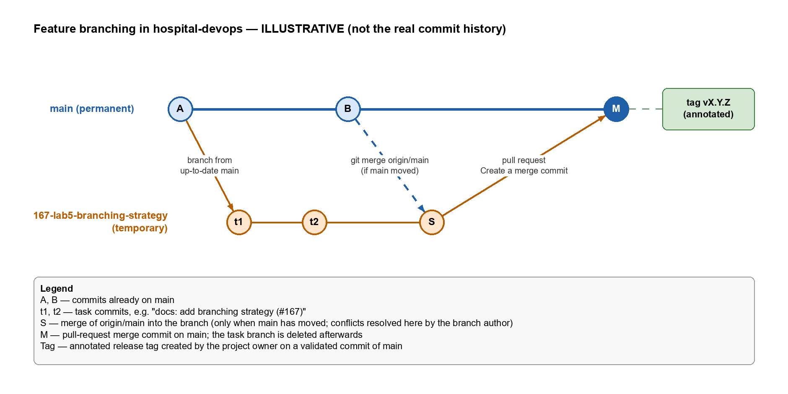

# Branching strategy

This document defines the branching strategy for `hospital-devops` (Lab 5, Task 6, #167). It builds on the workflow already practised in Lab 4 and recorded in [git-workflow.md](git-workflow.md), and on the branch naming convention in README §10.7.

> Lab 5 Tasks 1–5 (the practice repositories) have been deferred. This decision is based on the strategy comparison in the Lab 5 material and on the real practice in this repository during Lab 4.

## 1. Chosen strategy: feature branching

The project uses **feature branching**:

- `main` is the **only permanent branch**. There is no `develop` branch.
- Every task gets a **temporary branch** created from an up-to-date `main`.
- Work returns to `main` only through a **pull request** and the branch is deleted after the merge.
- `main` contains only finished, reviewed work, and releases are tagged on it.

### Justification

| Criterion | Situation in this project | Why feature branching fits |
| --- | --- | --- |
| Team size | Individual project (README §5.1): one person is Product Owner, developer and Scrum Master. | No integration branch is needed to coordinate several developers. One permanent branch is enough, and a `develop` branch would only add a second branch to keep in sync. |
| Release frequency | Four two-week sprints (README §5.1, §8). A working increment is delivered at the end of each sprint. | Releases happen at sprint boundaries, not continuously and not on a long release schedule. A tag on `main` per delivered increment is sufficient; separate `release/*` branches for stabilisation would add overhead without benefit. |
| Experience with automated tests | Test coverage is still small: one pytest test for the health endpoint (`tests/test_health.py`). | Trunk-based development relies on a strong automated test suite and feature flags to keep a constantly integrated trunk releasable. That safety net does not exist yet. A task branch plus a pull request gives a checkpoint for review and local validation before anything reaches `main`. |
| Expected CI/CD setup | CI is planned in Sprint 1 (US-23: GitHub Actions with Ruff, pytest and coverage, container build, required checks) and GHCR publication in US-24. No workflow exists yet. | Pull requests into `main` are the natural trigger for the planned CI checks, and merges into `main` for image publication. The strategy keeps the same shape when CI arrives: only the required checks are added. |
| Number of parallel features | Usually one task in progress at a time, sometimes two (for example, a small fix while a task is stashed, as with #132 and #164 in Lab 4). | Few parallel branches mean conflicts are rare and small. Git Flow's extra branch types are designed for many parallel features and maintained releases, which this project does not have. |

The choice of strategy depends on the project's needs, not only on team size: Git Flow or trunk-based development can work for teams and for individuals. For this project, at this stage, feature branching gives review and traceability with the least overhead. The decision will be reviewed if the test suite and CI mature enough to support shorter-lived branches.

## 2. Branch types and naming rules

| Branch | Lifetime | Created from | Merged into | Naming rule | Example |
| --- | --- | --- | --- | --- | --- |
| `main` | Permanent | — | — | `main` | `main` |
| Backlog task branch | Temporary (one task) | Up-to-date `main` | `main` via PR | `<issue-number>-<task-id>-<short-description>` (README §10.7) | `132-t-22-1-fastapi-health-endpoint` |
| Coursework branch | Temporary (one lab task) | Up-to-date `main` | `main` via PR | `<issue-number>-<lab-id>-<short-description>` | `167-lab5-branching-strategy` |
| Lab 4 practice branch (historical) | Temporary | `main` | `main` via PR | `lab4/<topic>` | `lab4/fix-readme-commit-example` |

Rules:

- The issue number comes first, so the branch is traceable to its issue. The task or lab identifier is lower case with dots replaced by hyphens (`T-22.1` → `t-22-1`).
- One branch per task (or per small user story).
- Defects use the same pattern, starting from a defect issue. There is no separate `hotfix/*` branch type, because there are no maintained older releases: a fix is a normal task branch merged into `main` and released with the next tag.
- `main` is never committed to directly.
- The `lab4/<topic>` prefix was used for Lab 4 exercises and is kept only in the history; new work uses the issue-number pattern.

### Creating a branch

Create the branch from the issue (**Development → Create a branch**, source `main`) or from the terminal, so that it is linked to the issue:

```bash
git switch main
git pull                      # make sure main is up to date
gh issue develop 167 --name 167-lab5-branching-strategy --base main --checkout
```

A branch created only with `git switch -c` and pushed manually is not linked to the issue.

### Deleting a branch after the merge

The repository does not delete head branches automatically, so the branch is deleted by hand after its pull request is merged:

```bash
git switch main
git pull
git branch -d 167-lab5-branching-strategy
git push origin --delete 167-lab5-branching-strategy   # if it still exists on the remote
git fetch --prune
```

`git branch -d` (not `-D`) refuses to delete a branch that is not merged, which protects against losing work.

## 3. Merge rules

1. **Pull request required.** Every change reaches `main` through a pull request. The description references the issue with `Closes #<issue>` when the change completes it, or `Refs #<issue>` for partial work.
2. **Documented self-review.** This is an individual project, so there is no second reviewer and zero approvals are required. Before merging, the author reviews the pull request and leaves a comment recording what was checked:
   - **scope:** the PR contains only changes for its issue (no unrelated files, no line-ending-only or formatting noise);
   - **diff:** the full diff on GitHub has been read;
   - **issue criteria:** each *Done when* condition of the issue is met, or the open ones are listed;
   - **validation:** which checks were run and their result.
3. **Merge method: Create a merge commit.** This preserves the branch commits and shows in the graph where each task started and was integrated, as in PRs #163, #164, #165 and #166. Squash and rebase merges are not used for normal work.
4. **Validation before merging.** Relevant tests must pass before the merge:
   - **Current (local) validation.** No CI workflow exists yet. The author runs `python -m pytest -v` locally whenever application code, tests or dependencies change, and checks the issue's *Done when* conditions. For documentation-only changes, the author checks the rendered Markdown, links and file names instead.
   - **Future CI checks.** When US-23 is implemented (T-23.2 and T-23.4), GitHub Actions will run Ruff, pytest with coverage and the container build on every pull request, and these checks will become **required status checks** on `main`. From then on, a pull request cannot be merged while a required check fails. Local validation remains a good practice before pushing.
5. **Protected `main`.** `main` is protected by a ruleset (see §7).

## 4. Release rules

- **Version numbering.** Releases follow semantic versioning, `vMAJOR.MINOR.PATCH`:
  - **MAJOR:** incompatible changes in behaviour or interfaces that users or integrations rely on;
  - **MINOR:** new functionality that stays compatible, for example a new user story delivered;
  - **PATCH:** compatible bug fixes only.
  - While the version is `0.y.z`, the application is still in initial development and may change; `1.0.0` is reserved for the first version considered stable for its intended use.
- **Where tags are created.** Only **annotated tags** (`git tag -a`) on **validated commits of `main`**, normally the merge commit of the pull request that completes an increment, typically at the end of a sprint. Tags are never created on task branches.
- **Who creates them.** The project owner creates the tags, pushes them explicitly (`git push origin vX.Y.Z`, because `git push` does not send tags) and publishes the GitHub Release.
- **Existing release.** `v0.1.0` is an annotated tag on `849318c` (merge of PR #165), with a published GitHub Release: <https://github.com/ceciliagalvaoo/hospital-devops/releases/tag/v0.1.0>.
- **Published release tags are immutable.** A tag that belongs to a published release is never moved, deleted or recreated; a correction is released as a new version. Temporary tags created for exercises are not releases and may be removed: in Lab 4, the lightweight tag `v0.1.0-rc1` was deleted locally (`git tag -d v0.1.0-rc1`) and on the remote (`git push origin --delete v0.1.0-rc1`).

```bash
git switch main
git pull
git tag -a v0.2.0 -m "Release v0.2.0: <summary>"   # example only
git push origin v0.2.0
```

## 5. Conflict policy

- **Who resolves.** The author of the branch resolves its conflicts, on the branch, never on `main`.
- **How.** Update the branch with the latest `main` using a merge. Pushed commits are not rebased.

  ```bash
  git switch <branch>
  git fetch origin
  git merge origin/main
  # resolve each conflicted file, then review before staging:
  git diff
  git add <file> ...
  # review exactly what the merge commit will contain:
  git diff --staged
  git commit
  git log --oneline --graph -5
  git push
  ```

- **While resolving:**
  - keep the behaviour that both sides need, not just one side, and do not accept `--ours`/`--theirs` blindly, because that can silently discard the other change;
  - before staging, review the resolved files with `git diff`, checking that no conflict markers remain and that both changes are kept where needed;
  - after `git add` and before `git commit`, review the staged result with `git diff --staged`;
  - after the commit, check the graph with `git log --oneline --graph`;
  - repeat the relevant validations (tests for code changes, rendering and links for documentation) before pushing.
- **In case of doubt.** Do not guess. Abort the merge if needed (`git merge --abort`), then read the requirements (README, the related issues and their *Done when* conditions) and the history of the conflicting lines (`git log -p`, `git blame`, the related PRs) to understand why each change was made. Integrate only once the correct result is clear.
- **No force push on `main`.** Force pushes to `main` are forbidden and blocked by the ruleset. Because branches are updated by merge, force pushing task branches is not needed either.

## 6. Diagram

The commit graph below is **illustrative**: it shows the shape of the strategy, not the real history (see [git-history.txt](git-history.txt) for that). The editable draw.io source is [branching-strategy.drawio](branching-strategy.drawio), and [branching-strategy.png](branching-strategy.png) is its exported image.



Text version of the same graph:

```text
main                         A───────B──────────────M   ← tag vX.Y.Z (annotated)
                              \       \            /
167-lab5-branching-strategy    t1──t2──S──────────┘

A, B    commits already on main
t1, t2  task commits, e.g. "docs: add branching strategy (#167)"
S       merge of origin/main into the branch (only when main has moved)
M       pull-request merge commit ("Create a merge commit")
```

1. The task branch starts from an up-to-date `main`.
2. Commits referencing the issue are made on the branch.
3. If `main` moved meanwhile, it is merged into the branch and any conflicts are resolved there.
4. The pull request is merged into `main` with a merge commit, and the branch is deleted.
5. A validated commit on `main` receives an annotated release tag.

## 7. Protection of `main`

Checked read-only via the GitHub API on 2026-10-31: `main` is protected by the repository ruleset **Protect main** (enforcement *active*, target `~DEFAULT_BRANCH`, no bypass actors). Its rules:

| Rule | Configured | Matches this strategy |
| --- | --- | --- |
| Require a pull request before merging | Yes, 0 required approvals | Yes: PRs are mandatory; zero approvals fit individual work with documented self-review. |
| Block force pushes (non-fast-forward) | Yes | Yes |
| Restrict deletions | Yes | Yes |
| Allowed merge methods | Merge, squash and rebase | Compatible: merge commit is the documented choice; the others are allowed but not used. |
| Required status checks | None | Expected for now: no CI exists yet; checks will be added with US-23 (T-23.4). |
