# Lab 8 – Publishing artifacts: registries, versioning and security

Report for Applied DevOps Lab 8, Tasks 0–4. Task 5 (publishing for this project) is documented separately in `docs/versioning.md` and `docs/publishing.md` of [`hospital-devops`](https://github.com/ceciliagalvaoo/hospital-devops).

- Demo repositories: <https://github.com/ceciliagalvaoo/publish-demo> (libraries, Tasks 0, 1, 3) and <https://github.com/ceciliagalvaoo/testing-demo> (Docker image, Task 2)
- Author: Cecília Galvão (GitHub: `ceciliagalvaoo`)

All links are absolute so that they keep working when this file is copied to another repository. Every command output in this report was captured from a real run on the machine described below; tokens and passwords are redacted (`***`). Screenshots of GitHub and Docker Hub pages are stored in [`docs/lab8-evidence/`](lab8-evidence/), next to this file. Anything that was changed, skipped or behaved differently from the lab sheet is stated explicitly.

---

## Environment

| Component | Where | Version |
|-----------|-------|---------|
| OS | WSL2 | Ubuntu 24.04 (kernel 6.6.87.2-microsoft-standard-WSL2) |
| Docker | WSL2 Docker Engine (client uses Docker Desktop's credential helper) | 28.5.1, buildx 0.29.1 |
| .NET SDK | WSL2 (`~/.dotnet`) | 10.0.403 |
| Java / Maven | OpenJDK / Maven wrapper (copied from the Lab 6 `java-app`) | 21.0.13 / 3.10.0 |
| Node.js / npm | WSL2 | 24.14.1 / 11.11.0 |
| Trivy | `aquasec/trivy:0.76.1` (pinned; 0.76.2 was released only 12 days before) | 0.76.1 |
| Container registry | `registry:3` | Distribution 3.1.2 |
| npm registry | `verdaccio/verdaccio:6` (pinned to the major) | 6.11.2 |

**Track.** Lab 7 was done on the **C# track**, so the Docker image in Task 2 is `lendit-dotnet` from `testing-demo`. Task 0 explicitly asks for all three libraries, so `publish-demo` contains the .NET, Java and npm library.

---

## Task 0 – Preparation

`publish-demo` was created with the layout of the sheet:

```text
publish-demo/
├── .github/scripts/version.sh                 # Task 1
├── .github/workflows/publish-packages.yml     # Task 3
├── consumers/{dotnet,maven,node}/              # Task 3: projects that install the packages
├── docs/versioning.md                          # Task 1
├── dotnet-lib/   src/LendIt.Pricing + tests/LendIt.Pricing.Tests (xUnit)
├── java-lib/     hr.lendit:lendit-pricing (JUnit 5) + Maven wrapper
└── js-lib/       @ceciliagalvaoo/lendit-pricing (node:test)
```

The `LateFee` code is copied from the sheet without changes. Each library has the same tests: no fee for 0 and 14 days (a parameterized test), 3.00 for 20 days, and the 10.00 cap for 100 days.

```text
$ dotnet test dotnet-lib/tests/LendIt.Pricing.Tests
Passed!  - Failed:     0, Passed:     4, Skipped:     0, Total:     4, Duration: 47 ms - LendIt.Pricing.Tests.dll (net10.0)

$ cd java-lib && ./mvnw -B -ntp test
[INFO] Tests run: 4, Failures: 0, Errors: 0, Skipped: 0
[INFO] BUILD SUCCESS

$ cd js-lib && npm test
ℹ tests 3
ℹ pass 3
ℹ fail 0
```

(4 tests in .NET and Java because the parameterized "no fee" test counts as two cases.)

Additions that are not in the sheet: a `.gitignore` (`bin/`, `obj/`, `out/`, `target/`, `node_modules/`, `.npmrc.verdaccio`), and a `.gitattributes` that keeps `*.sh` and `mvnw` with LF line endings. The repository is cloned on Windows with `core.autocrlf=true`, and a CRLF shebang line (`#!/usr/bin/env bash\r`) would break the scripts on the Linux runners.

---

## Task 1 – A versioning strategy and an automatic version

### 1.1 The rules

[`docs/versioning.md`](https://github.com/ceciliagalvaoo/publish-demo/blob/main/docs/versioning.md) (the same file is in [`testing-demo`](https://github.com/ceciliagalvaoo/testing-demo/blob/main/docs/versioning.md)) defines:

1. **Scheme:** SemVer 2.0.0. MAJOR = incompatible API change (a removed or renamed public method or HTTP endpoint, a changed meaning of the result); MINOR = new compatible functionality; PATCH = compatible bug fix.
2. **Channels:** `dev` (push to `main`, `X.(Y+1).0-dev.<run>`), `rc` (tag `vX.Y.Z-rc.N`), `release` (tag `vX.Y.Z`, after approval of `production`). Pull requests publish nothing.
3. **Immutable:** every exact version, the Docker digest, the `:<commit-sha>` build identity. **Floating:** `dev`, `rc`, `X.Y`, `X`, `latest`, and the npm dist-tags.
4. **Who may release:** only repository administrators may create `v*` tags. This is **enforced**, not only written down: both repositories have a tag ruleset *"release tags v\*"* (creation, update and deletion of `refs/tags/v*` are blocked, bypass only for the *Repository admin* role). A release also needs the approval of the `production` environment.

### 1.2 `version.sh`

The script from the sheet is in [`.github/scripts/version.sh`](https://github.com/ceciliagalvaoo/publish-demo/blob/main/.github/scripts/version.sh), and a copy is in `testing-demo`. It was tested in a throw-away clone, so that the `v1.0.0` test tag was not created in the real repository:

```text
$ git tag -a v1.0.0 -m "First release"
$ GITHUB_REF_TYPE=branch GITHUB_REF_NAME=main GITHUB_RUN_NUMBER=57 .github/scripts/version.sh
VERSION=1.1.0-dev.57
CHANNEL=dev
$ GITHUB_REF_TYPE=tag GITHUB_REF_NAME=v1.1.0-rc.1 .github/scripts/version.sh
VERSION=1.1.0-rc.1
CHANNEL=rc
$ GITHUB_REF_TYPE=tag GITHUB_REF_NAME=v1.1.0 .github/scripts/version.sh
VERSION=1.1.0
CHANNEL=release
$ GITHUB_REF_TYPE=tag GITHUB_REF_NAME=v1.1 .github/scripts/version.sh
Tag 'v1.1' is not vMAJOR.MINOR.PATCH or vMAJOR.MINOR.PATCH-rc.N
(exit 1)
```

The two failure modes mentioned in class, reproduced:

```text
# no tags visible (what a shallow checkout without fetch-depth: 0 sees)
$ GITHUB_REF_TYPE=branch GITHUB_RUN_NUMBER=59 .github/scripts/version.sh
VERSION=0.1.0-dev.59

# the bug from the hint: last release v1.2.0, then a tag v1.3.0-rc.1, then one more commit
$ GITHUB_REF_TYPE=branch GITHUB_RUN_NUMBER=60 .github/scripts/version.sh     # before the rc tag
VERSION=1.3.0-dev.60
$ git tag -a v1.3.0-rc.1 -m rc && git commit --allow-empty -m fix
$ GITHUB_REF_TYPE=branch GITHUB_RUN_NUMBER=61 .github/scripts/version.sh     # after the rc tag
VERSION=1.4.0-dev.61
```

The executable bit is stored in git with `git update-index --chmod=+x .github/scripts/version.sh`. This matters here, because a file added from Windows is stored as `100644` by default.

### 1.3 Tags per ecosystem

These are used exactly as in the table of the sheet: Docker `1.1.0-dev.N` + `dev` / `1.1.0-rc.1` + `rc` / `1.1.0`, `1.1`, `1`, `latest`; NuGet and Maven use the plain version; npm uses the version plus the dist-tag `dev` / `next` / `latest`.

### Questions

**1. Why must a release version be immutable?**
A version number is a promise that one name means one set of bytes, and every tool relies on that. `package-lock.json` stores an `integrity` hash, NuGet's `packages.lock.json` stores a content hash, Maven and NuGet cache a version locally forever, and a Docker node keeps an image it has already pulled. If someone re-published `1.1.0` with different content:
- Builds that have the old hash in a lock file fail with an integrity error. Builds without a lock file silently get the new content.
- Machines with a cached copy keep the old bytes and fresh machines get the new ones, so the "same version" behaves differently on two servers.
- Nobody can reproduce or audit what ran: the tests, the scan and the approval were done for content that no longer exists under that name.
- It is an attack: whoever can overwrite a version can replace a tested release with a backdoored one, and everyone who trusts the name runs it. Task 4.1 does exactly this: `demo/alpine:1.0` was overwritten with a different image without any error.

**2. Why is `latest` a bad choice for a deployment manifest?**
`latest` only means "whatever was pushed last". Concrete scenario: the manifest says `image: lendit:latest` and has run fine for a month. A node is replaced at 03:00, pulls `latest` and gets a build that somebody pushed yesterday (maybe from a test, maybe with a breaking change). Nothing in the repository changed and nothing was deployed, but the new pod behaves differently from the old pods, which still run the cached old `latest` (`imagePullPolicy: IfNotPresent`). Nobody can tell from the manifest which version is running. A rollback to "the previous latest" is impossible, and the difference does not appear in any diff. With `lendit:1.1.0` or `lendit@sha256:…`, the restart pulls exactly the same bytes.

**3. Why does `1.1.0-rc.1` sort before `1.1.0`, and why does it matter?**
SemVer §11 says a pre-release has *lower* precedence than the normal version with the same `MAJOR.MINOR.PATCH`: `1.1.0-rc.1` is a candidate *on the way to* `1.1.0`, so when the release appears it must win. Package managers use this ordering to choose what to install, and they hide pre-releases unless asked. `dotnet add package LendIt.Pricing` refuses the dev version (shown in Task 3.1), a NuGet range `[1.0,2.0)` ignores pre-releases, and npm's `^1.0.0` does not match `1.1.0-rc.1` (npm only matches a pre-release when the range itself names a pre-release of the same `X.Y.Z`). Consumers therefore never get an RC by accident. Once `1.1.0` is published it is "newer" than every `1.1.0-rc.N`, so people who opted in to the RC move to the release automatically. If the order were the other way round, an RC would look newer than the release and would be installed instead of it.

**4. The weakness of the script, and how tools handle it.**
The script always computes "last tag with the `-rc.N` removed, MINOR + 1". After `v1.3.0-rc.1` (shown above), every commit on `main` becomes `1.4.0-dev.N`, although `1.3.0` has not been released yet. The fixes that are going into `1.3.0` are labelled as `1.4.0` builds, and because `1.4.0-dev.61 > 1.3.0`, a consumer who follows the dev channel jumps past a release that does not exist yet. The script also always increments MINOR: after `v1.3.0`, a hotfix build is still called `1.4.0-dev.N` and never `1.3.1-…`, and a breaking change is not detected at all.
- **MinVer** uses the *height* (the number of commits since the tag). After a pre-release tag `1.3.0-rc.1` it produces `1.3.0-rc.1.<height>`, which sorts after `rc.1` and before `1.3.0`. After a release tag `1.3.0` it produces `1.3.1-alpha.0.<height>` (PATCH by default, configurable with `MinVerAutoIncrement` and `MinVerMinimumMajorMinor`).
- **semantic-release** and **release-please** derive the next version from the *content*, using conventional commits since the last release: `fix:` → PATCH, `feat:` → MINOR, `BREAKING CHANGE` / `feat!:` → MAJOR. Pre-releases come from configured branches (e.g. `next` → `1.3.0-next.N`, `beta` → `1.3.0-beta.N`), and the tool creates the tag and the changelog itself. A human then only decides *when* to release, not *what the number is*.

---

## Task 2 – Publishing Docker images: test and production

### 2.1 GHCR and the local credential

```text
$ gh auth token | docker login ghcr.io -u ceciliagalvaoo --password-stdin
Login Succeeded
$ cat ~/.docker/config.json
{
  "auths": { "ghcr.io": {} },
  "credsStore": "desktop.exe",
  "credHelpers": { "us-central1-docker.pkg.dev": "gcloud" }
}
```

**Where is the credential stored, and is it encrypted?** On this machine the Docker client is configured with `credsStore: desktop.exe`, Docker Desktop's credential helper. The token is therefore in the **Windows Credential Manager** (protected by Windows DPAPI with the user's login), and `config.json` contains only an empty entry for `ghcr.io`. To see the Linux default, the same login was repeated with a config that has no helper:

```text
$ DOCKER_CONFIG=/tmp/x docker login ghcr.io -u ceciliagalvaoo --password-stdin && cat /tmp/x/config.json
{ "auths": { "ghcr.io": { "auth": "Y2VjaWxpYWdhbHZhb286…(redacted)" } } }
$ echo <auth> | base64 -d
ceciliagalvaoo:gho_…(redacted)
```

That value is only **base64**, which is an encoding and not encryption. Anybody who can read the home directory (a backup, a shared machine, malware) has a token with `write:packages`. The token used here is the `gh` CLI's OAuth token, with the scopes `write:packages` and `read:packages` added (`gh auth refresh -s write:packages,read:packages`). After the test: `docker logout ghcr.io`.

Package settings in GHCR:

| Package | Visibility | Linked repository |
|---|---|---|
| `testing-demo/lendit-dotnet` | **public** (created by Lab 7); changed to **private** for this lab, as the sheet requires for test images (UI only, Package settings → *Change visibility*) | `ceciliagalvaoo/testing-demo` (so the repository's Actions have write access) |
| `lendit-promo-demo` (manual promotion test, below) | private (default for a package pushed from a laptop) | none |

GHCR visibility is set **per package, not per tag**, so making `lendit-dotnet` private also makes its release tags private. The public copy of the releases is the Docker Hub image (2.5).

### 2.2 Environments

Created through the GitHub API in both `testing-demo` and `publish-demo`:

| Environment | Protection rules | Secrets / variables |
|---|---|---|
| `test` | none | none |
| `production` | **Required reviewers:** `ceciliagalvaoo`; **Deployment branches and tags:** only tags matching `v*` | `testing-demo`: secret `DOCKERHUB_TOKEN`, variable `DOCKERHUB_USERNAME` |

```text
$ gh api -X PUT repos/ceciliagalvaoo/testing-demo/environments/production …
production rules=required_reviewers,branch_policy
policy: tag v*
```

Both repositories are public, so required reviewers are available on the free plan.

The `production` environment of `testing-demo`, with the tag rule `v*`, the environment secret `DOCKERHUB_TOKEN` and the variable `DOCKERHUB_USERNAME`:

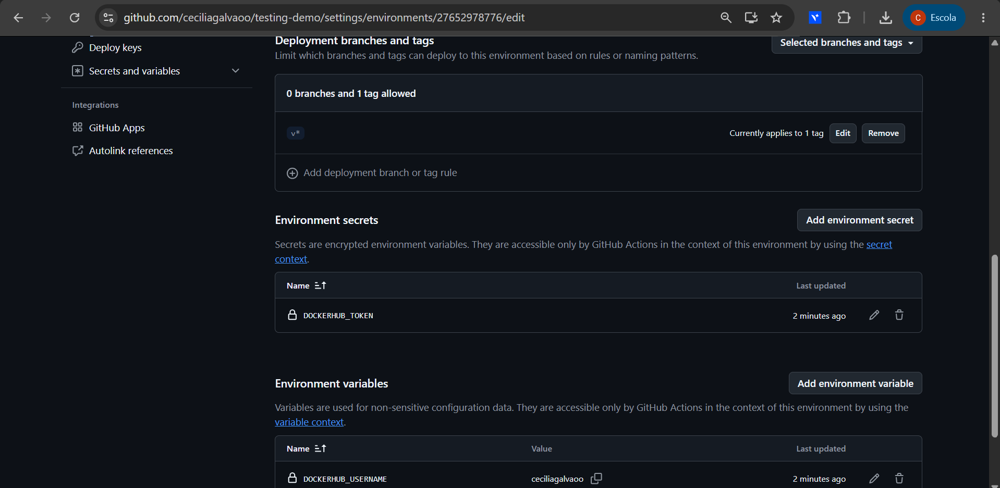

### 2.3 Build once, publish to `dev` automatically

Changes to [`testing-demo/.github/workflows/dotnet-ci.yml`](https://github.com/ceciliagalvaoo/testing-demo/blob/main/.github/workflows/dotnet-ci.yml):

- **(a)** `tags: ["v*"]` removed from `on: push`. Tags are now handled only by `release.yml`, so a tag never rebuilds. `.github/scripts/**` was added to the `paths` filter. This is a deviation: without it, a change to `version.sh` would not run the pipeline, and its commit would have no tested image.
- **(b)** The push step pushes only `"$IMAGE:$GITHUB_SHA"`, the **build identity**. The old `:main` and `:<version>` tags from Lab 7 are gone.
- **(c)** A new job, `publish-test` (*publish dev image*), runs after `e2e`, only on push to `main`, in the `test` environment, with `packages: write`. It adds `1.1.0-dev.N`-style and `dev` names with `docker buildx imagetools create`.
- **(2.6)** The Trivy scan runs between the tests and the push.

**A deviation that was necessary: `--prefer-index=false`.** The "same digest" promise did *not* hold with the command from the sheet. The manual promotion test (below) showed that when the source is a single-platform image manifest (which is what `docker push` of a `load`ed image produces), `imagetools create` by default **wraps it in a new image index**, and that index has a different digest:

```text
$ docker push ghcr.io/ceciliagalvaoo/lendit-promo-demo:1.1.0-dev.1
1.1.0-dev.1: digest: sha256:ed084b572ddd53d858cee236c56d97f1ba6a2e6a0d615a9932208e1bbef05d91 size: 1995
$ docker buildx imagetools create --tag …:1.1.0-rc.1 --tag …:rc …:1.1.0-dev.1
$ docker buildx imagetools create --tag …:1.1.0 --tag …:1.1 --tag …:1 --tag …:latest …:1.1.0-rc.1
1.1.0-dev.1  Digest:    sha256:ed084b572ddd53d858cee236c56d97f1ba6a2e6a0d615a9932208e1bbef05d91
1.1.0-rc.1   Digest:    sha256:958638c6e4bded07056c0809631fee8ab0d977b8a009ca40ba0f017767fd5abd
rc           Digest:    sha256:958638c6e4bded07056c0809631fee8ab0d977b8a009ca40ba0f017767fd5abd
1.1.0        Digest:    sha256:958638c6e4bded07056c0809631fee8ab0d977b8a009ca40ba0f017767fd5abd
1.1          Digest:    sha256:958638c6e4bded07056c0809631fee8ab0d977b8a009ca40ba0f017767fd5abd
1            Digest:    sha256:958638c6e4bded07056c0809631fee8ab0d977b8a009ca40ba0f017767fd5abd
latest       Digest:    sha256:958638c6e4bded07056c0809631fee8ab0d977b8a009ca40ba0f017767fd5abd

$ docker buildx imagetools inspect --raw …:1.1.0
mediaType: application/vnd.docker.distribution.manifest.list.v2+json
  manifests[]: sha256:ed084b572ddd…05d91 {'architecture': 'amd64', 'os': 'linux'}
```

The layers and the platform manifest are still the tested ones (the index points at `ed084b…`), but the top-level digest changed, so a check like "is the release digest identical to the dev digest?" would fail. With `--prefer-index=false` the new tag points at the very same manifest:

```text
$ docker buildx imagetools create --prefer-index=false --tag …:1.1.0-rc.2 …:1.1.0-dev.1
1.1.0-dev.1  Digest:    sha256:ed084b572ddd53d858cee236c56d97f1ba6a2e6a0d615a9932208e1bbef05d91
1.1.0-rc.2   Digest:    sha256:ed084b572ddd53d858cee236c56d97f1ba6a2e6a0d615a9932208e1bbef05d91
```

Both `publish-test` and `release.yml` therefore use `imagetools create --prefer-index=false`. All three workflows pass `actionlint` 1.7.7, including its `shellcheck` checks.

The merge of pull request #9 (`lab8-publish`) into `main` ran the whole pipeline (run #7, commit `df14197`). The new job `publish dev image` ran last, after all tests and the scan:

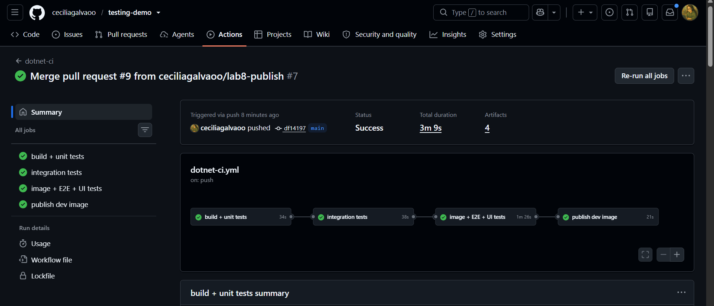

The package page shows the tested image with its build identity (the full commit SHA `df141973…`) and the dev names `0.3.0-dev.7` and `dev`. The package is now **Private**:

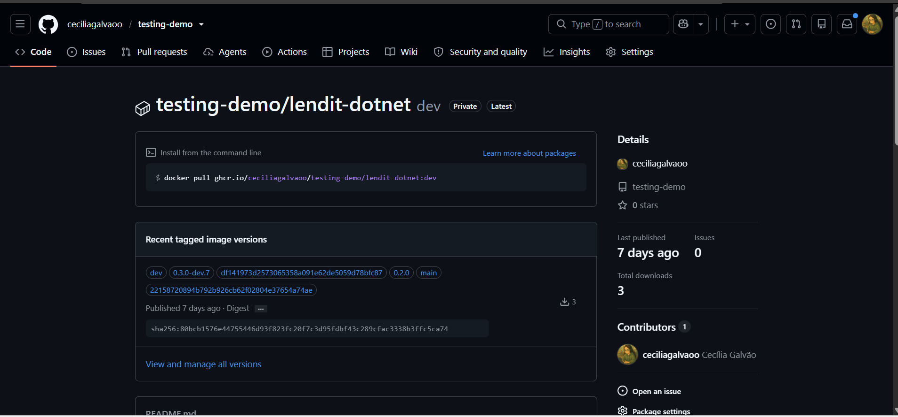

All three names have the same digest, so nothing was rebuilt:

```text
$ docker buildx imagetools inspect ghcr.io/ceciliagalvaoo/testing-demo/lendit-dotnet:df141973d2573065358a091e62de5059d78bfc87 | grep -i '^Digest'
Digest:    sha256:80bcb1576e44755446d93f823fc20f7c3d95fdbf43c289cfac3338b3ffc5ca74
$ docker buildx imagetools inspect ghcr.io/ceciliagalvaoo/testing-demo/lendit-dotnet:0.3.0-dev.7 | grep -i '^Digest'
Digest:    sha256:80bcb1576e44755446d93f823fc20f7c3d95fdbf43c289cfac3338b3ffc5ca74
$ docker buildx imagetools inspect ghcr.io/ceciliagalvaoo/testing-demo/lendit-dotnet:dev | grep -i '^Digest'
Digest:    sha256:80bcb1576e44755446d93f823fc20f7c3d95fdbf43c289cfac3338b3ffc5ca74
```

An interesting detail in the screenshot: the Lab 7 tags `0.2.0`, `main` and `22158720…` point at the **same digest** (*Published 7 days ago*). This lab changed only workflows, scripts and docs, not `dotnet-app/`. The image build therefore came entirely from the GitHub Actions layer cache (`cache-from: type=gha`), and it produced byte-for-byte the same image as in Lab 7. The registry stored nothing new, it only added names. "Same inputs, same digest" is exactly what makes promotion by digest verifiable.

The last tag in `testing-demo` before this lab is `v0.2.0` (Lab 7), so the first dev build is `0.3.0-dev.7` (7 = the run number). After `v1.1.0-rc.1` the dev builds become `1.2.0-dev.N`. That is the script weakness from Task 1, Question 4, showing up in practice.

### 2.4 Promotion to `rc` and `release`: `release.yml`

[`testing-demo/.github/workflows/release.yml`](https://github.com/ceciliagalvaoo/testing-demo/blob/main/.github/workflows/release.yml) is the workflow from the sheet. It differs in two ways: `--prefer-index=false`, and the promote step prints the digest of `<sha>` and of every new tag into the run summary, so the "identical digest" evidence is on the run page. It **does not build**:

1. `version`: `version.sh` on the tag (rejects a malformed tag).
2. `promote-ghcr` (environment `test` for rc, `production` for release, which waits for approval): fails with *"No tested image for commit …"* if `:<sha>` does not exist, then adds the tags.
3. `publish-dockerhub` (release only, environment `production`): copies the GHCR image to `docker.io/<user>/lendit` with `pull` → `tag` → `push`.
4. `github-release` (the only job with `contents: write`): `gh release create --generate-notes`, plus `--prerelease` for rc.

### 2.5 Docker Hub

Account `ceciliagalvaoo` and the public repository `ceciliagalvaoo/lendit`. A personal access token `github-actions-testing-demo` with **Repo Read & Write** (no *Delete*, and not the account password) was saved as the environment secret `DOCKERHUB_TOKEN` of `production` with `gh secret set` (the value was typed at the prompt, so it is not in the shell history). The user name was saved as the environment variable `DOCKERHUB_USERNAME`.

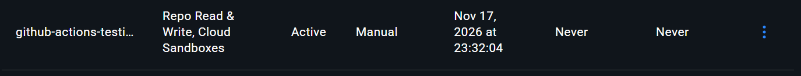

Two honest remarks on the token:
- It has **no expiration date** ("Never"). For a static secret, an expiry (e.g. 90 days) plus a rotation reminder would be better.
- It also has the scope *Cloud Sandboxes*, which the pipeline does not need. Least privilege would be *Repo Read & Write* only.

The account also has an *auto-generated* token (created by the Docker Desktop login) with *Read, Write, Delete* and no expiry. That one is **not** used in CI: it stays on the laptop.

Differences from GHCR:
- The image name is `docker.io/<user>/lendit`.
- The image has a public web page.
- Anonymous pulls work, but they are rate-limited per IP.
- There is no verified-publisher badge, so users must trust the account.


### 2.6 Scan before you publish

The same pinned Trivy version scanned the LendIt image (multi-stage, from `testing-demo`) and the Lab 6 images (multi-stage and naive). The vulnerability DB was cached in a Docker volume between the scans.

```bash
docker run --rm -v /var/run/docker.sock:/var/run/docker.sock -v trivy-cache:/root/.cache/ \
  aquasec/trivy:0.76.1 image --severity HIGH,CRITICAL --ignore-unfixed --exit-code 1 <image>
```

| Image | Size | Scanned targets | HIGH/CRITICAL fixable (the gate) | All findings | of which fixable |
|---|---|---|---|---|---|
| `lendit-dotnet` (multi-stage, `aspnet:10.0`) | 230 MB | 4 | **0** → exit 0 | 31 MEDIUM, 6 LOW | 13 MEDIUM |
| Lab 6 `demo-dotnet` multi-stage | 231 MB | 4 | **0** → exit 0 | 31 MEDIUM, 6 LOW | 13 MEDIUM |
| Lab 6 `demo-dotnet` **naive** (`sdk:10.0`, `COPY . .`) | **926 MB** | **36** | **0** → exit 0 | **41 MEDIUM**, 6 LOW | 12 MEDIUM |

```text
lendit-dotnet:lab8 (ubuntu 24.04)                    ubuntu        0
app/LendIt.Api.deps.json                             dotnet-core   0
usr/share/dotnet/shared/Microsoft.AspNetCore.App/10.0.15/…deps.json   0
usr/share/dotnet/shared/Microsoft.NETCore.App/10.0.15/…deps.json      0
```

One finding, read in detail (MEDIUM, so below the gate): **CVE-2026-18374** in `libc6` / `libc-bin` *2.39-0ubuntu8.9*, "glibc: heap buffer overflow via attacker-controlled fopen mode", **fixed in 2.39-0ubuntu8.12**. It comes from the Ubuntu 24.04 base layer of `mcr.microsoft.com/dotnet/aspnet:10.0`, not from our code. The fix is to rebuild on a refreshed base image (or `apt-get upgrade` in the final stage, which makes the image less reproducible).

The comparison: the naive image has nine times as many scanned targets. It ships the whole SDK (MSBuild, NuGet, Roslyn, the container-build tasks; each has its own `deps.json`) and the build output in `src/…/bin`. That is about 700 MB of extra attack surface and 10 more MEDIUM findings, for an image that does exactly the same at runtime.

A zero does not mean "secure". The gate was proven to work by including MEDIUM:

```text
$ trivy image --severity MEDIUM,HIGH,CRITICAL --ignore-unfixed --exit-code 1 lendit-dotnet:lab8
gate with MEDIUM included: exit=1
```

The scan is a step of the `e2e` job, after the UI tests and **before** the login and push. It also runs on pull requests, so a vulnerable base image is found before the merge. Because the DB changes daily, the same image can fail tomorrow; a scheduled re-scan of the published tags would catch that.

### 2.7 Optional: provenance, SBOM, signatures

Not done. How it would fit: SBOM and provenance attestations need `docker buildx build --push` (they cannot be attached to a `--load`ed image). The pipeline would have to push `:<sha>` directly from the build step with `--sbom=true --provenance=mode=max`, then run the E2E/UI tests against the image *pulled by digest* from the registry, and on failure delete the tag or leave it unpromoted. Promotion already only touches tested `:<sha>` images. Keyless `cosign sign` would go in `promote-ghcr` (with `id-token: write`), signing the digest.

### 2.8 Doing it

| Step | Result | Evidence (screenshot) |
|---|---|---|
| 1. Merge to `main` | `publish dev image` green; `<sha>`, `0.3.0-dev.7`, `dev` with one digest | `02`, `03` |
| 2. Tag `v1.1.0-rc.1` on the merge commit | `promote in GHCR` (env `test`) adds `1.1.0-rc.1`, `rc`; GitHub **pre-release** with generated notes | `05-rc-run.png`, `06-rc-prerelease.png` |
| 3. Tag `v1.1.0` on the same commit | run waits for **review** of `production`, then approved; GHCR `1.1.0`, `1.1`, `1`, `latest`; Docker Hub the same tags; digests identical to the dev digest | `07`–`07d`, `09`, and the digest output in Step 3 |
| 4. Tag a commit that never ran on `main` | `promote in GHCR` fails with *No tested image for commit …* | `11` |
| 5. Anonymous pull | private GHCR image denied; public Docker Hub image pulled | terminal output in Step 5 |

#### Step 1 – dev

See 2.3 (screenshots 02 and 03): `df14197…`, `0.3.0-dev.7` and `dev` share the digest `sha256:80bcb157…ca74`.

#### Step 2 – release candidate `v1.1.0-rc.1`

```text
$ git tag -a v1.1.0-rc.1 -m "Release candidate 1"      # on df14197, the merge commit that passed the pipeline
$ git push origin v1.1.0-rc.1
```

The `release` workflow (run #1, 36 s) built nothing. `version` computed `1.1.0-rc.1` / `rc`, and `promote in GHCR` ran in the `test` environment (no approval needed for rc). `publish to Docker Hub` was **skipped**, because Docker Hub only receives releases. `GitHub Release` created the pre-release:

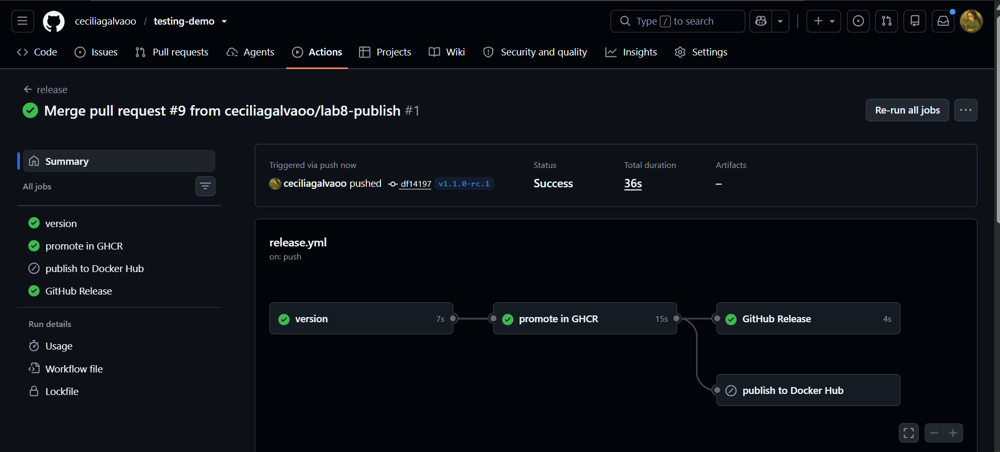

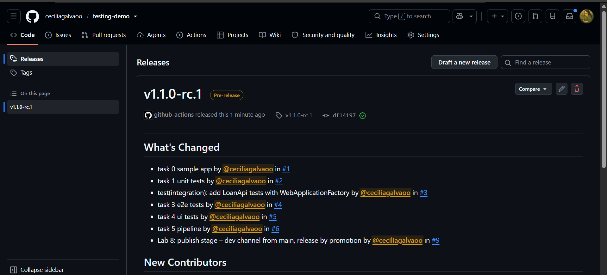

The release notes were generated from the merged pull requests (#1–#6 from Lab 7 and #9 from this lab), because this is the first GitHub Release of the repository. The new rc names point at the same manifest as the dev image:

```text
$ docker buildx imagetools inspect ghcr.io/ceciliagalvaoo/testing-demo/lendit-dotnet:<tag> | grep -i '^Digest'
1.1.0-rc.1   Digest:    sha256:80bcb1576e44755446d93f823fc20f7c3d95fdbf43c289cfac3338b3ffc5ca74
rc           Digest:    sha256:80bcb1576e44755446d93f823fc20f7c3d95fdbf43c289cfac3338b3ffc5ca74
```

This confirms the `--prefer-index=false` fix in the real pipeline: without it, `1.1.0-rc.1` would have received a new index digest.

#### Step 3 – release `v1.1.0` on the same commit

```text
$ git tag -a v1.1.0 -m "Release 1.1.0"                  # again on df14197
$ git push origin v1.1.0
```

The run stopped before `promote in GHCR` and waited for a reviewer of `production`. Nothing was published until the approval:

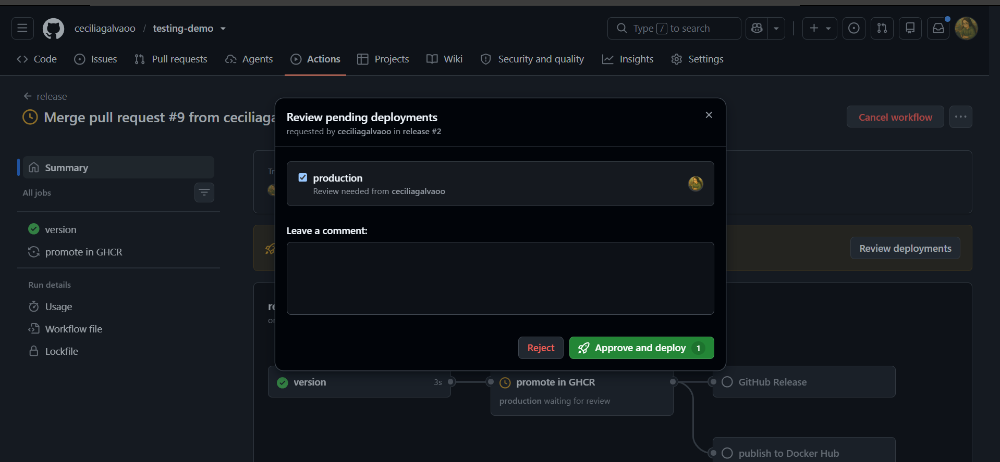

Because **two** jobs declare `environment: production` (`promote in GHCR` and `publish to Docker Hub`), GitHub asks for an approval **per job**. The second request appeared after the GHCR promotion had finished:

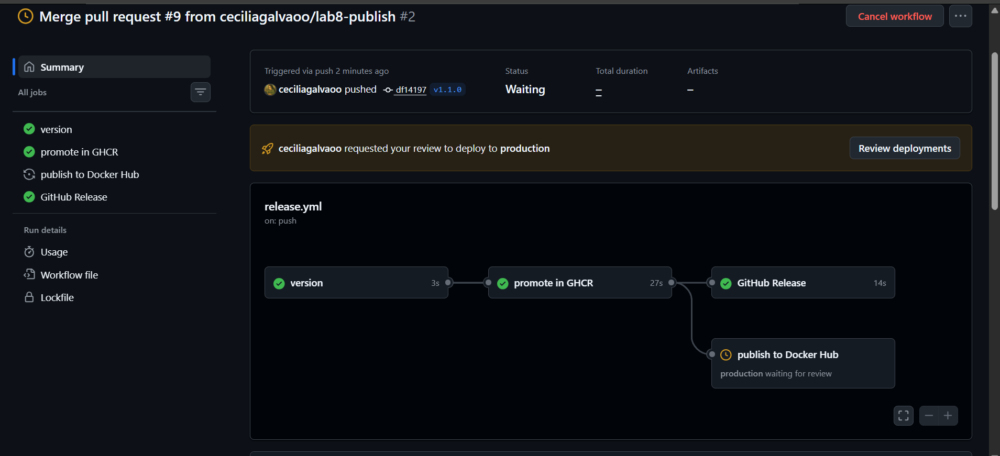

The screenshot also shows a design weakness of the workflow from the sheet. `GitHub Release` depends only on `promote in GHCR`, so the GitHub Release was already published while the Docker Hub job was still waiting. A stricter version would add `publish-dockerhub` to the `needs:` of `github-release` (with `if: always() && …` so that the rc still gets its release when the Docker Hub job is skipped).

**A real failure on the first attempt:** `publish to Docker Hub` failed after 4 s:

```text
Run docker/login-action@v3
  username: ceciliagalvaoo
##[error]Password required
```

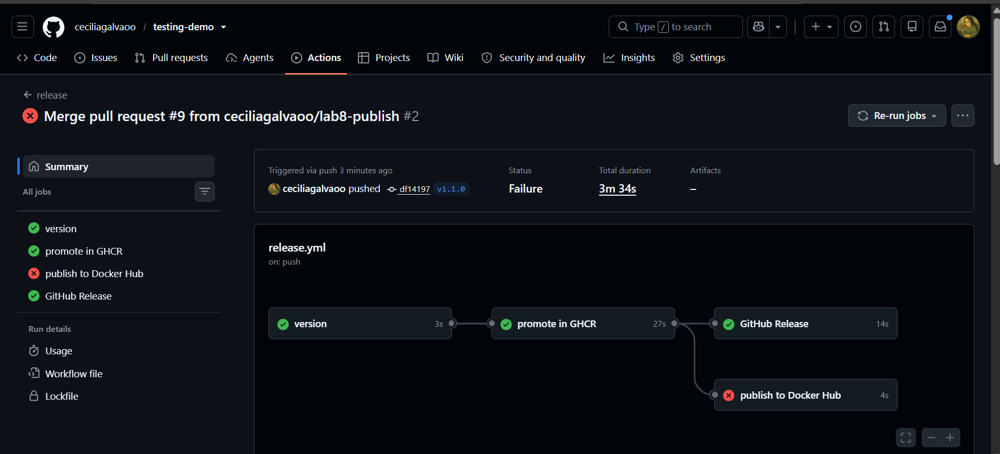

The cause: `DOCKERHUB_TOKEN` had been set with `gh secret set DOCKERHUB_TOKEN --env production` from a **non-interactive** shell. With no terminal, `gh` could not prompt for the value and stored an **empty** secret without any error, and the GitHub UI only shows that a secret exists, never its value. The fix was to paste the token in Settings → Environments → production → `DOCKERHUB_TOKEN` → *Update secret*, and then **Re-run failed jobs**: the same tag and the same commit, nothing rebuilt, approved again.

Two good properties showed up:
- The failure stopped the job **before** any push, so nothing was half-published.
- Re-running a release is safe, because promotion is idempotent: it only adds names to an existing digest.

The re-run succeeded:

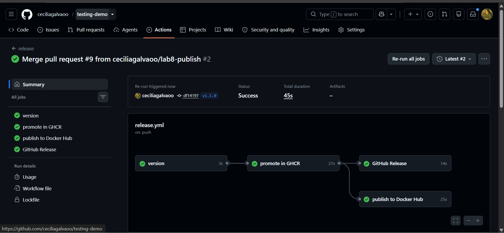

Docker Hub received `1.1.0`, `1.1`, `1` and `latest`, with digest `80bcb1576e44…`:

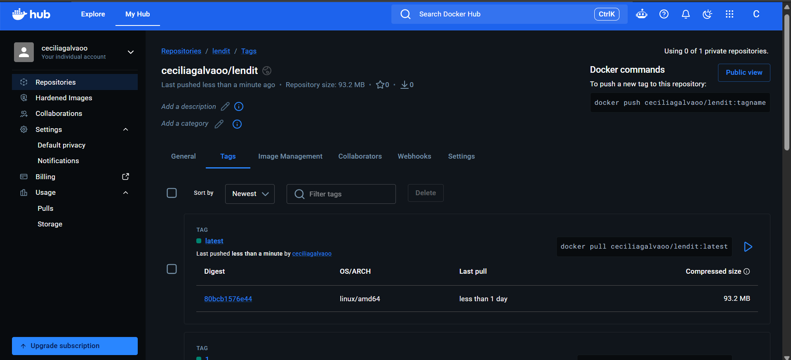

**The central evidence of the lab: one digest from the tested commit to production, in both registries:**

```text
# GHCR (tested image + dev + rc + release names)
lendit-dotnet:df141973d2573065358a091e62de5059d78bfc87 sha256:80bcb1576e44755446d93f823fc20f7c3d95fdbf43c289cfac3338b3ffc5ca74
lendit-dotnet:dev                          sha256:80bcb1576e44755446d93f823fc20f7c3d95fdbf43c289cfac3338b3ffc5ca74
lendit-dotnet:1.1.0-rc.1                   sha256:80bcb1576e44755446d93f823fc20f7c3d95fdbf43c289cfac3338b3ffc5ca74
lendit-dotnet:1.1.0                        sha256:80bcb1576e44755446d93f823fc20f7c3d95fdbf43c289cfac3338b3ffc5ca74
lendit-dotnet:1.1                          sha256:80bcb1576e44755446d93f823fc20f7c3d95fdbf43c289cfac3338b3ffc5ca74
lendit-dotnet:1                            sha256:80bcb1576e44755446d93f823fc20f7c3d95fdbf43c289cfac3338b3ffc5ca74
lendit-dotnet:latest                       sha256:80bcb1576e44755446d93f823fc20f7c3d95fdbf43c289cfac3338b3ffc5ca74
# Docker Hub
lendit:1.1.0                               sha256:80bcb1576e44755446d93f823fc20f7c3d95fdbf43c289cfac3338b3ffc5ca74
lendit:1.1                                 sha256:80bcb1576e44755446d93f823fc20f7c3d95fdbf43c289cfac3338b3ffc5ca74
lendit:1                                   sha256:80bcb1576e44755446d93f823fc20f7c3d95fdbf43c289cfac3338b3ffc5ca74
lendit:latest                              sha256:80bcb1576e44755446d93f823fc20f7c3d95fdbf43c289cfac3338b3ffc5ca74
```

The same digest is visible in the web UIs: `sha256:80bcb1576e44…` on the GHCR package page (screenshot 03, above) and `80bcb1576e44` for the Docker Hub tags (screenshot 09).

Even the `pull` → `tag` → `push` copy to Docker Hub kept the digest. The runner pushed the manifest it had pulled unchanged, because the classic image store keeps the original compressed layers. Docker Hub shows 93.2 MB: that is the **compressed** size, while the 230 MB from 2.6 is the unpacked size on disk.

#### Step 4 – a release of a commit that never ran on `main`

```text
$ git switch -c demo/untested
$ git commit --allow-empty -m "demo: commit that never ran on main"
$ git tag -a v1.1.1-rc.1 -m "untested"
$ git push origin v1.1.1-rc.1                 # pushes the tag and its commit, but not to main
```

`version` accepted the tag (`1.1.1-rc.1`, channel `rc`). `promote in GHCR` then refused to release something the pipeline had never seen:

```text
Error: No tested image for commit fa011c4d5b9f94c0bc1703efa5e7214e6dee83ee. Tag a commit that has passed the pipeline on main.
Error: Process completed with exit code 1.
```

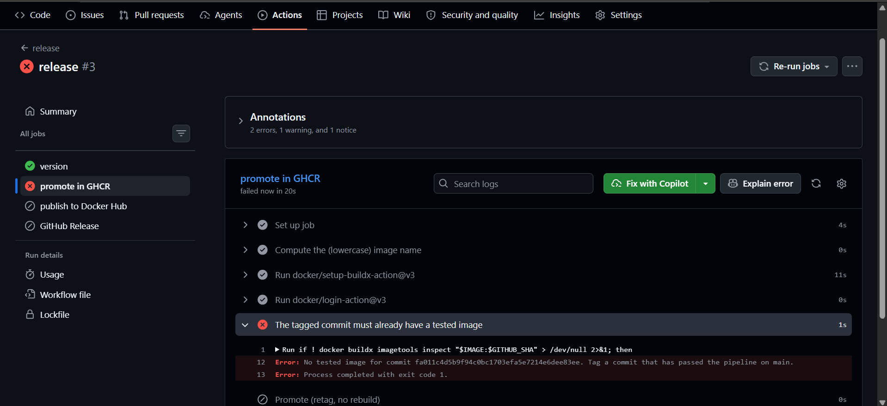

The step `Promote (retag, no rebuild)` and the jobs `publish to Docker Hub` and `GitHub Release` did not run, so no tag, image or release was created. The test tag was deleted afterwards: `git push origin :refs/tags/v1.1.1-rc.1` (allowed because admins bypass the tag ruleset).

#### Step 5 – anonymous pull

Done with an empty Docker configuration (`DOCKER_CONFIG` pointing to a new folder with `{}`), which is the same as a computer that is not logged in:

```text
$ docker pull ghcr.io/ceciliagalvaoo/testing-demo/lendit-dotnet:dev        # anonymous, private GHCR package
Error response from daemon: Head "https://ghcr.io/v2/ceciliagalvaoo/testing-demo/lendit-dotnet/manifests/dev": unauthorized
$ docker pull ceciliagalvaoo/lendit:1.1.0                                    # anonymous, public Docker Hub
Digest: sha256:80bcb1576e44755446d93f823fc20f7c3d95fdbf43c289cfac3338b3ffc5ca74
Status: Downloaded newer image for ceciliagalvaoo/lendit:1.1.0
docker.io/ceciliagalvaoo/lendit:1.1.0
```

The test channel is private, the release is public, and what an anonymous user downloads from Docker Hub is the tested digest `80bcb157…`.

### Questions

**1. Why does `release.yml` not build the image?**
Because a build is not reproducible: the base image tag `aspnet:10.0` moves, NuGet resolves again, timestamps change. A rebuild for production would ship bytes that no test has seen. By only adding names to `:<sha>`, the release is **provably the tested artifact**: the same digest went through unit, integration, E2E, UI and scan, and anybody can check it with `imagetools inspect`. It also makes a release fast (seconds) and lets it fail fast when there is no tested image.
The costs:
- Every release depends on an earlier green run of exactly that commit on `main`.
- The scan result is from build time, not release time.
- The image **cannot carry its release version inside it**: whatever is baked in at build time (an `org.opencontainers.image.version` label, `AssemblyInformationalVersion`, a `/version` endpoint) was decided before anybody knew it would become `1.1.0`. It can only say `0.3.0-dev.57` or the commit SHA.

How to handle it:
- Bake in only what *is* known and immutable, the **commit SHA** (label `org.opencontainers.image.revision`, a `/version` endpoint returning the SHA), and let the registry tags and the GitHub Release map version ↔ SHA ↔ digest.
- Or give the version to the container at **runtime** (`APP_VERSION=1.1.0` set by the deployment manifest that pins the digest).
- Or decide the version *before* the build (build on an `rc` tag, and the final release only promotes that rc image).

**2. Why is `imagetools create` better than `pull` + `tag` + `push` inside one registry?**
It runs **server-side**. Only a small manifest is uploaded, and the registry already has the layers, so nothing is downloaded or re-uploaded and the runner needs no disk space or Docker daemon. It also keeps **multi-platform** images intact: `docker pull` downloads only the runner's platform, so `pull`/`tag`/`push` would silently publish an amd64-only image. Finally, it guarantees the content is not re-serialized. `push` re-creates the manifest from the local image store, and with the containerd image store or re-compression the digest can change. As shown above, even `imagetools` needs `--prefer-index=false` to keep the digest of a single-platform image identical.

**3. Which secrets exist, where are they stored, who can read them?**

| Secret | Stored | Lifetime | Readable by |
|---|---|---|---|
| `GITHUB_TOKEN` | created by GitHub per job | one job | every job, with only the `permissions:` it declares. `packages: write`: `e2e`, `publish-test`, `promote-ghcr`, and the `nuget`/`maven`/`npm` jobs. `contents: write`: only `github-release`. Everything else: `contents: read` |
| `DOCKERHUB_TOKEN` | **environment secret** of `production` (`testing-demo`) | until revoked on Docker Hub (Read & Write, no Delete) | only jobs with `environment: production`, i.e. `promote-ghcr`/`publish-dockerhub` on a `v*` tag, **after approval**. Not readable from `test`, from branches or from pull requests |
| `DOCKERHUB_USERNAME` | environment **variable** of `production` (not secret) | – | same jobs |
| `gh` OAuth token (laptop) | `~/.config/gh/hosts.yml`, and the Windows Credential Manager after `docker login` | until revoked; scopes include `write:packages` | me, on this machine; never in a repository |
| Registry/Verdaccio passwords (Task 4) | `~/lab8/registry/.ci-pass`, `.deploy-pass` (`chmod 600`), bcrypt hashes in `auth/htpasswd` | lab only | me, on this machine |

`publish-demo` has no stored secrets at all: all three registries take the `GITHUB_TOKEN`.

**4. What could an attacker with write access to a feature branch do?**
They **can** push a modified workflow to their branch and run it (a `push` or `workflow_dispatch`), and that run gets a `GITHUB_TOKEN` with whatever `permissions:` their YAML asks for, including `packages: write`. Honestly, that means they could push to the GHCR package and even move tags like `dev` or `latest`: GHCR has no tag immutability, and the repository's Actions have write access to it. They **cannot**:
- read `DOCKERHUB_TOKEN`: the `production` environment only accepts refs matching `v*`, so a job on a branch that declares `environment: production` is rejected before it starts;
- get past the required reviewer;
- create or move a `v*` tag: the tag ruleset allows only admins;
- get their change into `main` without a pull request with the required checks (the `main-protection` branch ruleset).

So the public, consumed copy of a release (Docker Hub) and the release decision are out of their reach. To also protect the GHCR release tags: deploy by **digest**, keep write access to the repository small, and/or keep release images in a separate registry or repository whose credential lives only in `production`.

**5. What is the risk of floating tags, and why are exact versions still available?**
A floating tag moves without any change on the consumer side. `1` jumps from `1.1.0` to `1.2.0`, so a deployment of `:1` changes behaviour on the next pull, nodes with cached copies drift apart, and one bad (or malicious) push to `latest` reaches everybody at once. The exact versions stay because promotion **adds** names and never removes or rewrites the exact one: every release run creates `X.Y.Z` (and it is never pushed again), the `:<sha>` tag stays, and the digest cannot change. The floating names are pointers for humans ("the newest 1.1 patch"); deployments use `X.Y.Z` or `@sha256:…`.

---

## Task 3 – Publishing native packages: NuGet, Maven, npm

### 3.1 NuGet

[`LendIt.Pricing.csproj`](https://github.com/ceciliagalvaoo/publish-demo/blob/main/dotnet-lib/src/LendIt.Pricing/LendIt.Pricing.csproj) contains the package metadata from the sheet (`PackageId`, `Version` 1.0.0 overridden by `-p:Version`, authors, MIT, README, `RepositoryUrl` → `publish-demo`).

```text
$ dotnet pack src/LendIt.Pricing -c Release -p:Version=1.0.0-dev.1 -o out
$ unzip -l out/LendIt.Pricing.1.0.0-dev.1.nupkg
     477  _rels/.rels
     622  LendIt.Pricing.nuspec
     189  README.md
    4608  lib/net10.0/LendIt.Pricing.dll
     520  [Content_Types].xml
     637  package/services/metadata/core-properties/nuget.psmdcp
```

- **The `.dll`** is in `lib/<target framework>/` (`lib/net10.0/LendIt.Pricing.dll`), which is where NuGet looks for the assembly that matches the consumer's framework.
- **The metadata** is in `LendIt.Pricing.nuspec` (id, `<version>1.0.0-dev.1</version>`, authors, license expression, readme, `<repository url="https://github.com/ceciliagalvaoo/publish-demo">`, dependency groups) and in the OPC files `nuget.psmdcp`, `.rels` and `[Content_Types].xml`.
- **Nothing that should not be there:** no tests, no `.pdb` (symbols would go into a separate `.snupkg`), no source code and no configuration. The README is included on purpose.

```text
$ dotnet nuget push "out/*.nupkg" --source https://nuget.pkg.github.com/ceciliagalvaoo/index.json --api-key "***" --skip-duplicate
  PUT https://nuget.pkg.github.com/ceciliagalvaoo/
  OK https://nuget.pkg.github.com/ceciliagalvaoo/ 729ms
Your package was pushed.
$ (the same command again)
  Conflict https://nuget.pkg.github.com/ceciliagalvaoo/ 438ms
Package '…/LendIt.Pricing.1.0.0-dev.1.nupkg' already exists at feed 'https://nuget.pkg.github.com/ceciliagalvaoo'.
$ (again WITHOUT --skip-duplicate)
error: Response status code does not indicate success: 409 (Conflict).
```

The registry refuses to overwrite a version (immutability); `--skip-duplicate` only turns the 409 into a non-error.

The consumer, [`consumers/dotnet`](https://github.com/ceciliagalvaoo/publish-demo/tree/main/consumers/dotnet), has a `nuget.config` with `ClearTextPassword="%GITHUB_TOKEN%"`, so the token comes from the environment and is not in the file. It also has the **package source mapping** (`LendIt.*` only from `github`, everything else from `nuget.org`):

```text
$ dotnet add package LendIt.Pricing                   # stable versions only
error: There are no stable versions available, 1.0.0-dev.1 is the best available. Consider adding the --prerelease option
$ dotnet add package LendIt.Pricing --prerelease
info : PackageReference for package 'LendIt.Pricing' version '1.0.0-dev.1' added to file '…/Consumer.csproj'.
$ dotnet run
Late fee for 20 days: 3.00
```

### 3.2 Maven

[`java-lib/pom.xml`](https://github.com/ceciliagalvaoo/publish-demo/blob/main/java-lib/pom.xml) is the one from the sheet (coordinates `hr.lendit:lendit-pricing`, metadata, `maven-source-plugin`, `distributionManagement` with `<id>github</id>`). The credentials are in `~/.m2/settings.xml` on the laptop (not committed), and that file holds only `${env.GITHUB_ACTOR}` / `${env.GITHUB_TOKEN}`, no secret.

```text
$ ./mvnw -B versions:set -DnewVersion=1.0.0-dev.1 -DgenerateBackupPoms=false
$ ./mvnw -B verify
[INFO] Tests run: 4, Failures: 0, Errors: 0, Skipped: 0
[INFO] Building jar: …/target/lendit-pricing-1.0.0-dev.1.jar
[INFO] Building jar: …/target/lendit-pricing-1.0.0-dev.1-sources.jar
$ unzip -l target/lendit-pricing-1.0.0-dev.1.jar
       99  META-INF/MANIFEST.MF
      754  hr/lendit/pricing/LateFee.class
     1877  META-INF/maven/hr.lendit/lendit-pricing/pom.xml
       64  META-INF/maven/hr.lendit/lendit-pricing/pom.properties
$ ./mvnw -B deploy
[INFO] Tests run: 4, Failures: 0, Errors: 0, Skipped: 0
[INFO] BUILD SUCCESS
$ ./mvnw -B deploy        # the same version again
[ERROR] … Could not transfer artifact hr.lendit:lendit-pricing:pom:1.0.0-dev.1 from/to github (https://maven.pkg.github.com/ceciliagalvaoo/publish-demo): HTTP Status: 409
```

The consumer, [`consumers/maven`](https://github.com/ceciliagalvaoo/publish-demo/tree/main/consumers/maven), declares the GitHub repository and the **exact** version. To prove that the artifact really comes from GitHub Packages, the local copy that `deploy` had installed was deleted first:

```text
$ rm -rf ~/.m2/repository/hr/lendit && ./mvnw -B package
[INFO] Downloaded from github: https://maven.pkg.github.com/ceciliagalvaoo/publish-demo/hr/lendit/lendit-pricing/1.0.0-dev.1/lendit-pricing-1.0.0-dev.1.pom
[INFO] Downloaded from github: https://maven.pkg.github.com/ceciliagalvaoo/publish-demo/hr/lendit/lendit-pricing/1.0.0-dev.1/lendit-pricing-1.0.0-dev.1.jar
[INFO] BUILD SUCCESS
$ java -cp target/classes:<the downloaded jar> hr.lendit.consumer.Main
Late fee for 20 days: 3.00
```

### 3.3 npm

[`js-lib/package.json`](https://github.com/ceciliagalvaoo/publish-demo/blob/main/js-lib/package.json) uses the scoped name `@ceciliagalvaoo/lendit-pricing` and `"files": ["index.js", "README.md"]`. `js-lib/.npmrc` is committed without a secret (`_authToken=${GITHUB_TOKEN}`).

```text
$ npm pack --dry-run
npm notice 210B README.md
npm notice 170B index.js
npm notice 379B package.json
npm notice total files: 3
```

Nothing that should not be public: `index.test.js` and `.npmrc` are **not** in the package.

```text
$ npm version 1.0.0-dev.1 --no-git-tag-version
v1.0.0-dev.1
$ npm publish --tag dev
npm notice Publishing to https://npm.pkg.github.com with tag dev and default access
+ @ceciliagalvaoo/lendit-pricing@1.0.0-dev.1
$ npm view @ceciliagalvaoo/lendit-pricing dist-tags versions
(no output, exit 0)
$ npm view @ceciliagalvaoo/lendit-pricing@dev dist-tags versions
dist-tags = { dev: '1.0.0-dev.1' }
versions = '1.0.0-dev.1'
```

An observation: `npm view <pkg>` without a version means `<pkg>@latest`, and because only the `dev` dist-tag exists, it prints nothing. For the same reason, the consumer [`consumers/node`](https://github.com/ceciliagalvaoo/publish-demo/tree/main/consumers/node) cannot install the package without a tag, which is the safe outcome:

```text
$ npm install @ceciliagalvaoo/lendit-pricing
npm error code ETARGET
npm error notarget No matching version found for @ceciliagalvaoo/lendit-pricing@*.
$ npm install @ceciliagalvaoo/lendit-pricing@dev
added 1 package, and audited 2 packages in 1s
$ npm start
Late fee for 20 days: 3
```

All three packages are linked to the `publish-demo` repository: GitHub Packages shows `repo=ceciliagalvaoo/publish-demo` for `LendIt.Pricing`, `hr.lendit.lendit-pricing` and `lendit-pricing`. That is what allows the workflow's `GITHUB_TOKEN` to publish new versions.

### 3.4 One pipeline for the three packages

[`.github/workflows/publish-packages.yml`](https://github.com/ceciliagalvaoo/publish-demo/blob/main/.github/workflows/publish-packages.yml) is the workflow from the sheet, with these changes:
- `concurrency` per ref, never cancelled, so two publishes of the same ref cannot interleave;
- the version is written to the run summary;
- `npm version … --allow-same-version`, so the release cannot fail when the computed version equals the one in `package.json`;
- `GITHUB_TOKEN` is also set in the npm publish step, because the committed `js-lib/.npmrc` reads `${GITHUB_TOKEN}` and has priority over the `.npmrc` that `setup-node` writes.

Every job tests before it publishes, and the channel decides the environment (`test` / `production`) and the npm dist-tag (`dev` / `next` / `latest`).

The plan was to put the baseline tag `v1.0.0` on `854af43` (the last library commit, before the workflow existed, so that the tag itself publishes nothing). The first pipeline run on `main` would then be `1.1.0-dev.N`, as in the sheet.

**What actually happened on the first run.** The tag had been created locally but not pushed (`git ls-remote --tags origin` was empty). `version.sh` found no `v*` tag and fell back to `v0.0.0`, so run #1 published **`0.1.0-dev.1`** of all three packages. This is the "no tags visible" case from Task 1 (the same symptom as a shallow checkout without `fetch-depth: 0`):

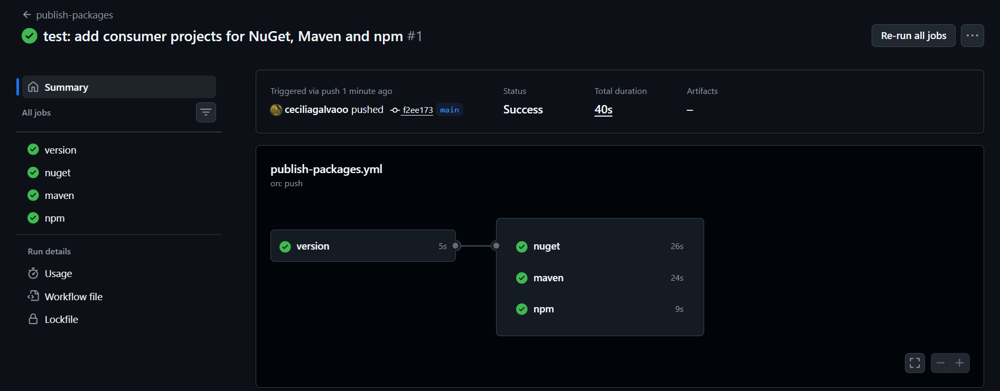

The fix needed no new commit. After `git push origin v1.0.0` and *Re-run all jobs* (same commit `f2ee173`, same run number 1), the version became `1.1.0-dev.1`:

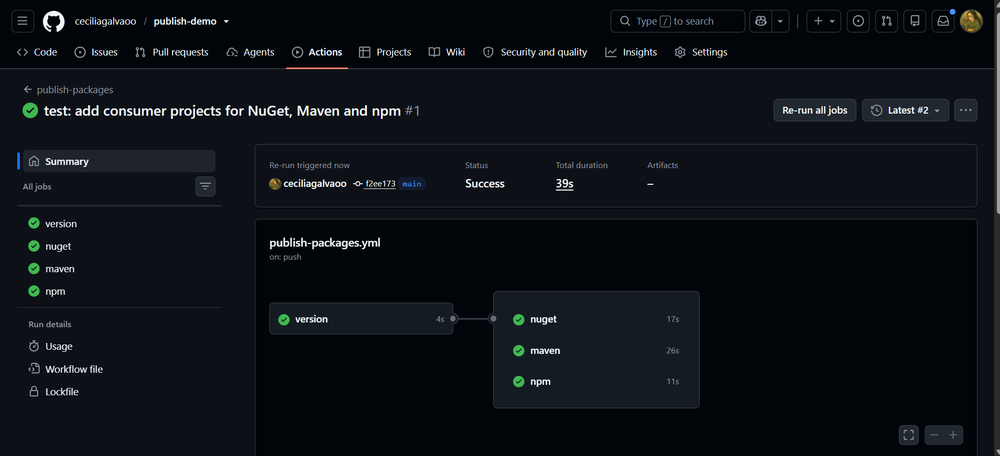

```text
$ git ls-remote --tags origin
dd9e8f08e644591f1d38475cae9f616b8ded944e  refs/tags/v1.0.0
854af4360793c04504c3fbf184710c171c1b7af5  refs/tags/v1.0.0^{}
$ gh api /users/ceciliagalvaoo/packages/<type>/<name>/versions --jq '[.[].name]'
nuget/LendIt.Pricing            1.1.0-dev.1, 0.1.0-dev.1, 1.0.0-dev.1
maven/hr.lendit.lendit-pricing  1.1.0-dev.1, 0.1.0-dev.1, 1.0.0-dev.1
npm/lendit-pricing              1.1.0-dev.1, 0.1.0-dev.1, 1.0.0-dev.1
```

The stray `0.1.0-dev.1` was left in place. It is a dev pre-release that no stable consumer resolves, versions are immutable, and the retention policy (4.5) removes old dev versions anyway. `1.0.0-dev.1` is the manual publication from 3.1–3.3.

| Run | Event | Versions published (NuGet, Maven, npm) | npm dist-tag | Environment |
|---|---|---|---|---|
| #1 (re-run) | push to `main` (`f2ee173`) | `1.1.0-dev.1` | `dev` | `test` |
| #2 | tag `v1.1.0-rc.1` (`f2ee173`) | `1.1.0-rc.1` | `next` | `test` |
| #3 | tag `v1.1.0` (`f2ee173`) | `1.1.0` | `latest` | `production` (approval) |

**rc** (no approval needed):

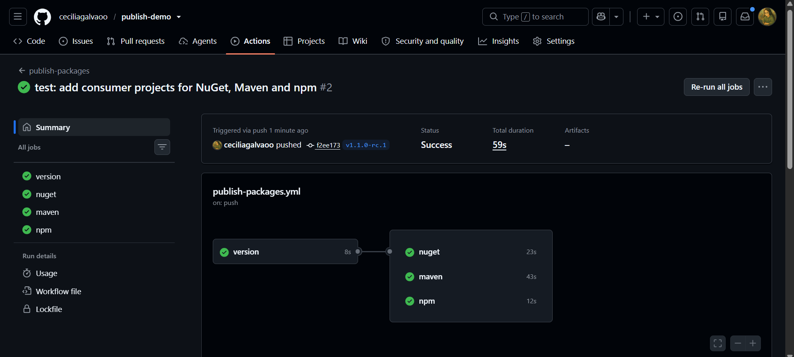

**release:** all three publish jobs declare `environment: production`, so the run waited for one review that covered the three jobs:

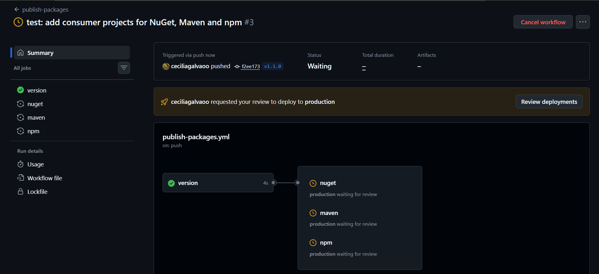

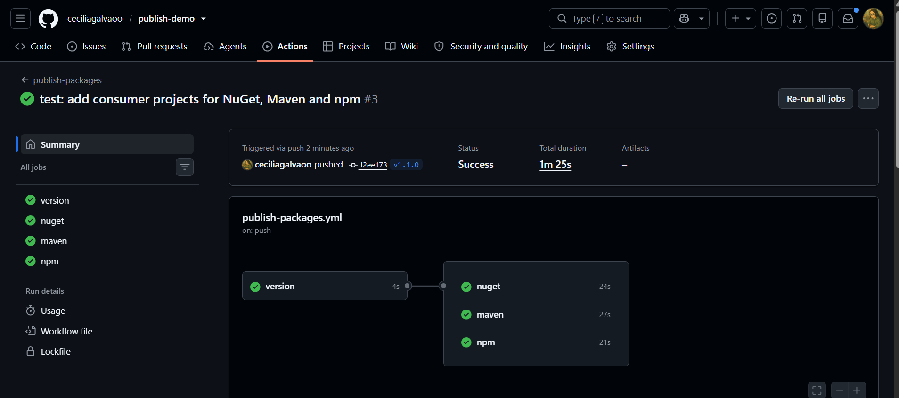

The npm package page on GitHub Packages, with `1.1.0` marked *Latest* and the rc and dev versions below it:

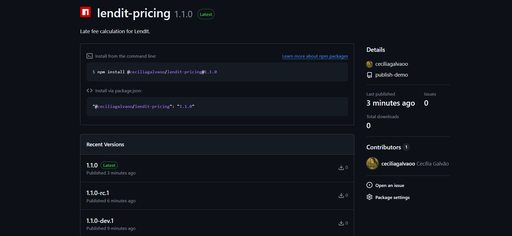

```text
$ npm view @ceciliagalvaoo/lendit-pricing dist-tags versions
dist-tags = { dev: '1.1.0-dev.1', latest: '1.1.0', next: '1.1.0-rc.1' }
versions = [ '0.1.0-dev.1', '1.0.0-dev.1', '1.1.0-dev.1', '1.1.0-rc.1', '1.1.0' ]

$ for p in nuget/LendIt.Pricing maven/hr.lendit.lendit-pricing; do gh api /users/ceciliagalvaoo/packages/$p/versions --jq '[.[].name]'; done
nuget/LendIt.Pricing            1.1.0, 1.1.0-rc.1, 1.1.0-dev.1, 0.1.0-dev.1, 1.0.0-dev.1
maven/hr.lendit.lendit-pricing  1.1.0, 1.1.0-rc.1, 1.1.0-dev.1, 0.1.0-dev.1, 1.0.0-dev.1
```

Each channel has its own npm dist-tag, and `latest` was only set by the release run.

**The consumers after the release.** These were run in throw-away copies of `consumers/`, so the committed projects still show the dev case from 3.1–3.3:

```text
## NuGet
$ dotnet add package LendIt.Pricing                   # stable only, now that 1.1.0 exists
info : PackageReference for package 'LendIt.Pricing' version '1.1.0' updated in file 'Consumer.csproj'.
$ dotnet run
Late fee for 20 days: 3.00

## npm
$ npm install @ceciliagalvaoo/lendit-pricing          # = @latest
added 1 package, and audited 2 packages in 1s
$ npm ls
└── @ceciliagalvaoo/lendit-pricing@1.1.0
$ npm install @ceciliagalvaoo/lendit-pricing@next     # the rc channel
$ npm ls
└── @ceciliagalvaoo/lendit-pricing@1.1.0-rc.1

## Maven (pom.xml: <version>1.1.0</version>)
$ ./mvnw -B package
[INFO] Downloaded from github: https://maven.pkg.github.com/ceciliagalvaoo/publish-demo/hr/lendit/lendit-pricing/1.1.0/lendit-pricing-1.1.0.jar
[INFO] BUILD SUCCESS
$ java -cp target/classes:<lendit-pricing-1.1.0.jar> hr.lendit.consumer.Main
Late fee for 20 days: 3.00
```

The same `dotnet add package LendIt.Pricing` that failed in 3.1 ("There are no stable versions available") now picks `1.1.0`. The same `npm install` that failed with `ETARGET` in 3.3 now installs `1.1.0`. Opting in is per channel: `--prerelease` for NuGet, `@next`/`@dev` for npm, the exact version for Maven.

**Why are packages rebuilt for each version, while images are promoted?** Because the version is **inside** the package bytes:
- `.nupkg`: in the `.nuspec` (and in the file name, and in the assembly attributes `AssemblyInformationalVersion`/`FileVersion` of the `.dll`);
- `.jar`: in `META-INF/maven/…/pom.xml` and `pom.properties`, and in the uploaded `.pom`;
- npm: in `package.json` inside the tarball.

The registry reads the version from that metadata, so `1.1.0-rc.1` and `1.1.0` are necessarily different files. An image's name lives *outside* the content (a tag is a pointer to a digest), which is why only images can be promoted without a rebuild. The pipeline compensates by building every channel from the same commit and running the tests again in every job.

### 3.5 Public registries

Nothing was published to Maven Central, nuget.org or npmjs.com, as the sheet requires.

### Questions

**1. Which fields contain the version, and where does the pipeline set it?**

| Format | Field | Set by the pipeline with |
|---|---|---|
| NuGet | `<version>` in the `.nuspec`, generated from MSBuild `Version` (`<Version>` in the `.csproj`) | `dotnet pack -p:Version="$VERSION"` |
| Maven | `<version>` in `pom.xml` (copied into the jar's `META-INF/maven/…/pom.properties`) | `./mvnw versions:set -DnewVersion="$VERSION"` |
| npm | `"version"` in `package.json` | `npm version "$VERSION" --no-git-tag-version` |

In all three cases `$VERSION` is the output of `version.sh` from the `version` job, so nobody types it.

**2. How do consumers opt in to test versions, and which default is the most dangerous?**
- NuGet: `--prerelease`, an exact pre-release version, or a range or float that names a pre-release (`1.1.0-*`). Without it, pre-releases are invisible (shown above).
- Maven: there is no "newest" at all. The consumer writes the exact version, e.g. `1.1.0-dev.57`; for `-SNAPSHOT` versions, snapshots must also be enabled on the repository.
- npm: the dist-tag or the version, `@dev`, `@next` or `@1.1.0-dev.57`.

**npm has the most dangerous default**, on the *publishing* side: `npm publish` without `--tag` sets `latest`, so one forgotten flag turns a dev build into what everybody's `npm install` gets. Task 4.6 showed a related effect: the very first publish to Verdaccio became `latest` even *with* `--tag next`, because a package must have a `latest`.

**3. Why does GitHub Packages require authentication even to read?**
Measured, without a token: `401` for the Maven, NuGet and npm endpoints of `publish-demo`, although the repository and the Maven package are public. GitHub's Maven/NuGet/npm registries tie every request to a GitHub identity (for permissions, abuse and rate-limit control, and because the registries are per owner and not one global namespace). GHCR is the exception: public images can be pulled anonymously. The cost for open-source consumers: everyone, including other projects' CI, needs a GitHub account and a PAT with `read:packages`, configured in `nuget.config`, `settings.xml` or `.npmrc` and stored as a secret. That is friction, and it spreads long-lived tokens around. For open source I would publish releases to the public ecosystem registries (**nuget.org, Maven Central, npmjs.com**), which allow anonymous download, and keep GitHub Packages for dev/rc channels and internal consumers.

**4. What does `files` in `package.json` protect against?**
Against publishing more than intended. Without a whitelist (or `.npmignore`), npm packs almost everything in the folder: tests, fixtures, `.env` files, a local `.npmrc` with a real `_authToken`, build output, notes. Public npm versions cannot be fully withdrawn, so a leaked token in a tarball stays downloadable. With `"files"`, the dry run shows exactly 3 files.

**5. What is dependency confusion?**
An attacker publishes a package on a **public** registry with the same name as an internal package (often with a higher version). A build that searches several sources and picks the highest version installs the attacker's package and runs its code (npm install scripts, MSBuild targets).
- **NuGet:** prevented by **package source mapping** in `nuget.config` (`<packageSourceMapping>`: `LendIt.*` may come only from `github`). It is in `consumers/dotnet/nuget.config`.
- **npm:** use **scoped names** (`@ceciliagalvaoo/…`) and map the scope to exactly one registry (`@ceciliagalvaoo:registry=https://npm.pkg.github.com` in `.npmrc`), so npm never asks npmjs.org for that scope. Also own the scope on npmjs.com, so nobody else can publish into it. In a proxying registry (Verdaccio, Task 4.6), the scope has **no `proxy:`**, so it is never looked up upstream.

---

## Task 4 – A self-hosted registry and its security

The registries ran locally in `~/lab8/` (Linux file system, outside every repository: it contains the private key and the passwords).

### 4.1 The dangerous way

```text
$ docker run -d --name registry-insecure -p 5000:5000 registry:3
$ docker tag alpine:3.20 localhost:5000/demo/alpine:1.0 && docker push localhost:5000/demo/alpine:1.0
1.0: digest: sha256:6c2a9711b0a9f32b0239d9222eb1072309cf46c6431d319ae249186d811a987c size: 527
$ curl http://localhost:5000/v2/_catalog
{"repositories":["demo/alpine"]}
$ curl http://localhost:5000/v2/demo/alpine/tags/list
{"name":"demo/alpine","tags":["1.0"]}

# the quiet attack: anyone overwrites the tag 1.0 with a different image
$ docker tag busybox:1.37 localhost:5000/demo/alpine:1.0 && docker push localhost:5000/demo/alpine:1.0
1.0: digest: sha256:63bb1322b9692d0a4ba0084a8168277d767a73048fc79a4869b912fe32d26bee size: 527
$ docker rm -f registry-insecure
```

No login and no TLS, the catalogue is readable by anyone, and `1.0` now points at a completely different image without any warning. Everyone who pulls `:1.0` from now on runs busybox.

### 4.2 TLS and authentication

```text
$ openssl req -x509 -newkey rsa:4096 -sha256 -days 365 -nodes -keyout certs/registry.key -out certs/registry.crt \
    -subj "/CN=localhost" -addext "subjectAltName=DNS:localhost,IP:127.0.0.1"
$ openssl x509 -in certs/registry.crt -noout -subject -ext subjectAltName -enddate
subject=CN = localhost
X509v3 Subject Alternative Name:
    DNS:localhost, IP Address:127.0.0.1
notAfter=Nov 17 22:06:15 2027 GMT
$ cut -c1-30 auth/htpasswd
ci-user:$2y$05$g2mt7fETgty33Z3…
deploy-user:$2y$05$oOI1shtE96s…
```

Deviation: the users were created with `htpasswd -Bbn <user> "$(cat .ci-pass)"`, because this shell is not interactive (`-it` and a password prompt are not possible). The passwords are random throw-away values (`openssl rand -hex 12`), stored in `chmod 600` files and never typed on a command line. The `$2y$` prefix shows the bcrypt hashes. The registry was started with the exact `docker run` from the sheet (TLS, `REGISTRY_AUTH=htpasswd`, `REGISTRY_STORAGE_DELETE_ENABLED=true`).

**Trusting the certificate, a finding.** Step 4 (copying `registry.crt` to `/etc/docker/certs.d/localhost:5443/`) turned out **not to be needed**, and the reason is worth knowing. `docker login localhost:5443` succeeded at once, because the Docker daemon treats loopback addresses as *insecure registries* by default and does **not verify certificates** for them:

```text
$ docker info | grep -A2 "Insecure Registries"
 Insecure Registries:
  ::1/128
  127.0.0.0/8
```

So against `localhost` the daemon gives no x509 error, and on a real host name the `certs.d` step is mandatory. `curl` does verify, and it shows that TLS works and that an untrusted certificate is rejected:

```text
$ curl -s -o /dev/null -w "%{http_code}\n" --cacert certs/registry.crt https://localhost:5443/v2/     # no credentials
401
$ curl https://localhost:5443/v2/                       # without trusting the self-signed certificate
curl: (60) SSL certificate problem: self-signed certificate
$ curl http://localhost:5443/v2/                        # plain HTTP to the TLS port
Client sent an HTTP request to an HTTPS server.
```

### 4.3 Access control

```text
$ docker push localhost:5443/demo/alpine:1.0                 # not logged in
no basic auth credentials
$ docker login localhost:5443 -u ci-user
Login Succeeded
$ docker push localhost:5443/demo/alpine:1.0                 # as ci-user
1.0: digest: sha256:6c2a9711b0a9f32b0239d9222eb1072309cf46c6431d319ae249186d811a987c size: 527
$ docker logout localhost:5443
$ docker login localhost:5443 -u deploy-user
Login Succeeded
$ docker pull localhost:5443/demo/alpine:1.0                 # as deploy-user
Status: Downloaded newer image for localhost:5443/demo/alpine:1.0
$ curl --cacert certs/registry.crt -u deploy-user https://localhost:5443/v2/_catalog     # password prompted
{"repositories":["demo/alpine"]}
$ curl --cacert certs/registry.crt -u wrong-user:wrong https://localhost:5443/v2/_catalog
{"errors":[{"code":"UNAUTHORIZED","message":"authentication required",…}]}  HTTP 401

# the uncomfortable result: the "read-only" deploy-user can write
$ docker push localhost:5443/demo/alpine:2.0                 # as deploy-user
2.0: digest: sha256:63bb1322b9692d0a4ba0084a8168277d767a73048fc79a4869b912fe32d26bee size: 527
$ docker push localhost:5443/demo/alpine:1.0                 # as deploy-user, overwriting 1.0 with busybox
1.0: digest: sha256:63bb1322b9692d0a4ba0084a8168277d767a73048fc79a4869b912fe32d26bee size: 527
```

`htpasswd` gives **authentication, not authorization**: every valid user can push, overwrite and (with delete enabled) delete in every repository.

**1. Why is this a problem for a production server with the credentials of `deploy-user`?**
A production server is the machine most exposed to attack, and its credentials have to be stored on it (in `~/.docker/config.json`, often only base64, see 2.1). If the server is compromised, the attacker gets push rights to the registry. They can then overwrite `lendit/dotnet:1.1.0` with a backdoored image, as was just done with `demo/alpine:1.0`, and every other server and environment that pulls that tag runs the attacker's code. One compromised host becomes all hosts, and the CI no longer controls what is in the registry. With delete enabled they can also delete releases (denial of service, destroyed evidence). Least privilege requires that a pull credential can only pull.

**2. Three ways to get real authorization:**
1. **Token authentication** (`REGISTRY_AUTH=token`): the registry delegates to a token service (e.g. `docker_auth`, or Keycloak with a plug-in). The service issues short-lived JWTs that contain explicit scopes such as `repository:lendit/dotnet:pull` or `…:pull,push`, per user or group and per repository.
2. A **reverse proxy** (nginx/Traefik) in front of the registry, which terminates TLS, authenticates the user and authorizes by HTTP method and path: `GET`/`HEAD` for the `deploy` group, `POST`/`PUT`/`PATCH` for `ci`, `DELETE` for nobody or only for admins.
3. A **registry product with built-in roles**, such as **Harbor**, **Sonatype Nexus**, **JFrog Artifactory** or **GitLab Container Registry**. These have projects, roles (guest/developer/maintainer), robot accounts with pull-only or push-only rights, tag immutability rules, vulnerability scanning, retention policies, replication and an audit log.

### 4.4 Using it from a pipeline (not run)

The steps that would publish the tested image to `registry.example.com/lendit/dotnet` (in `e2e`, after the scan, or better as a promotion job):

```yaml
      - name: Log in to the self-hosted registry (push-only CI account)
        if: github.event_name != 'pull_request'
        uses: docker/login-action@v3
        with:
          registry: registry.example.com
          username: ${{ secrets.REGISTRY_USER }}          # e.g. ci-user, environment secret
          password: ${{ secrets.REGISTRY_PASSWORD }}

      - name: Push the tested image to the self-hosted registry
        if: github.event_name != 'pull_request'
        env:
          TARGET: registry.example.com/lendit/dotnet
        run: |
          docker tag "$IMAGE:$GITHUB_SHA" "$TARGET:$GITHUB_SHA"
          docker push "$TARGET:$GITHUB_SHA"
```

The registry needs a certificate from a trusted CA (e.g. Let's Encrypt) on a public address, or the job runs on a self-hosted runner inside the network.

**Why must a self-hosted runner never run workflows from pull requests of public repositories?** In a public repository, *anyone* can fork it and open a pull request. The PR can change the workflow file, the tests, the build scripts or a `package.json` `postinstall`, and all of that is code that the runner executes. On a GitHub-hosted runner that code runs in a throw-away VM on the internet. On a self-hosted runner it runs **on your machine, inside your network**, so it can:
- reach the internal registry, databases and admin interfaces;
- read anything the runner user can (cached `docker login` credentials, `~/.m2/settings.xml`, the Docker socket, which means root on the host);
- leave a backdoor that the next job, possibly a trusted release job, will run, because self-hosted runners are not ephemeral by default.

Approval for first-time contributors is only a click away from a mistake. Therefore: GitHub-hosted runners for every PR; self-hosted runners only for private repositories, or only for trusted events (push to `main`, tags), as **ephemeral** runners in a restricted runner group.

### 4.5 Deleting and cleaning up

```text
$ docker push localhost:5443/lendit/dotnet:0.0.1-dev.1                   # as ci-user
$ du -sh /var/lib/registry
98.5M
$ curl -I -H "Accept: application/vnd.docker.distribution.manifest.v2+json" …/v2/lendit/dotnet/manifests/0.0.1-dev.1
docker-content-digest: sha256:ed084b572ddd53d858cee236c56d97f1ba6a2e6a0d615a9932208e1bbef05d91
$ curl -X DELETE …/v2/lendit/dotnet/manifests/sha256:ed084b57…05d91
HTTP 202
$ curl …/v2/lendit/dotnet/tags/list
{"name":"lendit/dotnet","tags":[]}
$ du -sh /var/lib/registry                    # the manifest is gone, the blobs are still on disk
98.5M
$ docker exec registry registry garbage-collect --delete-untagged /etc/distribution/config.yml
level=info msg="Deleting layer link path: /docker/registry/v2/repositories/lendit/dotnet/_layers/sha256/e6595acb…/link"
…
$ du -sh /var/lib/registry
2.5M
```

(The digest is the same `ed084b…` as in GHCR in Task 2: pushing the same local image to two registries gave the same manifest.) `--delete-untagged` also removed the original `demo/alpine` manifest that had become untagged when `1.0` was overwritten in 4.3. In production, the garbage collector must run while the registry is **read-only or stopped** (Distribution documents that a concurrent push can lose blobs), e.g. in a nightly maintenance window.

**Clean-up policy for the test channel:**

| Channel | Keep | Delete |
|---|---|---|
| `dev` (`X.Y.Z-dev.N`, `:<sha>`) | the **last 20** dev versions **and** everything newer than **14 days**, and any `:<sha>` that an rc or release tag points to | everything else, weekly (delete the manifests by digest, then GC in the maintenance window) |
| `rc` | all RCs of a version until `X.Y.Z` is released, then 30 more days | older RCs |
| `release` | **forever** (immutable) | never deleted; a release with a critical vulnerability is *replaced* by a PATCH release and marked deprecated in the release notes |

Retention is also a security measure: an old dev image with known vulnerabilities that can still be pulled is a liability. For GitHub Packages the same policy can be implemented with `actions/delete-package-versions` (`min-versions-to-keep: 20`, `delete-only-pre-release-versions: true`).

### 4.6 Verdaccio

`config.yaml` from the sheet with `'@ceciliagalvaoo/*'` (login required for access, publish and unpublish, **no `proxy`**) and `'**'` (anonymous read, proxied to npmjs.org). The image was pinned to `verdaccio/verdaccio:6`, and the folders were given to UID 10001 with `docker run --rm -v "$PWD/verdaccio:/v" alpine chown -R 10001:65533 /v` (sudo needs a password in this shell).

Deviation: `npm adduser --auth-type=legacy` asks for the user name and password interactively, so the same CouchDB user API that it calls (`PUT /-/user/org.couchdb.user:<name>`) was used with `curl`, and the returned token was written to a local `--userconfig` file outside the repository. The publish used a copy of `js-lib`, so the version in the repository did not change.

```text
$ npm whoami --registry http://localhost:4873
cecilia
$ npm version 1.0.0-rc.1 --no-git-tag-version
$ npm publish --userconfig .npmrc.verdaccio --tag next
npm notice Publishing to http://localhost:4873/ with tag next and default access
+ @ceciliagalvaoo/lendit-pricing@1.0.0-rc.1
$ npm dist-tag ls @ceciliagalvaoo/lendit-pricing --registry http://localhost:4873
latest: 1.0.0-rc.1
next: 1.0.0-rc.1
```

**Observation:** although the publish used `--tag next`, the first version also became `latest`, because Verdaccio sets `latest` when a package has none. The promotion was therefore shown with a second RC:

```text
$ npm version 1.0.0-rc.2 --no-git-tag-version && npm publish --userconfig .npmrc.verdaccio --tag next
+ @ceciliagalvaoo/lendit-pricing@1.0.0-rc.2
$ npm dist-tag ls @ceciliagalvaoo/lendit-pricing
latest: 1.0.0-rc.1
next: 1.0.0-rc.2
$ npm dist-tag add @ceciliagalvaoo/lendit-pricing@1.0.0-rc.2 latest --registry http://localhost:4873     # the promotion
+latest: @ceciliagalvaoo/lendit-pricing@1.0.0-rc.2
$ npm dist-tag ls @ceciliagalvaoo/lendit-pricing
latest: 1.0.0-rc.2
next: 1.0.0-rc.2
```

The promotion changed no bytes, it only moved a pointer. That is the npm equivalent of `imagetools create`.

**Scope protection and proxy:**

```text
$ curl -s -o /dev/null -w "%{http_code}" http://localhost:4873/@ceciliagalvaoo%2flendit-pricing    # anonymous
401
$ npm view @ceciliagalvaoo/does-not-exist --registry http://localhost:4873
npm error code E404
npm error 404 Not Found - GET http://localhost:4873/@ceciliagalvaoo%2fdoes-not-exist - no such package available
$ npm view left-pad version --registry http://localhost:4873
1.3.0
```

The Verdaccio log proves the difference:

```text
info <-- 172.17.0.1 requested 'GET /@ceciliagalvaoo%2fdoes-not-exist'
http <-- 404, user: cecilia(172.17.0.1), req: 'GET /@ceciliagalvaoo%2fdoes-not-exist', error: no such package available
info <-- 172.17.0.1 requested 'GET /left-pad'
info --- making request: 'GET https://registry.npmjs.org/left-pad'
```

For our scope Verdaccio answers 404 **without asking npmjs.org**. If an attacker published `@ceciliagalvaoo/does-not-exist` (or a copy of our package name) publicly, our builds would still never resolve it: there is no dependency confusion. Any other package is fetched from npmjs.org once, cached, and served from our registry afterwards.

**Closing registration** (`max_users: -1`, `docker restart verdaccio`):

```text
$ grep max_users verdaccio/conf/config.yaml
    max_users: -1              # no self-registration
$ npm adduser … (new user "mallory")
{ "error": "user registration disabled" }  HTTP 409
$ npm whoami --registry http://localhost:4873          # the existing user still works
cecilia
```

Verdaccio on `http://localhost` sends the token unencrypted, which is acceptable only on this computer. A network-reachable instance needs TLS in front of it.

The optional Nexus part was not done.

---

## Deviations and findings (summary)

| # | What | Why |
|---|---|---|
| 1 | `imagetools create --prefer-index=false` in `publish-test` and `release.yml` | without it, promoting a single-platform image creates an index with a **new digest**; measured in 2.3 |
| 2 | `.github/scripts/**` added to the `paths` filter of `dotnet-ci.yml` | otherwise a commit that only changes `version.sh` would have no tested image |
| 3 | `.gitattributes` with `*.sh text eol=lf` in both repositories, and `git update-index --chmod=+x` for `version.sh` and `mvnw` | Windows checkout with `autocrlf=true` and without an executable bit |
| 4 | tag rulesets for `v*` in both repositories | turns "who may create a release" into an enforced rule |
| 5 | the certificate step in 4.2 was not needed | Docker skips TLS verification for `127.0.0.0/8` by default |
| 6 | `htpasswd -Bbn` with random passwords from files; `npm adduser` through the API | non-interactive shell |
| 7 | Verdaccio set `latest` on the first `--tag next` publish | a promotion was shown with `rc.2` |
| 8 | npm: `--allow-same-version`, `GITHUB_TOKEN` in the publish step | robustness of the release job |
| 9 | manual promotion test in a separate package `lendit-promo-demo` | so the hand-made tags do not mix with those of the pipeline |
| 10 | Trivy pinned to `0.76.1`, Verdaccio to `:6` | never `latest` for tools that gate a release |
| 11 | first `v1.1.0` run failed in `publish to Docker Hub` (`Password required`) | `gh secret set` from a non-interactive shell stored an empty secret; fixed in the UI, then *Re-run failed jobs* |
| 12 | two approvals for one release | two jobs use `environment: production`, and GitHub approves per job |
| 13 | `publish-demo` run #1 published `0.1.0-dev.1` | the baseline tag `v1.0.0` had not been pushed yet; fixed with `git push origin v1.0.0` + *Re-run all jobs* → `1.1.0-dev.1` |
