# Lab 7 – Automated testing and the CI/CD pipeline

Report for Applied DevOps Lab 7, Tasks 0–5. Task 6 (tests and pipeline for this project) is carried out in Sprint 2 of `hospital-devops` (ceciliagalvaoo/hospital-devops#216, #217 and #219) and documented in [`docs/testing.md`](https://github.com/ceciliagalvaoo/hospital-devops/blob/main/docs/testing.md) once that work is merged.

- Demo repository: <https://github.com/ceciliagalvaoo/testing-demo>
- Author: Cecília Galvão (GitHub: `ceciliagalvaoo`)

All links in this report are absolute so that they keep working when the file is copied to another repository. Every command output shown here was captured from a real run; anything that was skipped, changed or failed is stated explicitly. The GitHub evidence (runs, pull requests, images) was collected while the steps of Task 5.5 were carried out. Screenshots of GitHub pages are stored in [`docs/lab7-evidence/`](https://github.com/ceciliagalvaoo/hospital-devops/tree/main/docs/lab7-evidence) of this repository.

---

## Track and environment

**Track: C# only.** The class slides say: *"Pick one track and stay in it. C# and Java appear side by side on the whole sheet, but the concepts are identical — doing both halves your time and teaches you nothing extra"*, and for Task 5: *"copy the workflow for your track"*. `hospital-devops` is a Python project, so neither track matches it exactly; the C# track was chosen because the .NET toolchain was already set up in Lab 6 and because it shows two test frameworks (xUnit and NUnit) side by side. Consequently there is no `java-app/` and no `java-ci.yml` in the demo repository.

| Component | Where | Version |
|-----------|-------|---------|
| OS | WSL2 | Ubuntu 24.04 (kernel 6.6.87.2-microsoft-standard-WSL2) |
| Docker | WSL2 Docker Engine | 28.5.1 |
| .NET SDK | WSL2 (`~/.dotnet`) | 10.0.403 (runtime 10.0.14) |
| PowerShell | `dotnet tool install --global PowerShell --version 7.6.0` | 7.6.0 (the latest 7.7.0 was not on NuGet yet, so the install without `--version` failed) |
| Test packages | | xUnit 2.9.2, NSubstitute 6.2.0, Microsoft.Extensions.TimeProvider.Testing 10.11.0, Microsoft.AspNetCore.Mvc.Testing 10.0.0, coverlet.msbuild 10.1.0, NUnit 4.2.2, Microsoft.Playwright.NUnit 1.64.1 |

Deviation from the lab text: the projects were first generated on Windows with the .NET 9 SDK (`net9.0`). They were retargeted to **`net10.0`** so that the local SDK, the Dockerfile (`sdk:10.0` / `aspnet:10.0`) and the CI (`dotnet-version: 10.0.x`) all use the same version. `Microsoft.AspNetCore.Mvc.Testing` had to be pinned to `10.0.0`, because `dotnet add package` without a version picked a package that is incompatible with `net10.0`.

---

## Task 0 – The sample application

The solution `dotnet-app/LendIt.sln` contains `src/LendIt.Api` and the three test projects `LendIt.Tests` (xUnit, unit + integration), `LendIt.E2E.Tests` (xUnit) and `LendIt.UI.Tests` (NUnit + Playwright). The application code (`Domain/`, `Infrastructure/`, `Program.cs`, `wwwroot/index.html`) was copied from the lab without changes.

```text
$ curl -s -w ' %{http_code}\n' http://localhost:8080/items
[] 200
```

The page at `/` lets a user add an item and lend it (verified by hand and, automatically, by the UI tests in Task 4).

---

## Task 1 – Unit tests

Files: [`LateFeeCalculatorTests.cs`](https://github.com/ceciliagalvaoo/testing-demo/blob/main/dotnet-app/tests/LendIt.Tests/Unit/LateFeeCalculatorTests.cs), [`LoanServiceTests.cs`](https://github.com/ceciliagalvaoo/testing-demo/blob/main/dotnet-app/tests/LendIt.Tests/Unit/LoanServiceTests.cs). All are tagged `[Trait("Category", "Unit")]`.

| Class | Tests (test cases) |
|-------|--------------------|
| `LateFeeCalculator` | parameterized: 0, 1, 13, **14** (last free day), **15** (first fee), 16, 20, **33** (last day below the cap), **34** (cap reached), **35** (first day above the cap), 100 days; return before lending is rejected; **own boundary:** a loan over 29 Feb 2028 counts the leap day (20 Feb → 6 Mar = 15 days = 0.50) |
| `LoanService.Lend` | marks the item unavailable and creates a loan; uses today's date from the clock; unknown item → `NotFoundException`; item lent out → `RuleViolationException` and no loan created; blank `""`, `"   "` and **`null`** borrower → `ArgumentException`; **exactly 3** active loans → rejected (message contains "3 active loans"); 3 active loans → item is not changed; **2** active loans → allowed |
| `LoanService.Return` | item becomes available again; return date is stored on the loan; fee 0 after 14 days; fee 3.00 after 20 days (`_clock.Advance(TimeSpan.FromDays(20))`); unknown loan → not found; already returned → rule violation and item not saved; item of the loan no longer exists → not found |

```text
$ dotnet test tests/LendIt.Tests --filter "Category=Unit"
Passed!  - Failed:     0, Passed:    30, Skipped:     0, Total:    30, Duration: 194 ms - LendIt.Tests.dll (net10.0)
```

### Coverage

```text
$ dotnet test tests/LendIt.Tests --configuration Release --filter "Category=Unit" \
    -p:CollectCoverage=true -p:CoverletOutputFormat=cobertura -p:CoverletOutput=../../TestResults/coverage/ \
    -p:Include="[LendIt.Api]LendIt.Api.Domain.*" -p:Threshold=80 -p:ThresholdType=line -p:ThresholdStat=total
| Module     | Line   | Branch | Method |
| LendIt.Api | 93.54% | 100%   | 90.9%  |
```


The only two uncovered lines are in `LateFeeCalculator`: the declarations `public const decimal FeePerDay = 0.50m;` and `MaxFee = 10.00m;`. A `decimal` constant is not a real IL constant, so the compiler initializes it in a static constructor, and coverlet reports that `.cctor` as never executed. This is an instrumentation artefact, not untested logic. Branch coverage is 100%.

### Questions

**Why does `Assert.Equal` on `decimal` in C# not have the `BigDecimal` scale problem?** C# `decimal` also stores a scale (`0.0m.ToString()` is `"0.0"`, `0m.ToString()` is `"0"`), but `decimal.Equals` and `==` compare the **numeric value** only, so `0.0m == 0m` is `true`. Java's `BigDecimal.equals` compares value **and** scale, so `new BigDecimal("0.0").equals(BigDecimal.ZERO)` is `false`; that is why the Java test uses `isEqualByComparingTo` (`compareTo`).

**Why are Mockito's strict stubs useful?** A stub that the code never calls means the test does not exercise the path its author thinks it does: for example, the code may throw earlier (at the borrower validation) and the test passes for the wrong reason, or the setup is left over after a refactoring. Strict stubs turn that into a failure, which keeps tests minimal and honest. NSubstitute has no strict mode, so in C# this is a code-review discipline: every `Returns(...)` in these tests is needed by the path under test.

### 1.5 Bug on purpose

`>= MaxActiveLoans` was changed to `> MaxActiveLoans` in `LoanService.Lend`.

1. With **only the tests given in the lab** (`Lend_marks…`, `Lend_throws…`, `Lend_rejects…` and the late-fee tests), the bug survived:

   ```text
   Passed!  - Failed:     0, Passed:    19, Skipped:     0, Total:    19
   | Total   | 59.45% | 61.11% | 72.72% |
   ```

   Line 17 (`if (loans.CountActive(borrower) >= MaxActiveLoans)`) **was executed** by `Lend_marks_the_item_as_unavailable…` (with `CountActive = 0`), so line coverage counted it as covered, although no test checked the boundary.

2. With the complete suite, two boundary tests fail:

   ```text
   Failed LendIt.Tests.Unit.LoanServiceTests.Lend_does_not_change_the_item_when_the_loan_limit_is_reached
   Failed LendIt.Tests.Unit.LoanServiceTests.Lend_is_rejected_when_the_borrower_has_exactly_3_active_loans
   Failed!  - Failed:     2, Passed:    28, Skipped:     0, Total:    30
   ```

The bug was reverted afterwards. **Lesson:** coverage measures what was *executed*, not what was *checked*. A rule like "at most 3" needs a test exactly *at* the limit (3 → rejected) and one just *below* it (2 → allowed); only those two values distinguish `>=` from `>`. This is what mutation testing (e.g. Stryker.NET) automates.

---

## Task 2 – Integration tests

File: [`LoanApiTests.cs`](https://github.com/ceciliagalvaoo/testing-demo/blob/main/dotnet-app/tests/LendIt.Tests/Integration/LoanApiTests.cs) – `WebApplicationFactory<Program>` as an `IClassFixture`, tagged `Category=Integration`.

| # | Test | Source |
|---|------|--------|
| 1–3 | lend → 201 and item unavailable; same item twice → 409; unknown item → 404 with message | given |
| 4 | **time controlled:** returning after 20 days charges 3.00 (`FakeTimeProvider` replaces `TimeProvider` via `WithWebHostBuilder` + `RemoveAll<TimeProvider>()`) | given |
| 5 | `POST /items` with `""` and `"   "` → 400 and "Name is required" (2 cases) | own (required 1) |
| 6 | `POST /loans` with blank borrower → 400 | own (required 2) |
| 7 | `POST /loans` without the `borrower` property → 400 (checks the `?? string.Empty` binding) | own |
| 8 | the 4th loan of a borrower → 409 with "3 active loans" | own (required 3) |
| 9 | after return, `GET /items/{id}` shows the item available | own (required 4) |
| 10 | returning the same loan twice → 409 | own (required 4) |
| 11 | returning an unknown loan → 404 | own |
| 12 | `GET /items` contains the created item | own (required 5) |
| 13 | `GET /items/{id}` for an unknown id → 404 | own |
| 14 | `/` serves the web page (`UseDefaultFiles` + `UseStaticFiles`) | own |

```text
$ dotnet test tests/LendIt.Tests --configuration Release --filter "Category=Integration"
Passed!  - Failed:     0, Passed:    15, Skipped:     0, Total:    15, Duration: 1 s - LendIt.Tests.dll (net10.0)
```

In CI the same tests ran in the job [`integration tests`](https://github.com/ceciliagalvaoo/testing-demo/actions/runs/42981186429/job/130392032916) of PR [#6](https://github.com/ceciliagalvaoo/testing-demo/pull/6) – green, 22 s (see the screenshot in Task 5).

### Questions

1. **Two bugs that integration tests find and unit tests cannot:** (a) a **wiring** error – e.g. `builder.Services.AddSingleton<LoanService>()` missing, or a repository registered as `Transient` instead of `Singleton` (every request would see an empty repository); the unit tests construct `LoanService` by hand and never notice. (b) a **mapping / serialization** error – e.g. `RuleViolationException` mapped to 400 instead of 409 in `Handle`, the route `/loans/{id:int}/return` misspelled, or the JSON property names changing from `itemId` to `ItemId`. None of that code is executed by a unit test.
2. **Own item and own borrower per test:** the fixture shares **one application instance** (singleton in-memory repositories) between all tests of the class, and xUnit does not guarantee the order. If tests shared an item, a test that lends it would make another test's "lend → 201" fail with 409 depending on the order; if they shared a borrower, three earlier loans would make a later test hit the 3-loan limit. This really happened in Task 4 (see *Findings*): a UI test with a fixed borrower name passed twice and failed from the 4th run on.
3. **Why slower:** most of the time is spent building and starting the host (configuration, DI container, middleware pipeline, `TestServer`) – once per fixture, plus once more for the time-travel test with its own factory – and then sending each request through the full HTTP pipeline with JSON (de)serialization. Measured: 30 unit tests in 194 ms vs. 15 integration tests in ~1 s.

---

## Task 3 – End-to-end tests

Files: [`Dockerfile`](https://github.com/ceciliagalvaoo/testing-demo/blob/main/dotnet-app/Dockerfile), [`.dockerignore`](https://github.com/ceciliagalvaoo/testing-demo/blob/main/dotnet-app/.dockerignore), [`LoanJourneyTests.cs`](https://github.com/ceciliagalvaoo/testing-demo/blob/main/dotnet-app/tests/LendIt.E2E.Tests/LoanJourneyTests.cs). The E2E project has **no** reference to `LendIt.Api`; its DTOs are declared in the test file.

| Journey | Steps |
|---------|-------|
| `A_borrower_can_lend_and_return_an_item` (given) | create → lend 201 → unavailable → 2nd loan 409 → return 200 → available |
| `A_borrower_is_limited_to_3_loans_until_one_is_returned` (own) | 4 items; 3 loans 201; 4th 409; return one; 4th now 201 |
| `Invalid_input_is_rejected_and_nothing_is_created` (own) | blank name 400; blank borrower 400; the diff of `GET /items` before/after contains only the valid item, no blank-named item, and the item is still available (no loan) |

```text
$ docker build -t lendit:local . && docker run -d --name lendit -p 8080:8080 lendit:local
$ BASE_URL=http://localhost:8080 dotnet test tests/LendIt.E2E.Tests
Passed!  - Failed:     0, Passed:     3, Skipped:     0, Total:     3, Duration: 313 ms
$ BASE_URL=http://localhost:8080 dotnet test tests/LendIt.E2E.Tests --no-build      # 2nd run, same container
Passed!  - Failed:     0, Passed:     3, Skipped:     0, Total:     3, Duration: 171 ms
```

### 3.4 Break it on purpose

**A) Wrong port mapping** (`-p 9090:8080`, tests still use `http://localhost:8080`):

```text
System.Net.Http.HttpRequestException : Connection refused (localhost:8080)
Failed!  - Failed:     3, Passed:     0, Skipped:     0, Total:     3, Duration: 97 ms
```

**B) Broken image** (`ENTRYPOINT ["dotnet", "LendIt.Apix.dll"]`, correct port mapping):

```text
$ docker ps -a --filter name=lendit --format '{{.Status}}'
Exited (155) 3 seconds ago
$ docker logs lendit
The application 'LendIt.Apix.dll' does not exist or is not a managed .dll or .exe.

$ dotnet test tests/LendIt.Tests                       # unit + integration on the same code
Passed!  - Failed:     0, Passed:    45, Skipped:     0, Total:    45
$ BASE_URL=http://localhost:8080 dotnet test tests/LendIt.E2E.Tests
Failed!  - Failed:     3, Passed:     0, Skipped:     0, Total:     3
```

Both problems are invisible to unit and integration tests, because those never use the Dockerfile, the image or the port mapping. Only the **E2E and UI** levels (and in CI, already the "wait until it answers" step) catch them. The code was correct in both cases – the **deployment** was broken, and that is exactly what E2E tests exist for.

Side finding: when the container was restarted, `curl --retry 30 --retry-connrefused` once ended with **exit code 56** ("connection reset by peer") because the port was open before Kestrel was ready; `--retry-connrefused` retries only *refused* connections. The CI step therefore uses `--retry-all-errors`.

### Questions

1. **What can E2E detect that integration cannot?** Everything between the source code and the running process: a wrong `ENTRYPOINT`, files missing from the image (e.g. `wwwroot` not published), the port Kestrel listens on in the `aspnet` image (8080) vs. the mapping, the non-root `USER $APP_UID`, the `Production` environment and its configuration, differences between the SDK and the runtime image. The integration test runs the code in the test process with the test's configuration and never sees any of that.
2. **Why unique names?** The container keeps its state for its whole lifetime, across tests and across test runs. With fixed names, the second run against the same container would find leftovers: the loan-limit journey would start with a borrower who already has active loans and get 409 on the first lend, and assertions on lists could match items of the previous run. The suite was run twice against the same container and stayed green because of the `Guid` names.
3. **Slower and more fragile:** a real network hop per call, the container must be built and started (and be *ready*), the environment must be right (Docker, free port, `BASE_URL`), the state is shared and persistent, and a journey is a long sequence of calls where any step can fail. A failure is also harder to diagnose: you need the container log, not just a stack trace.

---

## Task 4 – Automated UI tests

Files: [`LendingPage.cs`](https://github.com/ceciliagalvaoo/testing-demo/blob/main/dotnet-app/tests/LendIt.UI.Tests/LendingPage.cs) (page object), [`LendingPageTests.cs`](https://github.com/ceciliagalvaoo/testing-demo/blob/main/dotnet-app/tests/LendIt.UI.Tests/LendingPageTests.cs). The fixture derives from Playwright's `PageTest` (NUnit); data is prepared through the API, every name contains a `Guid`, and a `[TearDown]` stores a full-page screenshot of every **failed** test (uploaded as a CI artifact).

| Test | Source |
|------|--------|
| `Adding_an_item_shows_it_as_available` | given (locator fixed, see below) |
| `Lending_an_item_marks_it_as_lent_out` | given |
| `A_blank_borrower_is_rejected_and_the_item_stays_available` – message matches `^Error:`, status stays `Available` | own (required 1) |
| `A_lent_item_cannot_be_lent_from_another_browser` – a 2nd `Browser.NewContextAsync()` sees `Lent out` and a disabled button | own (required 2) |
| `Adding_an_item_with_a_blank_name_shows_an_error` | own |
| `Screenshot_of_the_page_after_lending` – takes the screenshot below and attaches it to the test result | own |

All tests use the page object (`OpenAsync`, `AddItemAsync`, `EnterBorrowerAsync`, `LendAsync`, `Message`, `Item(name)`, `StatusOf(id)`, `LendButton(id)`).

```text
$ pwsh tests/LendIt.UI.Tests/bin/Debug/net10.0/playwright.ps1 install chromium
$ for i in $(seq 1 10); do BASE_URL=http://localhost:8080 dotnet test tests/LendIt.UI.Tests --no-build; done
Passed!  - Failed:     0, Passed:     6, Skipped:     0, Total:     6, Duration: 3 s      # 10 of 10 runs
```

Screenshot taken by the test `Screenshot_of_the_page_after_lending`:


### Findings while writing the UI tests

1. **The given test `Adding_an_item_shows_it_as_available` failed with a strict-mode violation.** `GetByText(name)` matched two elements: the status message `Added Ladder-…` *and* the list entry `Ladder-… – Available`. Playwright refuses to act on an ambiguous locator. Fix in the page object: `Item(name) => page.GetByRole(AriaRole.Listitem).Filter(new() { HasText = name })` – the locator now says what the test means ("an entry in the list").
2. **A flaky test of my own.** The screenshot test first used the fixed borrower `screenshot-user`. Runs 1 and 2 passed; from run 3 on (same container) it failed with `Locator expected to have text 'Lent out' But was: 'Available'`, and one run took 2 min 43 s. Cause: the borrower had reached **3 active loans**, so the 4th lend was rejected. Fix: `screenshot-{Guid}`. After that 10 out of 10 runs passed. This is rule 4 (independent tests, unique data) learned the hard way.

### Questions

1. **Why is the item created through the API?** The test is about *lending*; creating the item in the UI would add slow, unrelated steps, and a bug in the "Add item" form would make the lending test fail too, pointing at the wrong feature. An API call is fast and reliable, and it returns the `id` needed for the `lend-button-{id}` test id.
2. **What is wrong with `Thread.Sleep(3000)`?** It is a guess: on a slow CI runner 3 s can be too short (flaky test), and on a fast machine it always wastes 3 s (slow suite) – both at once. Playwright instead *auto-waits* before every action until the element is attached, visible, enabled and stable, and its web-first assertions (`Expect(...).ToHaveTextAsync`) **retry** until the condition holds or the timeout (5 s by default) expires, returning as soon as it is true.
3. **Replaceable vs. not replaceable:**
   - *Could move down:* the server side of `A_blank_borrower…` and `Adding_an_item_with_a_blank_name…` is already covered by the integration tests (400 + message); in the UI only the rendering of `Error: …` is new. `Screenshot_of_the_page_after_lending` is documentation, not a behavior check.
   - *Cannot move down:* `Lending_an_item_marks_it_as_lent_out` and `A_lent_item_cannot_be_lent_from_another_browser` test **front-end logic** that no lower level executes – the text `Lent out`, `button.disabled = !item.available` and the page re-loading its state from the server. Task 5.5.3 proves it: changing the text `Lent out` breaks only the UI tests.

---

## Task 5 – Test automation in the CI/CD pipeline

Workflow: [`.github/workflows/dotnet-ci.yml`](https://github.com/ceciliagalvaoo/testing-demo/blob/main/.github/workflows/dotnet-ci.yml) – three jobs `build + unit tests` → `integration tests` → `image + E2E + UI tests` (+ push), as in the lab, with three additions:

- the wait step uses `--retry-all-errors` (see Task 3.4);
- the unit job writes a coverage table to the run summary (`$GITHUB_STEP_SUMMARY`, ReportGenerator `MarkdownSummaryGithub`) and uploads the HTML report;
- the `e2e` job also uploads the UI failure screenshots.

Every command of the `unit` and `integration` jobs was run locally with `--configuration Release` before pushing (results above). There is no Java workflow, because only the C# track was done (see *Track and environment*).

### First run

The pipeline was pushed on the branch `task-5-pipeline` and opened as PR [#6](https://github.com/ceciliagalvaoo/testing-demo/pull/6). The [first run](https://github.com/ceciliagalvaoo/testing-demo/actions/runs/42981186429) was green on the first attempt:

| Job | Result | Duration |
|-----|--------|----------|
| [`build + unit tests`](https://github.com/ceciliagalvaoo/testing-demo/actions/runs/42981186429/job/130391743191) | success | 41 s |
| [`integration tests`](https://github.com/ceciliagalvaoo/testing-demo/actions/runs/42981186429/job/130392032916) | success | 22 s |
| [`image + E2E + UI tests`](https://github.com/ceciliagalvaoo/testing-demo/actions/runs/42981186429/job/130392197243) | success | 1 min 33 s |

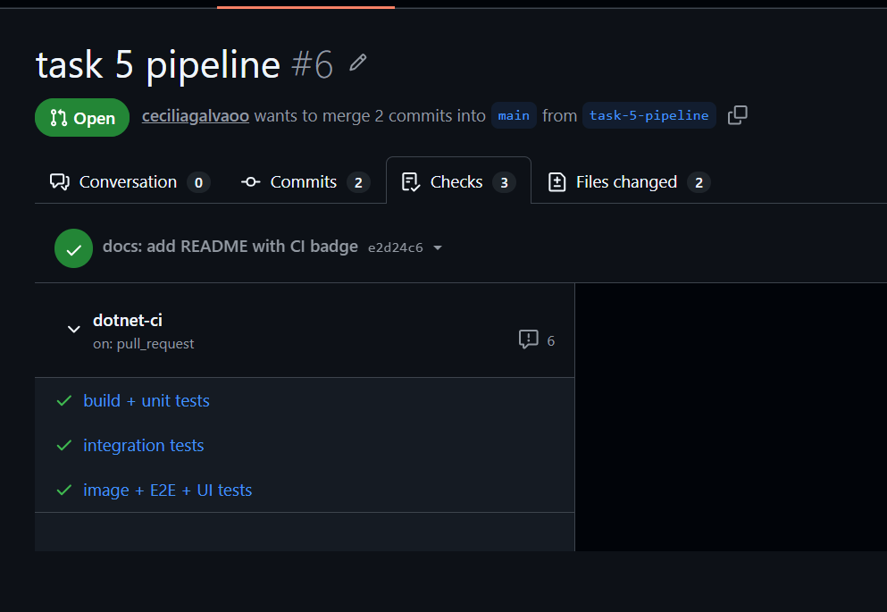

The order of the durations is the pyramid again: the cheapest job finishes first, and the slowest job (image build, container, browser) runs only after both cheaper ones passed. Push to the registry was correctly skipped, because the run was for a pull request.

The run shows warnings (annotations): `actions/cache@v4` and `actions/upload-artifact@v4` target the deprecated Node.js 20 and are forced to run on Node.js 24, and `ubuntu-latest` is migrating to Ubuntu 26. They do not fail the run; upgrading those actions to their next major version is a follow-up.

**Unit tests in the Dockerfile or in the pipeline?** In the pipeline. The pipeline needs TRX reports, a coverage report and gate, and separate, visible stages (fail fast, required checks per level). A `test` stage in the Dockerfile would only give pass/fail inside the build log, and it would run the tests a second time on every image build. The trade-off is that `docker build` alone no longer guarantees tested code – the pipeline does.

### 5.4 Questions

1. **`needs:`** makes the jobs sequential and conditional: `integration` starts only if `unit` succeeded, `e2e` only if `integration` succeeded. When a unit test fails, the run stops after the first (fastest, ~1 min) job: no runner time is spent on the image build, the container and the browser installation, and the developer gets the answer in about a minute instead of after the slowest job.
2. **`load: true` and push later:** "build once, test the artifact you ship". With `push: true` in the build step the image would be published *before* it was tested, so a broken image could reach the registry (and `:main`). `load: true` puts the image into the runner's Docker, the E2E/UI tests run against exactly that image, and only after all of them passed the *same* image (same digest, not a rebuild) is pushed.
3. **Push guard for pull requests:** a PR is a proposal, not an accepted change; publishing its image would put unreviewed code in the registry (and PRs from forks do not get a token with `packages: write` anyway). The tests still run on PRs because that is their purpose – to tell reviewers *before* the merge that the change works, so that `main` stays green.
4. **`concurrency`:** groups runs by workflow and ref. For a PR, a new push cancels the still-running, now outdated run (saves runner minutes, and the checks always show the latest commit). For `main` and tags, `cancel-in-progress` is `false`, so pushes are queued and every commit on `main` is tested and published in order.
5. **Git tag `v0.2.0` ↔ image tag `0.2.0`:** pushing the tag triggers the workflow (`tags: ["v*"]`); `GITHUB_REF_TYPE` is `tag` and `GITHUB_REF_NAME` is `v0.2.0`; `${GITHUB_REF_NAME#v}` strips the `v`, so the tested image is pushed as `:0.2.0` (and as `:<sha>`). The semantic version from Lab 4 therefore names both the source snapshot and the published image, and both point to the same commit.
6. **`if: always()` for the uploads:** by default a step is skipped after a failed step, which would throw away the reports exactly when they are needed – to see *which* test failed and why. `always()` uploads the TRX files, coverage and screenshots on success, failure and cancellation.
7. **`curl --retry`:** `docker run -d` returns as soon as the container is *created*, not when the application is *ready*. Without waiting, the first E2E test may hit the port before Kestrel listens and fail with "connection refused" – sometimes, depending on the runner's speed: a flaky pipeline. The step polls `/items` up to 30 times, one second apart, and fails clearly after 30 s if the application never comes up (a broken image fails *here*, with the container log printed by the `if: failure()` step). `--retry-all-errors` additionally covers the "connection reset" case observed locally.

### 5.5 Make the pipeline matter

| Step | Evidence |
|------|----------|
| Required status checks `build + unit tests`, `integration tests`, `image + E2E + UI tests` in the ruleset for `main` | ruleset `main-protection` – screenshot and API output below |
| PR with the unit-test bug (`>=` → `>`): `build + unit tests` red, the other two jobs skipped, Merge blocked | PR [#7](https://github.com/ceciliagalvaoo/testing-demo/pull/7), [run 43018780623](https://github.com/ceciliagalvaoo/testing-demo/actions/runs/43018780623) – screenshots below |
| PR that changes `Lent out` to `On loan` in `index.html` | PR [#8](https://github.com/ceciliagalvaoo/testing-demo/pull/8), [run 43019225781](https://github.com/ceciliagalvaoo/testing-demo/actions/runs/43019225781) – screenshots below |
| Push to `main` publishes `ghcr.io/ceciliagalvaoo/testing-demo/lendit-dotnet:main` | [run 42982697382](https://github.com/ceciliagalvaoo/testing-demo/actions/runs/42982697382) (push of the merge of PR #6) → [package `lendit-dotnet`](https://github.com/ceciliagalvaoo/testing-demo/pkgs/container/testing-demo%2Flendit-dotnet), tags `main` and `2215872…` |
| Tag `v0.2.0` publishes `:0.2.0` | [run 43020635489](https://github.com/ceciliagalvaoo/testing-demo/actions/runs/43020635489) (push of tag `v0.2.0`) → [package](https://github.com/ceciliagalvaoo/testing-demo/pkgs/container/testing-demo%2Flendit-dotnet), tag `0.2.0` |
| Artifacts of a run downloaded and a report opened | artifact `dotnet-unit-results` of the tag run – screenshots below |
| First run on PR #6, all three jobs green | [run 42981186429](https://github.com/ceciliagalvaoo/testing-demo/actions/runs/42981186429), screenshot above |
| Badge in `README.md` | [README](https://github.com/ceciliagalvaoo/testing-demo/blob/main/README.md) |

**Ruleset.** A new branch ruleset `main-protection` (Settings → Rules) targets the default branch with: *Require a pull request before merging* (0 approvals – I review my own work), *Require status checks to pass* with the three jobs (source: GitHub Actions; "up to date" not required), and *Block force pushes*. The bypass list is empty, so not even the repository owner can merge past a red check.

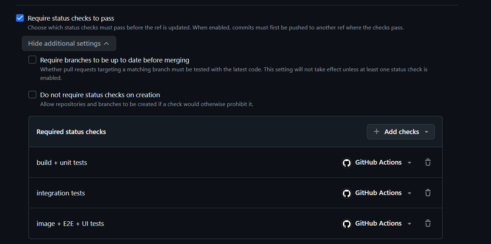

```text
$ gh api repos/ceciliagalvaoo/testing-demo/rulesets/27014665
name: main-protection   enforcement: active   target: ~DEFAULT_BRANCH   bypass_actors: []
rules: non_fast_forward
       required_status_checks: build + unit tests, integration tests, image + E2E + UI tests
       pull_request: required_approving_review_count = 0
```

**Publishing from `main`.** All six task branches were merged through pull requests ([#1](https://github.com/ceciliagalvaoo/testing-demo/pull/1)–[#6](https://github.com/ceciliagalvaoo/testing-demo/pull/6)). The merge of PR #6 triggered the [`main` run](https://github.com/ceciliagalvaoo/testing-demo/actions/runs/42982697382) (push event, commit `2215872`): unit 39 s, integration 24 s, image + E2E + UI 2 min 3 s, total 3 min 15 s, 4 artifacts. In the third job the E2E tests (3/3) and the UI tests (6/6) passed against the freshly built image, and only then the push steps ran:

```text
Passed!  - Failed:     0, Passed:     3, Skipped:     0, Total:     3 - LendIt.E2E.Tests.dll
Passed!  - Failed:     0, Passed:     6, Skipped:     0, Total:     6 - LendIt.UI.Tests.dll
22158720894b792b926cb62f02804e37654a74ae: digest: sha256:80bcb1576e44755446d93f823fc20f7c3d95fdbf43c289cfac3338b3ffc5ca74
main: digest: sha256:80bcb1576e44755446d93f823fc20f7c3d95fdbf43c289cfac3338b3ffc5ca74
```

Both tags have the **same digest**: `:main` is not a second build but the very image that the E2E and UI tests ran against (question 2, "build once"). The package is public: the registry lists its tags and serves the image without credentials.

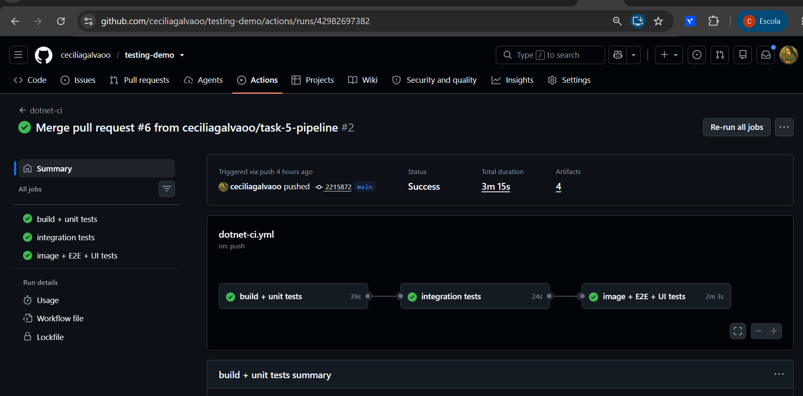

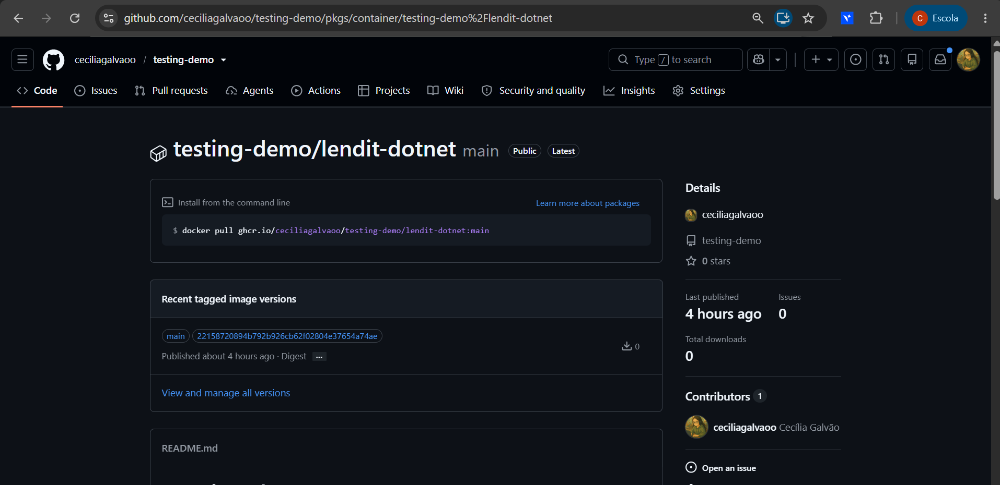

**Blocked pull request (unit test).** PR [#7](https://github.com/ceciliagalvaoo/testing-demo/pull/7) (branch `demo/broken-unit-test`) contains only the bug from Task 1.5 (`>=` → `>` in `LoanService.Lend`). In the [run](https://github.com/ceciliagalvaoo/testing-demo/actions/runs/43018780623) the job `build + unit tests` failed after 32 s with exactly the two boundary tests from Task 1.5, and `integration tests` and `image + E2E + UI tests` were **skipped** (`needs:`), so no image was built:

```text
Failed LendIt.Tests.Unit.LoanServiceTests.Lend_does_not_change_the_item_when_the_loan_limit_is_reached
   Assert.Throws() Failure: No exception was thrown
Failed LendIt.Tests.Unit.LoanServiceTests.Lend_is_rejected_when_the_borrower_has_exactly_3_active_loans
   Assert.Throws() Failure: No exception was thrown
Failed!  - Failed:     2, Passed:    28, Skipped:     0, Total:    30
##[error]Process completed with exit code 1.

$ gh pr view 7 --json mergeStateStatus
BLOCKED
```

All three checks are marked **Required**, and the *Merge pull request* button is disabled. The PR was closed without merging.

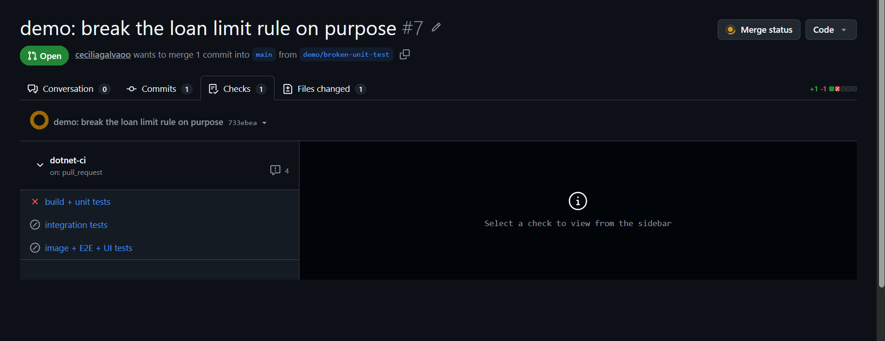

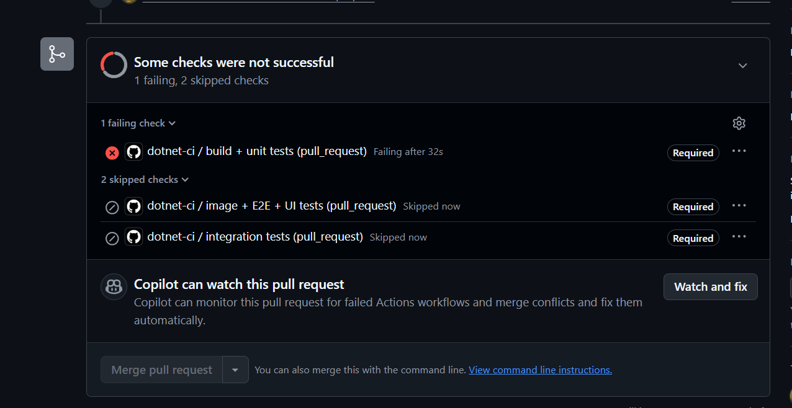

**Pull request that breaks only the UI.** PR [#8](https://github.com/ceciliagalvaoo/testing-demo/pull/8) (branch `demo/broken-ui-text`) changes the status text `Lent out` to `On loan` in `index.html`. [Run](https://github.com/ceciliagalvaoo/testing-demo/actions/runs/43019225781):

| Job / step | Result |
|------------|--------|
| [`build + unit tests`](https://github.com/ceciliagalvaoo/testing-demo/actions/runs/43019225781/job/130517924347) | ✅ success |
| [`integration tests`](https://github.com/ceciliagalvaoo/testing-demo/actions/runs/43019225781/job/130518246394) | ✅ success |
| [`image + E2E + UI tests`](https://github.com/ceciliagalvaoo/testing-demo/actions/runs/43019225781/job/130518435714) | ❌ failure |
| ↳ E2E tests | ✅ 3/3 passed |
| ↳ **UI tests** | ❌ 3 failed, 3 passed |
| ↳ Show the container log on failure / Upload test results and screenshots | ran (`if: failure()` / `if: always()`) |
| ↳ Log in to ghcr.io / Push the tested image | skipped – nothing was published |

```text
Passed!  - Failed:     0, Passed:     3, Skipped:     0, Total:     3 - LendIt.E2E.Tests.dll
  Failed A_lent_item_cannot_be_lent_from_another_browser
   Microsoft.Playwright.PlaywrightException : Locator expected to have text 'Lent out'
But was: 'On loan'
  Failed Lending_an_item_marks_it_as_lent_out            (same message)
  Failed Screenshot_of_the_page_after_lending            (same message)
Failed!  - Failed:     3, Passed:     3, Skipped:     0, Total:     6 - LendIt.UI.Tests.dll
```

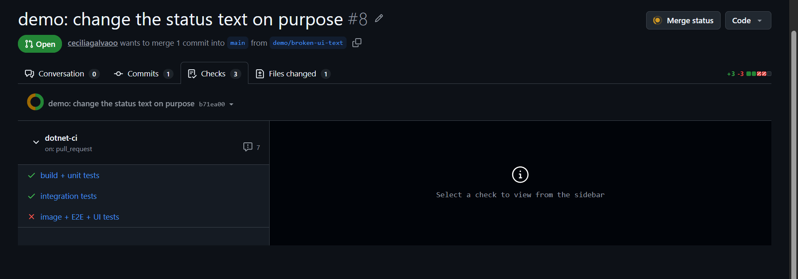

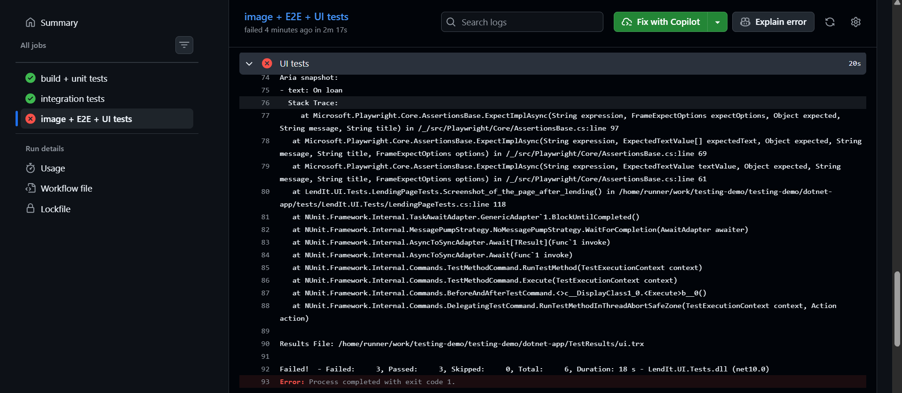

The `[TearDown]` of the UI fixture saved a screenshot of every failed test, and the artifact `dotnet-e2e-ui-results` of this run contains them. This one shows the page exactly as the browser rendered it in CI:

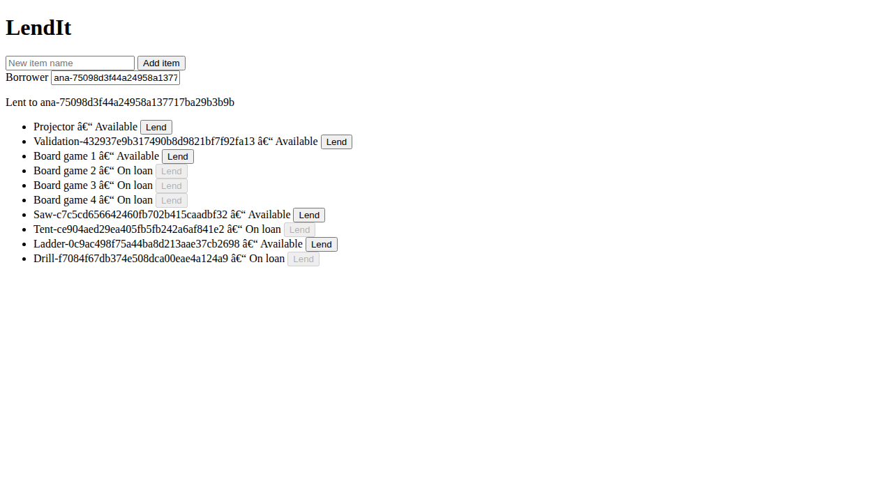

**An unplanned second finding.** The text was replaced on Windows with `(Get-Content …) -replace … | Set-Content`. Windows PowerShell 5.1 read the UTF-8 file as ANSI and wrote it back with a BOM, so the diff of PR #8 has three changed lines instead of one: a BOM before `<!doctype html>`, `'On loan'`, and the en dash in `item.name + ' – '` turned into mojibake (`–`, visible in the screenshot above). **No automated test noticed the mojibake.** Every test asserts on the status text or on test ids, none on the separator between name and status. This is a real example of the "does it look right" check that the lab leaves to *manual* testing. PR #8 was closed without merging, so `main` is unaffected.

**Versioned image from a tag.** After both demo PRs were closed, `main` was tagged and the tag was pushed:

```text
$ git tag v0.2.0
$ git push origin v0.2.0
$ git ls-remote --tags origin
22158720894b792b926cb62f02804e37654a74ae	refs/tags/v0.2.0
```

The [tag run](https://github.com/ceciliagalvaoo/testing-demo/actions/runs/43020635489) (event `push`, ref `v0.2.0`, same commit `2215872` as `:main`) went through all three jobs again (27 s, 26 s, 1 min 7 s – total 2 min 9 s) and took the `GITHUB_REF_TYPE = tag` branch of the push step:

```text
#12 … #17 CACHED
#18 exporting manifest sha256:80bcb1576e44755446d93f823fc20f7c3d95fdbf43c289cfac3338b3ffc5ca74 done
Passed!  - Failed:     0, Passed:     3, Skipped:     0, Total:     3 - LendIt.E2E.Tests.dll
Passed!  - Failed:     0, Passed:     6, Skipped:     0, Total:     6 - LendIt.UI.Tests.dll
22158720894b792b926cb62f02804e37654a74ae: digest: sha256:80bcb1576e44755446d93f823fc20f7c3d95fdbf43c289cfac3338b3ffc5ca74
0.2.0: digest: sha256:80bcb1576e44755446d93f823fc20f7c3d95fdbf43c289cfac3338b3ffc5ca74
```

The image was rebuilt for the tag run, but every layer came from the BuildKit cache (`cache-from: type=gha`), so the result is **bit-for-bit the same image**: the package shows **one** version carrying the three tags `0.2.0`, `main` and `2215872…` (question 5). The git tag `v0.2.0` and the image tag `0.2.0` point to the same commit and the same digest. (Strictly, "build once" holds *within* a run. Across runs the identical digest comes from the cache. Without the cache a rebuild of the same commit could give a different digest, for example because of a newer base image. A promotion step that re-tags the `:main` image would avoid that.)

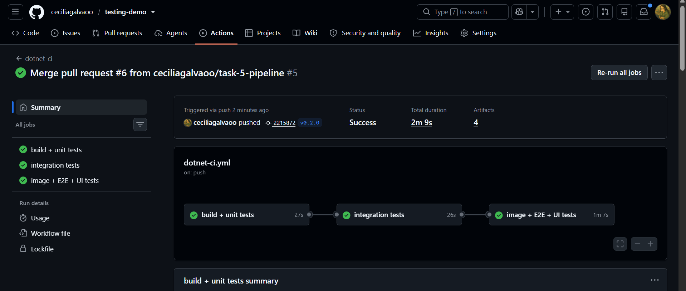

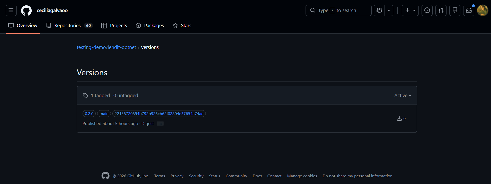

**Artifacts.** The artifact `dotnet-unit-results` of the [tag run](https://github.com/ceciliagalvaoo/testing-demo/actions/runs/43020635489) was downloaded from the run page and unzipped to `C:\Users\Inteli\Downloads\dotnet-unit-results`:

```text
dotnet-unit-results/
├── unit.trx                         <Counters total="30" executed="30" passed="30" failed="0" … />
└── coverage/
    ├── coverage.cobertura.xml
    └── html/index.html              (ReportGenerator, built in CI)
```

The HTML report built in CI shows the same numbers as the local run in Task 1: 93.5 % line coverage (29 of 31 lines), 100 % branch coverage (18 of 18). The only red lines are again the two `decimal const` declarations of `LateFeeCalculator`.

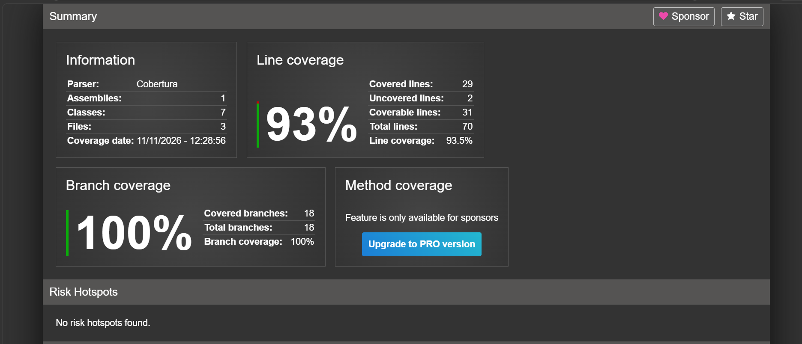

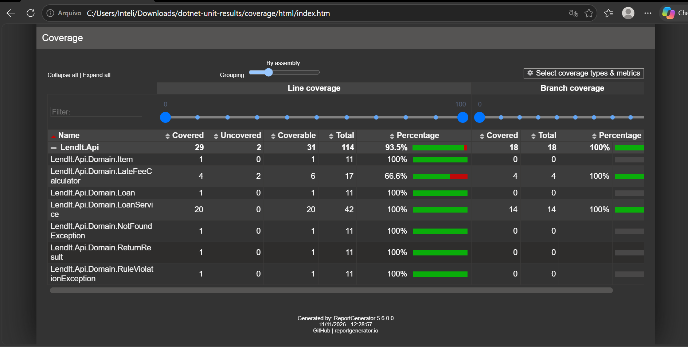

**Expected result of 5.5.3 – first verified locally** with the same commands the pipeline runs (`On loan` instead of `Lent out`, image rebuilt):

```text
unit + integration:  Passed!  - Failed: 0, Passed: 45, Total: 45
E2E:                 Passed!  - Failed: 0, Passed:  3, Total:  3
UI:                  Failed A_lent_item_cannot_be_lent_from_another_browser
                     Failed Lending_an_item_marks_it_as_lent_out
                     Failed Screenshot_of_the_page_after_lending
                     Failed!  - Failed: 3, Passed: 3, Total: 6
```

So in CI the jobs `build + unit tests` and `integration tests` are green and `image + E2E + UI tests` turns red at the *UI tests* step (E2E passes, nothing is pushed). The earlier levels cannot detect it because the status text is produced by JavaScript in the browser: unit and integration tests never run `index.html`, and the E2E tests only see the JSON field `available: false`, which did not change.

---

## Summary

| Level | Tests | Result |
|-------|-------|--------|
| Unit | 30 (requirement: 15) | green, domain line coverage 93.5 %, branch 100 %, gate 80 % |
| Integration | 15 (requirement: 8) | green, time controlled with `FakeTimeProvider` |
| E2E | 3 journeys (requirement: 3) | green against the container, also on a second run |
| UI | 6 (requirement: 4) | green 10/10 runs, page object, API-prepared data |
| Pipeline | `dotnet-ci.yml`, 3 jobs + gated push | green: [run 42981186429](https://github.com/ceciliagalvaoo/testing-demo/actions/runs/42981186429) (PR #6); red: [run 43018780623](https://github.com/ceciliagalvaoo/testing-demo/actions/runs/43018780623) (PR #7) |
