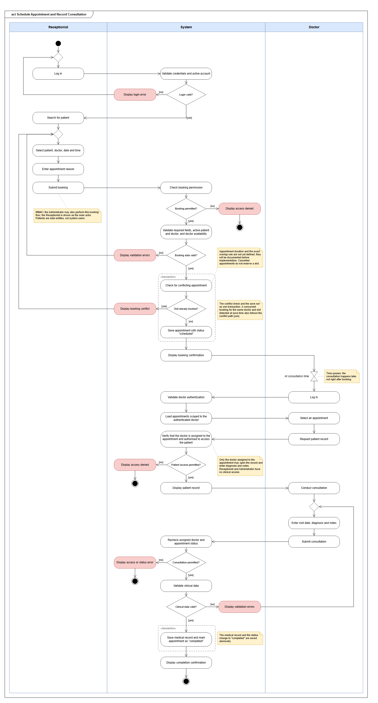

# Tools and technology stack

## 1. Application development

| Area | Selected tool | Justification |
| --- | --- | --- |
| Programming language | Python | Uses an existing skill set and allows development effort to focus on the DevOps workflow |
| Backend framework | FastAPI | Provides routing, request validation and an API structure suitable for automated testing |
| Application server | Uvicorn | Runs the FastAPI application in development and inside the application container |
| User interface | Jinja2 templates, HTML, CSS and minimal JavaScript | Keeps the interface within the same application and avoids a separate frontend build pipeline |
| Database | PostgreSQL | Stores related hospital entities and supports transactions and database-level integrity constraints |
| Database access | SQLAlchemy | Provides a consistent approach to models, queries and transactional persistence |
| Database migrations | Alembic | Versions schema changes so they can be reviewed and applied reproducibly |
| Input validation | Pydantic | Defines and validates request data and supports clear validation responses |
| Password hashing | bcrypt | Implements the password-storage requirement with a configured cost factor of at least 10 |
| Authentication | Server-side sessions stored in PostgreSQL | Allows logout and inactive-account checks to invalidate access without relying only on client-side state |

The interface will use server-rendered pages with small JavaScript requests where appropriate. Protected routes will enforce the HTTP 401/403 behaviour defined in the requirements.

Session identifiers will be stored in HttpOnly cookies, with Secure enabled in HTTPS environments and an appropriate SameSite setting. State-changing browser requests will include CSRF protection.

## 2. Testing and code quality

| Area | Selected tool | Justification |
| --- | --- | --- |
| Unit and integration tests | pytest | Supports repeatable tests for business rules, persistence and permissions |
| HTTP endpoint tests | HTTPX | Exercises FastAPI endpoints and verifies response status, validation and access control |
| End-to-end tests | Playwright for Python | Verifies complete browser workflows and can run headlessly in CI |
| Test coverage | pytest-cov | Reports which application code is exercised and helps identify untested areas |
| Linting and formatting | Ruff | Provides consistent automated code-quality checks with limited configuration |
| Performance testing | Locust | Generates authenticated concurrent-user traffic for the response-time requirement |
| Recovery verification | Python test script and Docker CLI | Automates process failure and measures recovery against the 30-second requirement |

Integration tests will use an isolated PostgreSQL database. Automated tests will use synthetic data and will not contain real patient information.

Manual test checklists will be stored in the repository for validation wording, empty states, keyboard navigation and small-screen layouts.

## 3. Containers and delivery

| Area | Selected tool | Justification |
| --- | --- | --- |
| Application packaging | Docker | Packages the application and its runtime dependencies as a reproducible image |
| Local service orchestration | Docker Compose | Starts the application, database and monitoring services through versioned configuration |
| Continuous integration and delivery | GitHub Actions | Runs checks on pull requests and publishes successful main-branch images |
| Container registry | GitHub Container Registry — GHCR | Stores application images with source-commit tags for traceability |
| Dependency management | pip with pinned requirements files | Keeps runtime and development dependencies explicit and reproducible |
| Configuration | Environment variables and a committed `.env.example` | Documents required settings while keeping real credentials outside version control |

Runtime and development dependencies will be maintained separately. Selected versions will be pinned when the application is scaffolded.

Pull-request workflows will run linting, unit tests, integration tests, end-to-end tests and container builds. Required failed checks will prevent merging.

Successful main-branch checks will trigger image publication to GHCR. Every published image will include a commit-SHA tag and source metadata. Publication is the delivery target; a running production deployment is outside the current defined scope.

## 4. Monitoring

| Area | Selected tool | Justification |
| --- | --- | --- |
| Application instrumentation | Prometheus Python client | Exposes request counts, errors and response-time metrics |
| Metrics collection | Prometheus | Collects application and container metrics for dashboard queries |
| Container resource metrics | cAdvisor | Supplies container CPU and memory metrics |
| Dashboard | Grafana | Displays the required operational metrics with a refresh interval of no more than 30 seconds |
| Application logs | Python logging to standard output | Makes application events and failures accessible through container logs |

Metrics and logs will avoid patient names, diagnoses, passwords and other sensitive values. Patient identifiers will not be used as metric labels.

The monitoring setup will be versioned alongside the application configuration.

## 5. Collaboration and documentation

| Area | Selected tool | Justification |
| --- | --- | --- |
| Version control | Git and GitHub | Preserve change history and connect implementation work to branches and pull requests |
| Backlog tracking | GitHub Projects | Tracks status, story points, epic, sprint and item type |
| Development environment | Visual Studio Code | Supports Python development and editing of repository configuration |
| Activity UML diagram | diagrams.net / Draw.io | Produces an editable `.drawio` source file that can be versioned in `docs/` |
| Documentation | Markdown | Keeps requirements, decisions, sprint notes and instructions readable in the repository |

The GitHub Project will be linked to the repository and include board and table views. Its custom fields are Status (Backlog, Ready, In Progress, In Review, Done), Story points (number), Priority (single select: P0 to P3), Epic (single select: E1 to E6), Sprint (two-week iteration) and Item type (epic, story, task, defect). The full GitHub configuration is described in [github-project.md](github-project.md). The activity diagram for scheduling an appointment and recording the consultation is stored at `docs/diagrams/activity-appointment.drawio`, with a PNG export beside the editable source:

## 6. Architecture and scope

The application will use a single FastAPI service with server-rendered pages and a PostgreSQL database. Routes, business logic, database models and tests will be organised into separate modules within the same repository.

This structure keeps application development manageable while supporting the main project objectives: automated testing, containerisation, delivery, monitoring and traceability.

External paid services are not required by the planned architecture.

The architecture as implemented, with its modules, data model, request flow, delivery pipeline and design decisions, is documented in [docs/architecture.md](architecture.md) and updated at the end of every sprint.
